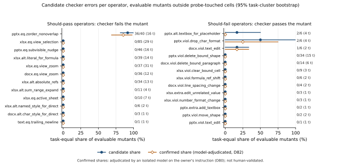
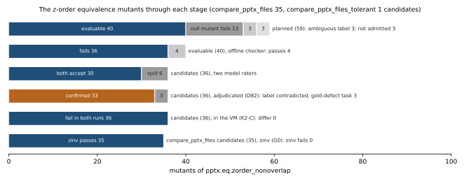

# Do OSWorld's file-state checkers accept equivalent end states? A descriptive mutation audit

Research note, draft of 2026-10-11. CoTCodec research program, question Q2
(`program/questions/q2-calibrated-cua-instrument.md`), item R03 of the question-renewal dossier
(`program/evidence/2026-10-11/question-renewal/dossier.md`, section 3). Program owner: Kevin Liu.

Repository: <https://github.com/Kevin-Liu-01/cotcodec> (public). Every evidence path below
resolves on `main` at `746d60d2`, the base of this draft's branch `stage0/r03-note`. The note's
script, figures and number table (`paper/checker-mutation-note/scripts/`, `figures/`, `data/`)
are added on that branch. The note expands section 6 of the Q2 report draft
(`paper/q2-report/draft.md`), which predates K2 (D79) and the adjudication (D82); where the two
differ, the numbers here are the later ones.

> **Status: DRAFT. Not published, not for circulation.**
>
> - Publishing this note is an outward action reserved to the program owner (D2, D80).
> - It reports candidate defects in OSWorld checkers that have not been disclosed to the OSWorld
>   maintainers (xlang-ai). Whether and how to disclose them is the owner's decision (D2, D80),
>   and it comes before any publication. Any disclosure text uses D72 (iii)'s counts.
> - Every result is **descriptive** (D35). Nothing here is confirmatory.
> - Every audit-dependent number is **adjudicated by an isolated model on the owner's
>   instruction (D80); not human-validated**. The human spot check that D9 planned is still
>   pending.
> - The offline harness's verdicts were **checked inside real VMs by K2** (D79) on a registered
>   sample of 80 scoring jobs.
> - The note quotes no OSWorld task document. Task ids are OSWorld's public task identifiers.

## Summary

OSWorld scores many office tasks by comparing the agent's saved file with a reference file. We
asked whether these file-state checkers accept end states that satisfy the instruction and
reject end states that violate it. We edited the reference ("gold") end states of the frozen
confirm split with 64 operators, labelled every edit from a requirement spec written without
seeing any checker, saved each edited file the way the VM's own LibreOffice saves it, and
scored it with OSWorld's unmodified evaluator. Two model raters audited every case where the
checker and the label disagreed, and an isolated model adjudicated the items they split on or
both read against the label.

- **One comparator fails equivalent edits.** Swapping the stacking order of two slide shapes
  that cannot paint the same pixel changes nothing a viewer sees. 36 of 40 evaluable mutants of
  this kind fail their checker (90.0%; task-equal share 91.7%, 81.3-100%): `compare_pptx_files`
  35 of 39 and `compare_pptx_files_tolerant` 1 of 1. After adjudication 33 are confirmed and 3
  have their label contradicted, all 3 on one task whose gold the adjudicator also rejected.
  Every other should-pass operator gave 0 failures (for example 0 of 85 selection changes and
  0 of 39 literal-for-formula alternatives in spreadsheets).
- **The false negatives sit in one comparator family.** The adjudicated confirmed share is
  11.6% (6.4-17.3%) pooled over all 60 evaluable tasks, 37.1% (28.3-44.6%) within
  `compare_pptx_files`, and 85.4% (68.8-97.9%) within the z-order operator.
- **Few audited false positives.** 5 of 96 evaluable should-fail mutants pass their checker
  (task-equal 5.9%, 0.8-12.3%). 2 are confirmed violations (2.1%, 0-5.4%); for the other 3 the
  audit says the edit does not violate the task. Probe-touched cells, kept out by registration,
  hold 28 more false-positive events that nobody audited.
- **The gold is not a fixed point of a GUI save.** 4 of 92 golds that pass raw fail after a
  GUI-faithful LibreOffice save (exact 95% 1.20-10.76%); 3 of those flips are audit-confirmed
  checker errors (3.26%, 0.68-9.23%).
- **The result holds inside the VM.** On the registered K2 sample, 78 of 78 compared pairs give
  the offline verdict in both runs, and all 41 candidate events reproduce.
- **No on-policy consequence is shown.** A corrected comparator changed 0 of 1,808 verdicts of
  two Qwen3.5 policies in the program's S1a run.
- **The audit rests on correlated models.** The two raters agree at Cohen's κ 0.343; the
  adjudicator is the same model as one rater and matched it on all 25 spot-check items. No
  human has validated any label.

## 1. Question

A file-state checker turns an end state into a pass or a fail. On OSWorld that verdict becomes
the benchmark score and, in RL on such tasks, the reward. The study
(`q2-evaluator-mutation-v1`, frozen in ledger row 11 at `65bc2e2`) asks how often
OSWorld-Verified's file-state checkers (a) reject end states that satisfy the task instruction
(false negatives) and (b) accept end states that violate it (false positives), when every
office end state reaches the checker the way it does in the real pipeline, re-saved by the VM's
own LibreOffice [MUT-REG section 1].

Scope: the 205 offline-checkable, web-free tasks of OSWorld-Verified (`test_nogdrive.json`,
361 tasks), split by a seeded draw into dev 32, confirm 120 and reserve 53 tasks [MUT-REG
sections 1-2]. Live-state, web and infeasible tasks are out of scope. Everything below is on the
confirm split unless it says otherwise.

Since D35 the study answers this descriptively: it lists and counts candidate checker errors on
blind-labelled mutants, each with its audit decision, and states no confirmatory rate.

This note completes R03 of the question-renewal dossier, whose corrected question has three
parts [DOSSIER, section 3]. Part (a), whether mutants saved inside the certified VM get the
offline verdict, is answered by K2 (section 3.6). Part (b), whether the corrected comparator
`zinv` holds on the held-out reserve split, has not run (section 3.7). Part (c), operator
families for the pool's non-office checkers, would need a new registration and has not been
written. The adjudication the dossier left to the owner was done by an isolated model under
D80 (section 2.5).

## 2. Method

### 2.1 Targets and mutants

A mutation target is one gold file of a task with a complete gold, of a type an operator family
handles. The confirm split has 68 targets on 67 tasks (32 xlsx, 22 pptx, 13 docx, 1 text);
43 confirm tasks have no complete gold and get no mutant [MUT-REG section 6]. The catalog
`q2-mut-operators-v1` has 64 operators in five document families (xlsx, docx, pptx, text,
config), each operator nominally in one of four classes [MUT-REG Appendix A]:

- **Equivalence** edits change nothing the task constrains (document properties, zoom, the
  selected cell, a shape nudged by less than LibreOffice's rounding, the stacking order of
  shapes that cannot overlap).
- **Alternative solutions** reach the requested result another way (a literal in place of a
  formula, absolute references, a named style in place of direct formatting).
- **Violations** break a requirement (a changed value, dropped character formatting, a deleted
  bound shape).
- **Extra changes** alter something the task did not ask for.

Operators work through LibreOffice's document model, or splice characters of text files. They
never read a task config, a checker or a verdict [MUT-REG section 3].

### 2.2 Blind labels

Each mutant's label comes from a requirement spec, never from a checker. The 205 specs (598
requirements) were written by a Claude model (Claude Opus 5.5) from sanitized task exports,
without reading any checker or evaluator code; no spec names any of the 117 checker functions
scanned, and the author model may have seen the public OSWorld repository in pretraining
[MUT-REG sections 2 and 9; `program/evidence/q2-mutation/integration/blind-spec-provenance.json`].
Witness rules map an edit and the spec to one of `should_pass_equiv`,
`should_pass_alt_solution`, `should_fail_violation`, `should_fail_extra_change` or
`ambiguous`; a nominal alternative solution whose aspect the spec pins becomes a violation, for
example [MUT-REG Appendix A]. Ambiguous mutants are counted, never audited or rated.

The z-order operator (`pptx.eq.zorder_nonoverlap`) is restricted so it cannot change what is
drawn: it swaps two shapes only when every shape between them has a known frame and neither
shape comes within 2 mm of the other or of any shape stacked between them [MUT-REG Appendix A;
D27].

### 2.3 Building, saving and scoring

A mutant is the raw gold with one operator recipe applied and one LibreOffice save, so a mutant
and its null mutant (the gold saved once, unedited) are each one round trip from the gold. A
GUI-faithful save stage then opens every office candidate in non-headless LibreOffice under
Xvfb, in a copy of the VM's own profile and build (LibreOffice 7.3.7.2), and replays the
task's postconfig: window activation, keystrokes, sleeps and conversions. The unmodified
pinned `DesktopEnv.evaluate()` scores each saved candidate offline, twice in fresh processes,
under each of two dependency sets [MUT-REG section 3].

A mutant is **evaluable** when it was admitted, saved, scored, kept its edit through the save,
its null mutant passes, its repeated scorings agree and its label is not ambiguous [MUT-REG
section 7]. A **candidate** is an evaluable mutant on which checker and label disagree: a
should-pass mutant that fails (false-negative candidate) or a should-fail mutant that passes
(false-positive candidate).

Table 1. From plan to population [MUT; `build-summary.json`; `audit/sample/sample-summary.redacted.json`].

| Stage | Mutants |
|---|---:|
| Planned | 1,289 |
| Admitted (build-time purity passed, duplicates removed) | 1,232 |
| Evaluable (both dependency sets) | 888 |
| Evaluable outside probe-touched cells, on 60 tasks (the population) | 444 |
| of which `should_pass_equiv` / `should_pass_alt_solution` | 255 / 93 |
| of which `should_fail_violation` / `should_fail_extra_change` | 91 / 5 |

Before the freeze, exploratory scoping probes had shown how some checkers treat some edits.
Every (task, operator) cell a probe touched is outside the population, because its result is
not blind; its events are counted per checker family and never audited [MUT-REG section 12].

The pipeline's own checks were clean. The harness check K1 passed (raw gold passes and raw
do-nothing fails on 70 of 74 confirm tasks, against a 90% line). No dependency-set
disagreement, no nondeterministic checker and no save failure occurred; 23 of 1,232 admitted
mutants lost their edit in the save, and 96 of 1,300 saves took longer than the 0.5 s the VM
waits before reading the file (slowest 1.20 s). 7 of 68 targets have a saved null mutant that
fails its own checker, and their mutants leave the population [MUT, S1-S7].

### 2.4 The audit

Every candidate, every alternative solution the checker passes (the gate for MUT-P2, below),
every gold flip of MUT-P1 and 40 shams were audited: a census of 178 items, not a sample
[MUT-AUD, "Sample"]. The shams are 33 saved golds, one for every audited task, and 7 saved
do-nothing states. Each item became a blind packet: the instruction, every starting and
end-state file with a structure listing, a structural difference against the saved starting
file, and 100-dpi page renders by the VM's own LibreOffice [MUT-REG section 9]. A packet never
shows the gold, the checker, its verdict, the operator or the label. The listings come from
the operators' own snapshot model, not from the libraries the checkers use, so the raters do
not share the checkers' blind spots.

Two model raters answered accept, reject or unsure for every item (D9, D23):

- **Claude** (`claude-opus-5-5`), one fresh agent per item through the Claude Code agent
  harness, reading only its own item directory with the Read tool (D25, D27). A registered
  transcript audit voids any rating whose agent read or ran anything else (D34, D35, D38).
  177 ratings passed and 1 was voided.
- **Qwen3.6-35B-A3B**, self-hosted, seeded, thinking on, the independent rater (D23, D34). It
  answered all 178 items; 6 hit the token limit while thinking and count as unsure. It used
  0.365 GPU-h.

A decision is accept or reject when both raters agree, and unresolved otherwise. Items where
the raters split, gold shams they split on, and items where both contradict the label form the
**adjudication pool** of 34 items. A stratified **spot check** of 25 items (7 also in the pool;
52 distinct) was set aside as D9's human validation of the model raters.

### 2.5 The adjudication

The registered adjudicator was the owner. On 2026-10-11 Kevin delegated his pending research
decisions (D80), and the pool and the spot check were answered by fresh, isolated model
adjudicators, one per item, blind to both raters, under the raters' own isolation template.
This is a disclosed deviation from D9: the spot check was meant to be human, and it is not
human here. A first run was void, because its agents were not started with the registered
template and all of them used a forbidden tool; none of its answers is used (D81). The record
is the second run [ADJ]:

- `claude-opus-5-5`, the same model as the Claude rater; 52 transcripts, 52 passing the
  registered isolation audit and 0 void. The agents used 711 Read calls and 52 structured
  answers, and opened 503 of 506 page images.
- The pool split 17 accept and 17 reject; the spot check 19 accept and 6 reject.
- Two sensitivities fixed before any answer existed (D81): the same items answered by
  `claude-fable-5-1`, a model that is neither rater's (independence), and the 12 items whose
  packets show the differ's added-sheet marker answered with one fixed explanatory sentence
  (notation).

### 2.6 VM fidelity (K2)

Scoring ran offline, in a harness built from the VM's extracted files. The registration's K2
gate compares, for a sample of scoring jobs drawn before any verdict existed, the verdict
inside a freshly booted certified VM with the offline verdict for the same candidate bytes
[MUT-REG section 10]. Its executor did not exist at the freeze, so the first analysis carried
the label "offline harness, VM fidelity unverified". The K2 addendum
(`q2-evaluator-mutation-v1-k2`, ledger row 17) supplied it: the candidate is uploaded into the
VM after the task's own setup, opened and saved by the VM's own LibreOffice, and scored by the
unmodified evaluator [K2-REG section 1]. The sample is 80 jobs, 20 per domain, on 41 tasks, 73
mutants and 7 null mutants. K2-C, a descriptive companion, runs all 41 candidate events of the
campaign. Every pair runs twice.

### 2.7 The frozen analysis and why it is descriptive

The registered rater-agreement rule was κ ≥ 0.6 between the two raters. On the development
audit κ was 0.066 under the registered ingest, and 0.575 with a harness relay turn excepted
(a byte-identical copy of the session request the agent harness placed before resumed raters'
tasks). Both are below 0.6. D34's exit then fired: no other rater was tried, the per-family
and pooled rates (MUT-P2 to MUT-P5) left the confirmatory headline, and D35 froze the study as
a pre-specified descriptive protocol [ADJ-AN, `exclusions.d34_dev_exit`]. The analysis is code
(`harness/q2_mutation/analysis.py`), fixed at the freeze. It ran after the model audit, again
with the K2 report and again with the adjudications, each time from a git archive whose code
equals the frozen pins. Each later run differs from the one before only through its new input,
which a byte-for-byte control run confirms [K2; ADJ, "Controls"].

Every share is task-equal: each task's share of its evaluable mutants with the event, averaged
over tasks with every task weighted equally, because mutants of one task share checker code
paths. Intervals are 95% task-cluster percentile bootstrap intervals (10,000 resamples, seed
42), and exact Clopper-Pearson intervals for task-level proportions [MUT-REG section 4]. No
share is compared with a threshold. A candidate is **confirmed** when the audit agrees with its
label (a false-negative candidate decided accept, a false-positive candidate decided reject)
and **label contradicted** when it decides the opposite.

## 3. Results

### 3.1 `compare_pptx_files` fails equivalent shape reorders

In a PowerPoint file, the order of shapes in a slide's shape tree is their stacking order.
`compare_pptx_files` zips the two decks' top-level shapes in that document order and compares
the pairs [ZINV]. A constructed illustration (not a task): a slide holds a title, a text box on
the left half and a picture on the right half, more than 2 mm apart. Swapping the text box and
the picture leaves the rendered slide unchanged, but the checker now compares the reference's
text box with the agent's picture, and fails.

D72 (iii) fixed the counts for any text: **36 of 40 evaluable z-order equivalence mutants fail
their checker: `compare_pptx_files` 35 of 39, `compare_pptx_files_tolerant` 1 of 1.** Before
adjudication, 29 of the 35 were confirmed by both raters and 6 were unresolved, and the
tolerant one was confirmed: 30 confirmed in all. The raw share is 90.0%; the task-equal share
is 91.7%, because the estimand weights the 16 tasks equally (S11). The 4 evaluable mutants the
checker passes are all on `compare_pptx_files`. Of the 59 z-order mutants planned, 13 sit on
targets whose null mutant fails, 3 have ambiguous labels and 3 were not admitted [DER].

After adjudication (D82), **33 are confirmed and 3 are label contradicted**. The 3 are all of
task `5c1a6c3d`'s candidates; the adjudicator also rejected that task's saved gold, so it is a
gold-defect task (section 3.3), and the 3 are reported as gold defects. The 3 newly confirmed
candidates are on tasks `57667013`, `70bca0cc` and `eb303e01`.

Table 2. False-negative candidates and confirmed shares, task-equal, in the population [ADJ-AN
`checker_candidates.false_negative`; ADJ, "What changed"]. Before adjudication an unresolved
candidate counts as not confirmed.

| Scope | Evaluable mutants (tasks) | Checker fails | Candidate share | Confirmed share before | Confirmed share after (D82) |
|---|---:|---:|---|---|---|
| z-order operator | 40 (16) | 36 | 91.7% (81.3-100%) | 77.1% (61.5-90.6%) | 85.4% (68.8-97.9%) |
| `compare_pptx_files`, all should-pass | 85 (16) | 35 | 40.2% (32.9-46.3%) | 33.5% (24.8-41.7%) | 37.1% (28.3-44.6%) |
| all families, all should-pass | 348 (60) | 36 | 12.4% (7.2-18.3%) | 10.6% (5.8-16.2%) | 11.6% (6.4-17.3%) |

**Every other should-pass operator gave no failure.** No equivalence operator other than the
z-order swap and no alternative solution (0 of 93) fails its checker. Per operator:
`xlsx.eq.view_selection` 0 of 85 (29 tasks), `pptx.eq.subvisible_nudge` 0 of 46,
`xlsx.alt.literal_for_formula` 0 of 39, `xlsx.eq.view_zoom` 0 of 37, `docx.eq.view_zoom` 0 of
36, `xlsx.alt.absolute_refs` 0 of 34, and smaller cells [ADJ-AN]. Per family, `compare_table`
has 0 of 218 should-pass mutants on 30 tasks. Figure 1 shows every operator.



Figure 1. Per-operator candidate share (filled circle) and adjudicated confirmed share (open
diamond) with 95% task-cluster bootstrap intervals, in the population. Left: should-pass
operators, where a candidate is a failed verdict. Right: should-fail operators, where a
candidate is a pass. Labels give candidates over evaluable mutants and the number of tasks
("t"). Generated by `scripts/figures.py` from the adjudicated analysis.



Figure 2. The z-order mutants through each stage: planning and evaluability [DER], the offline
checker, the two model raters [MUT `summary.json`], the adjudication [ADJ-AN], the in-VM rerun
(K2-C) [K2] and the corrected comparator `zinv` [ZINV-VAL]. Generated by `scripts/figures.py`.

### 3.2 False-positive candidates

5 should-fail mutants pass their checker, out of 96 evaluable on 26 tasks (task-equal candidate
share 5.9%, 0.8-12.3%). All 5 carry a violation label; no extra change passes outside
probe-touched cells (0 of 5).

Table 3. False-positive candidates [ADJ-AN `checker_candidates.false_positive.events`].

| Task | Operator | Checker family | Raters | Adjudicator (D82) | Reading |
|---|---|---|---|---|---|
| `358aa0a7` (2 mutants) | `pptx.alt.textbox_for_placeholder` | `compare_pptx_files` | both accept | accept (pool and spot check) | label contradicted |
| `70bca0cc` | `pptx.viol.drop_char_format` | `compare_pptx_files` | both reject | reject (spot check) | confirmed |
| `a434992a` | `pptx.viol.drop_char_format` | `compare_pptx_files_tolerant` | both accept | accept (pool and spot check) | label contradicted |
| `d53ff5ee` | `docx.viol.text_edit` | `compare_docx_files` | both reject | reject (spot check) | confirmed |

The confirmed share is 2.1% (0-5.4%), from 2 events. The textbox-for-placeholder mutants are
nominal alternative solutions that the spec's witness rule turned into violations; both raters
and the adjudicator read them as acceptable, so the label, not the checker, looks wrong there.
Adjudication changed nothing in this table: the 3 label-contradicted items were concordant
contradictions in the pool, and the adjudicator upheld the raters on all 3.

Probe-touched cells hold 28 more false-positive events (`compare_table` 12,
`compare_docx_tables` 7, `compare_docx_images` 6, `compare_docx_files` 3), none audited
[ADJ-AN `checker_candidates.probe_touched_events`]. The registration keeps them out of the
candidates because they are not blind, not because they are few. Some may be label errors, as
3 of the 5 audited candidates were.

### 3.3 Gold-defect tasks

A task whose saved gold sham is decided reject is a gold-defect task (D34): the audit says the
reference itself does not satisfy the instruction. Of the 33 gold shams, the raters split on
4, all rejected by Claude. The adjudicator rejected 3: `5c1a6c3d` (`compare_pptx_files`) and
`881deb30` and `8e116af7` (both `compare_table`); it accepted `035f41ba` [ADJ, "What
changed"]. There were none before adjudication.

Their consequences are the main thing adjudication changed:

- The 3 z-order candidates of `5c1a6c3d` became label contradicted (section 3.1). Mutants of a
  rejected gold are judged against a reference the audit does not accept, so they say little
  about the checker.
- All 10 alternative solutions on `881deb30` (6) and `8e116af7` (4) were rejected. The
  alternative-solution gate went from 72 accepted, 3 rejected and 18 unresolved to 82 accepted,
  11 rejected and 0 unresolved; outside gold-defect tasks, 82 of 83 alternative solutions are
  accepted.
- The equivalence label error (K3) fell from 0.167 to 0.000 (33 items on 15 tasks, exact upper
  bound 0.087), and K4 no longer fires. K3 still fires, through κ alone.

These three calls rest on Claude-family judgment: the adjudicator sided with Claude, not Qwen,
on 3 of the 4 split gold shams. The record cannot separate a gold defect from a shared
Claude-family reading [ADJ, "What the result licenses"].

### 3.4 A GUI-faithful save flips reference golds (MUT-P1)

MUT-P1, a pre-specified replication, asks whether a gold that passes raw still passes after the
GUI-faithful save. The population is the 92 golds that place an office file the save rewrites
(confirm 67, reserve 25) [ADJ-AN `P1`]:

- 4 flip raw (4.35%; exact 95% 1.20-10.76%): `30e3e107`, `9ec204e4` and `b8adbc24` (confirm)
  and `3a7c8185` (reserve).
- 3 flips are audit-confirmed checker errors (3.26%; 0.68-9.23%): both raters accept the saved
  gold of `3a7c8185`, `9ec204e4` and `b8adbc24` as still correct.
- Both raters reject the saved gold of `30e3e107`: the save changed its content, so that flip
  is not a checker error.

No P1 flip was in the adjudication pool, so adjudication changes none of this. The measurement
replicates an earlier headless round trip, a different save path, that flipped 7 of 63 confirm
golds and 1 of 26 reserve golds [MUT-REG section 4]. A gold that does not survive the save the
pipeline itself applies means an agent that produces exactly the reference file can still fail.

### 3.5 Exploratory rates (MUT-P2 to MUT-P5)

These left the confirmatory headline under D34 (i) and are reported with the same tables
[ADJ-AN]:

- **MUT-P2** (false negatives per family; equivalence mutants plus the alternative solutions
  the audit accepted): 12.4% (7.2-18.3%) on 337 mutants and 60 tasks. Without the gold-defect
  tasks' equivalence mutants (the registered sensitivity) it is 12.2% (6.7-18.1%; 323 mutants,
  57 tasks). `compare_table` is 0 of 207 on 30 tasks (zero-event bound 9.5%); in the
  sensitivity 0 of 199 on 28 tasks, bound 10.1%. Adjudication moved the population from 327 to
  337, not the rate.
- **MUT-P3** (violations passed): 6.1% (0.8-13.1%) on 91 mutants and 25 tasks.
- **MUT-P4** (extra changes passed and rejected by the audit): 0 of 5 on 2 tasks.
- **MUT-P5** (tasks with any false-negative or violation event): 17 of 60, 28.3% (exact
  17.5-41.4%).

### 3.6 Inside the VM (K2)

The frozen K2 job ran once (Slurm job 1186, CPU only, 65 minutes) from an export of the freeze
commit, with no other Slurm job running. Outcome: **VERIFIED** (D79) [K2]:

- The fitness gate passes: 2 of 80 pairs were excluded (at most 8 allowed), both VM
  infrastructure failures on task `51f5801c`, where a LibreOffice window that the task's setup
  had opened did not quit in time.
- All 78 compared pairs give the offline verdict in both runs (41 pass, 37 fail): no difference,
  so none needed one of the four registered explanations and no family was dropped.
- K2-C: all 41 candidate events reproduce in both runs. The 36 false negatives fail in the VM
  and the 5 false positives pass, as offline.
- `compare_pptx_files_tolerant` has no pair in the K2 sample and is reported as not covered;
  its 2 candidate events reproduce in K2-C.

Table 4. K2 pairs compared per checker family [K2 `k2-summary.json`].

| Family | Pairs | Agree in both runs | Excluded |
|---|---:|---:|---:|
| `compare_table` | 27 | 27 | 0 |
| `compare_pptx_files` | 23 | 23 | 0 |
| `compare_docx_files` | 11 | 9 | 2 |
| `compare_line_spacing` | 6 | 6 | 0 |
| `compare_docx_images` | 6 | 6 | 0 |
| `check_tabstops` | 3 | 3 | 0 |
| `evaluate_strike_through_last_paragraph` | 2 | 2 | 0 |
| `compare_docx_tables` | 1 | 1 | 0 |
| `compare_csv+compare_table` | 1 | 1 | 0 |

With K2's report, the analysis label became "VM fidelity checked (K2)"; nothing else in the
analysis changed.

### 3.7 A corrected comparator, validated where it was built

`compare_pptx_files_zinv` realigns the agent deck's shapes to the reference order only where
the swapped shapes are apart by the operator's own rule, then runs the original comparator with
the task's options, so a visible stacking change still fails [ZINV]. It was validated on CPU on
the stored confirm campaign: 291 items, every evaluable mutant, gold and do-nothing state of
the 16 tasks whose every metric is `compare_pptx_files` [S1A-REG section 8; ZINV-VAL]:

- It passes all 29 then-confirmed z-order false negatives, and all 6 then-unresolved ones.
- The 256 other items keep the original verdict, including every should-fail mutant (113 that
  the original rejects stay rejected, 3 that it passes stay passed) [DER].
- The first two versions failed the gate (0 of 29, then 26 of 29), and each fix came from the
  confirmed mutants that failed. The 29 are therefore a development set as much as a gate
  [S1A-REG section 8].
- `compare_pptx_files_tolerant` is not corrected.

So `zinv` is validated only on the split it was built for. R03 part (b), whether it accepts at
least 95% of held-out z-order mutants on the reserve split while accepting no violation the
original rejects, has not run. The reserve split has 28 targets, 8 of them pptx, so that test
will probably be descriptive (O4).

### 3.8 What the defect did on policy

S1a ran Qwen3.5-4B and Qwen3.5-9B on two certified harnesses (screenshot only, 15 steps) over
113 tasks and scored 1,808 episodes with no infrastructure loss [S1A]. Offline rescoring of
every final state with `zinv` in place of `compare_pptx_files` (72 episodes per job, 288 in
all) changed **0 of 1,808 verdicts**, and 0 of the 512 primary ones [S1A-RESC]. For these two
policies at 15 steps, the reorder defect moved no outcome. A stronger agent that rebuilds or
reorders slide shapes could meet it; S1a does not measure that.

## 4. How reliable the audit is

Table 5. Agreement [MUT `summary.json`; ADJ `summary.json` `agreement`, `spot_check`].

| Comparison | Items | Agree | κ |
|---|---:|---:|---:|
| Claude rater vs Qwen rater, real items of the census | 138 | 114 (82.6%) | 0.343 |
| Adjudicator vs Claude rater, the 52 adjudicated items | 52 | 41 | 0.60 |
| Adjudicator vs Qwen rater, the 52 adjudicated items | 52 | 35 | 0.34 |
| Adjudicator vs Claude rater, the 28 pool splits | 28 | 17 | 0.24 |
| Adjudicator vs Qwen rater, the 28 pool splits | 28 | 11 | 0.00 |
| Fable vs adjudicator, the 52 items | 52 | 51 | 0.96 |

- **The raters.** κ is 0.343 on the 138 real items, below the registered 0.6, and adjudication
  cannot change it. Sham accuracy is 0.90 for Claude (36 of 40) and 0.975 for Qwen (39 of 40).
  24 of the 138 real items were unresolved before adjudication. On the 36 z-order candidates
  the raters agreed on 30.
- **The adjudicator leans to Claude.** On the 28 splits it sided with Claude 17 times and with
  Qwen 11 times, including all 6 equivalence splits. In the spot check it matched the Claude
  rater on all 25 items and the raters' consensus on all 23 concordant ones, and it got all 5
  shams right. A model spot check that agrees with one rater on every item cannot validate that
  rater; D9's human spot check stays open as the only independent validation (D82).
- **Fable, the independence sensitivity.** `claude-fable-5-1` agreed with the record on 51 of 52
  items and 27 of 28 splits. Its one unsure, `0fd24b93`, is an equivalence split, which leaves
  32 confirmed false negatives and confirmed shares of 11.2% (6.2-17.0%) pooled, 35.8%
  (26.9-43.5%) for `compare_pptx_files` and 82.3% (66.6-95.8%) for the z-order operator. Under
  the strict registered audit all 52 Fable answers are void, because every Fable transcript
  carries a harness attachment type off the registered list (a fixed reminder to batch tool
  calls, 171 entries in 52 transcripts); the reading above excepts that one type. Fable comes
  from the same provider, so this measures stability across two Anthropic models, not
  independence from Anthropic.
- **Notation, the second sensitivity.** The 12 items whose packets show the differ's
  added-sheet marker were all accepted by the record without D81's sentence and all accepted
  with it, so the analysis is byte-identical. In the registered rating the Claude rater had
  rejected 9 of these 12 and Qwen accepted all 12, which is descriptive only.
- **K3 and K4** are reported, not acted on (D35). After adjudication K3 fires through κ alone
  for the equivalence group and fires for the violation group (5 items on 4 tasks,
  insufficiently audited); K4 no longer fires.

## 5. Limitations

These bound every result above, and they are stated as plainly as the results.

- **Descriptive only.** D34's exit fired on the development audit, so the study is a
  pre-specified descriptive protocol (D35). It lists and counts candidates; it makes no
  confirmatory claim, compares no share with a threshold and does not estimate a checker error
  rate for OSWorld as a whole.
- **Offline harness, checked in the VM on a sample.** Scoring ran in an offline replica of the
  VM's files. K2 checked it inside real VMs on 80 registered jobs (78 compared) and on all 41
  candidate events, with no difference. It did not rerun all 1,300 scoring jobs in the VM, and
  `compare_pptx_files_tolerant` has no pair in the K2 sample.
- **Model raters, a correlated model adjudicator, no human.** Both raters are models. The
  labels come from specs written by a Claude model, one rater is Claude, and the adjudicator is
  the same model as that rater (`claude-opus-5-5`). The independence sensitivity used another
  Anthropic model. The adjudicator matched the Claude rater on all 25 spot-check items. Nothing
  here is human-validated; D9's human spot check is pending.
- **κ 0.34.** The raters agree at κ 0.343 on the real items, far below the registered 0.6. The
  z-order finding is the most stable part (30 of 36 concordant before adjudication, 33 confirmed
  after, 32 under Fable); the alternative-solution and gold-sham readings are the least stable.
- **One host, one snapshot.** Every save, scoring and VM job ran on one host (`fal-h100-01`;
  CPU-only jobs, apart from the open-weight rater's 0.365 GPU-h) against one benchmark
  snapshot: OSWorld at `b138d348`, the VM image at Hugging Face revision `a5d9c3ea`,
  LibreOffice 7.3.7.2 in one locale [MUT-REG section 2]. Another LibreOffice build, locale or
  OSWorld revision may give other verdicts.
- **A narrow population.** The population is 444 synthetic mutants on 60 confirm tasks, mostly
  LibreOffice spreadsheets, documents and decks. Not covered: 43 confirm tasks without a
  complete gold, the reserve split (apart from MUT-P1's golds), live-state and web tasks, and
  every non-office checker (GIMP, VLC, Thunderbird, VS Code, OS settings). Probe-touched cells
  were excluded and their 28 false-positive events are unaudited.
- **The catalog shapes the finding.** Operators find only the kinds of edit they make. That
  the z-order swap dominates says that this catalog found one comparator defect; it does not
  say other checkers are sound against edits the catalog lacks.
- **The correction is validated only on its build split.** `zinv` was developed and validated
  on the confirm campaign's own z-order mutants. The held-out reserve-split check (R03 part (b))
  is pending.
- **No on-policy consequence shown.** The corrected comparator flipped 0 of 1,808 S1a verdicts
  (two policies, 15 steps). The defect is real on constructed end states; this note does not
  show that it changed any agent's score.
- **Mutants are not agent end states.** A mutant differs from its gold by one controlled edit.
  Real agent end states differ in many ways at once, so these counts are not rates of wrong
  verdicts on agent runs; R02 would measure those.

## 6. Related work

**Closest prior.** Finding Blind Spots in AppWorld and WorkArena Task Verifiers (arXiv
2610.09142, 2026-10-06) mutation-tests task verifiers on two web and API suites. It names
OSWorld-Verified-class desktop checkers as outside its scope (Limitations) and lists an OSWorld
rank-consequence audit as future work, with estimating a false-accept rate and mapping it to a
policy's silent-wrong-action rate [CLAIMS c076; verifier finding S6]. Its Limitations sentence
describes its own scope; it is not evidence that desktop checkers are untested. That absence
claim rests on the program's own searches: the renewal sweep's 272 cell queries and the
dossier owner's 22 queries (among them queries 10, 15 and 19, which target checker mutation and
checker audits on desktop and GUI benchmarks in alphaXiv, OpenReview and the ACL Anthology)
found no prior that mutation-tests desktop file-state checkers [DOSSIER, "Method" and
section 3]. The alphaXiv results reached 2026-10-09, so later posts are not covered, and an
absence in these searches is not a claim that none exists.

**Audits of verdicts.** How Benchmarks Mis-Score Computer-Use Agents (arXiv 2607.28367,
2026-07-30) hand-audits 150 FAIL-scored trajectories from five benchmarks; of 57 OSWorld items,
8 are evaluator false negatives (14.0%), and it leaves the complementary audit of PASS verdicts
open [CLAIMS c066]. Our false negatives are on the same side, found by construction rather than
by reading agent failures, with a false-positive side and a GUI-save fixed point added. Auditing
Web Agent Evaluation on WebArena-Lite (arXiv 2610.01491, title resolved 2026-10-11) finds by
human review 5.45-8.49 pp of success the evaluator missed, on the web [DOSSIER, query 2]. A Trust
Layer for Agent Evaluation (arXiv 2610.07274, title resolved 2026-10-11) checks earned passes,
honesty and rerun stability on 108 Agents' Last Exam tasks and finds 22.6% of recorded passes
clear all four checks [DOSSIER, query 1].

**Benchmark and checker audits elsewhere.** Measuring the Checker (arXiv 2609.22220,
2026-09-02) applies mutation analysis to kernel correctness oracles; the official KernelBench
check misses 16.9% of its witnessed faults [CLAIMS c069]. Do Agent Benchmarks Do What They
Say? (arXiv 2609.37315) and Who Guards the Benchmarks? (BenchGuard, arXiv 2604.24955, COLM 2026)
audit tool-using agent environments, not desktop state checkers [CLAIMS c121, c122; SLATE
section 1]. OpenComputer (ICLR 2027 submission, OpenReview `CgLTapI6Mr`) builds verifiable
software worlds with their own state verifiers rather than auditing OSWorld's [CLAIMS c085].
SSCBench (arXiv 2610.11514) studies the evidential validity of fault-injection tests for
tool-using agents [DOSSIER, "Method"]. The equivalence operators play the role that
metamorphic relations play in testing without a full oracle; Barr et al. survey that oracle
problem (IEEE TSE 41(5), 2015) [CLAIMS c182].

**What is left to this note.** Desktop document checkers; false rejects of equivalent edits as
the dominant error; gold files that are not a fixed point of the pipeline's own save; a VM
fidelity check of the offline harness; and a zero on-policy consequence for two small policies.

## 7. Reproducing this note

Every number in the text is listed in `data/claims.json` with the committed file and key it
comes from. `scripts/check_claims.py` checks each entry against its source and checks that every
number in the text is covered:

```bash
uv run --locked python paper/checker-mutation-note/scripts/figures.py
uv run --locked python paper/checker-mutation-note/scripts/check_claims.py
```

Both run from the repository root on CPU, without network. `figures.py` writes the two figures
and `data/derived.json`, which holds the few counts no committed file states directly (the
z-order operator's statuses and per-family verdicts, read from `outcomes.jsonl`, and the zinv
rows per reading). The registered analyses themselves are reproduced by the commands in [MUT],
[K2] and [ADJ].

Not in the repository: the mutant documents, packets, rater transcripts and answer reasons,
because they hold or quote third-party task documents. They are hashed in the committed
receipts.

## 8. Authorship and process

AI agents (Claude models) ran the campaign, the audit, the adjudication and the analyses under
the program's frozen registrations and decisions, and an AI agent wrote this draft as its single
author from committed evidence only. Decisions D80-D82 delegated the adjudication to an isolated
model. No human has reviewed this note, adjudicated an item or validated a label. Kevin Liu owns
the program and every outward action, including any disclosure and publication.

## Sources

Program evidence (paths from the repository root):

- [MUT-REG] `program/preregistrations/q2-evaluator-mutation-v1.md` (frozen, ledger row 11).
- [K2-REG] `program/preregistrations/q2-evaluator-mutation-v1-k2.md` (frozen, ledger row 17).
- [MUT] `program/evidence/2026-10-08/q2-mutation-confirm/README.md`, `results/README.md`,
  `results/summary.json`, `results/released/confirm-mutants-v1/`.
- [MUT-AUD] `program/evidence/2026-10-08/q2-mutation-confirm/audit/README.md`.
- [K2] `program/evidence/2026-10-11/q2-mutation-k2/README.md` and
  `k2-confirm-v1-job1186/` (README, `report/k2-summary.json`).
- [ADJ] `program/evidence/2026-10-11/q2-mutation-adjudication-v2/README.md` and
  `summary.json`; [ADJ-AN] its `analysis/analysis.json`.
- [ZINV] `harness/q2_stage1/zinv.py`; [ZINV-VAL]
  `program/evidence/2026-10-08/q2-stage1-g0/zinv/zinv-validation-v3.json`.
- [S1A-REG] `program/preregistrations/q2-stage1-rescoped-v1.md`; [S1A]
  `program/evidence/2026-10-10/q2-stage1-a1/RESULTS.md`; [S1A-RESC]
  `program/evidence/2026-10-10/q2-stage1-analysis/rescore-coverage.json`.
- [DER] `paper/checker-mutation-note/data/derived.json` (written by `scripts/figures.py`).
- [DOSSIER] `program/evidence/2026-10-11/question-renewal/dossier.md`; [SLATE] `slate.md`;
  [CLAIMS] `claim-registry.json` and `verification.json` in the same directory.
- Decisions D2, D9, D23, D25, D27, D34, D35, D38, D72, D79, D80, D81 and D82:
  `program/decisions.md`.

External sources (dates are first-version dates where the program's verifier recorded them,
otherwise the date the title was resolved):

- OSWorld: <https://arxiv.org/abs/2404.07972> (2024-04-11); repository
  <https://github.com/xlang-ai/OSWorld>, pinned at `b138d348`.
- Finding Blind Spots in AppWorld and WorkArena Task Verifiers:
  <https://arxiv.org/abs/2610.09142> (2026-10-06).
- How Benchmarks Mis-Score Computer-Use Agents: <https://arxiv.org/abs/2607.28367>
  (2026-07-30).
- Measuring the Checker: <https://arxiv.org/abs/2609.22220> (2026-09-02).
- Auditing Web Agent Evaluation on WebArena-Lite: <https://arxiv.org/abs/2610.01491> (resolved
  2026-10-11).
- A Trust Layer for Agent Evaluation: <https://arxiv.org/abs/2610.07274> (resolved 2026-10-11).
- Do Agent Benchmarks Do What They Say?: <https://arxiv.org/abs/2609.37315> (resolved
  2026-10-11).
- Who Guards the Benchmarks? (BenchGuard): <https://arxiv.org/abs/2604.24955> (resolved
  2026-10-11).
- SSCBench: <https://arxiv.org/abs/2610.11514> (resolved 2026-10-11).
- OpenComputer: <https://openreview.net/forum?id=CgLTapI6Mr> (resolved 2026-10-11).
- Barr, Harman, McMinn, Shahbaz and Yoo, The Oracle Problem in Software Testing: A Survey,
  IEEE TSE 41(5), 2015: <https://doi.org/10.1109/tse.2014.2372785>.
