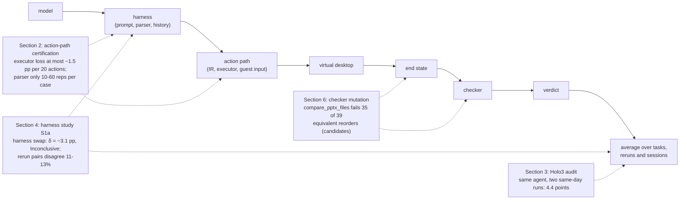
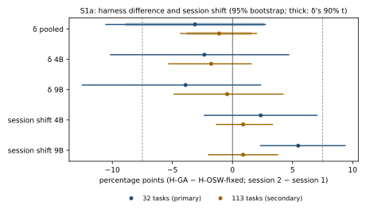
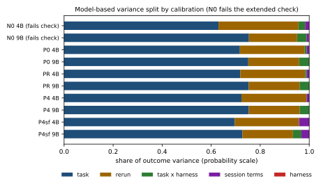

# What an open computer-use benchmark comparison measures: a certified action path, a rerun noise floor and candidate checker defects on OSWorld

Technical report, draft of 2026-10-11 (revision 2). CoTCodec research program, question Q2, "a
calibrated computer-use instrument" (`program/questions/q2-calibrated-cua-instrument.md`).
Program owner and author of record: Kevin Liu. The section "Authorship and process" says which
steps AI agents carried out and what a human has and has not reviewed.

Repository: <https://github.com/Kevin-Liu-01/cotcodec> (public). Every evidence path below
resolves at commit `360058d` on `main`, the base of this draft's branch `stage0/q2-report`. The
draft's own scripts, data file and figures (`paper/q2-report/scripts/`, `data/`, `figures/`) are
added on that branch.

> **Status: DRAFT. Not published, not for circulation.**
>
> - Publishing this report is an outward action reserved to the program owner.
> - Section 6 reports candidate OSWorld checker defects that have not been disclosed to the
>   OSWorld maintainers. Whether and how to disclose them is the owner's decision, and it must be
>   settled before any publication.
> - Every number from the harness study (section 4) carries the label **not externally
>   anchored**.
> - Every checker-study number (section 6) is stated **before the owner's adjudication of a
>   34-item pool and a 25-item human spot check**, and carries the registered label **offline
>   harness, VM fidelity unverified**.
> - Section 12 lists what still waits on human review. Program-record corrections found while
>   drafting are in the internal cover note (`paper/q2-report/cover-note.md`), not in this report.

## Summary

Comparisons of computer-use agents on OSWorld are read as differences between agents. A measured
difference also passes through three other parts of the measurement pipeline: the **action
path** that turns a model's tool call into keyboard and mouse input; **run-to-run variation**,
both between reruns of one episode and between serving sessions; and the benchmark's own
**file-state checkers**. On one 8 x H100 host we measured each part, using two open-weight
agents, Qwen3.5-4B and Qwen3.5-9B. The checker audit's two raters were Claude (Anthropic,
`claude-opus-5-5`) and the open-weight Qwen3.6-35B-A3B. The action-path certification and the
harness study ran under frozen preregistrations. The checker study is reported descriptively,
because its rater-agreement gate failed, and the design study is model-based and was never
registered. We also audited one public pair of leaderboard runs, under its own preregistration. Each item names the section it
summarises and its main evidence keys.

1. **The action path can be certified; the first certification failed on its own measuring
   device** (section 2). Version 1 of a preregistered suite was invalidated when its key-event
   recorder logged a delivered Super+d chord without its modifier [AP1]. The cause lies in what
   the recorder sees. While GNOME Shell holds a synchronous keyboard grab, the X server's RECORD
   extension reports a queued key event before the server computes its modifier state (read in
   the X server source at master; the guest's records agree; development evidence) [AP2-REG
   section 26; DEC D43]. Version 2, with a corrected judge, passed all seven acceptance criteria
   and four validity controls on its first run, for the project's executor and two Qwen3.5
   harness adapters [AP2]. Its 64,028 high-volume trials with zero failures bound the executor
   (L0-fixed) path's loss at about 1.5 pp per 20-action episode. That is a family-wise 95% upper bound,
   over the catalog's actions as the plan weights them, at no more than 32 concurrent VMs on
   this host. The harness adapters' reply parsing has only 10 repetitions per tested case and 60
   per stress entry [AP2-VB].
2. **No harness difference was detected, and none was ruled out** (section 4). For the two
   realized serving sessions per size, on 32 primary tasks with 15-step episodes, the two
   harness adapters differed by −3.1 pp in task success (H-GA minus H-OSW-fixed; 90% interval
   −8.9 to +2.7 pp; 512 primary episodes, 1,808 with the registered 113-task secondary set; no
   episode lost to infrastructure) [S1A]. A difference as large as the registered ±7.5 pp
   margin is not excluded, so the registered classification is Inconclusive. Rerunning the same
   episode changed its outcome in 11.3% of rerun pairs across sessions and 12.5% within a
   session. The registered prediction that cross-session pairs disagree more than within-session
   pairs is falsified (one-sided upper bound of the excess 0.78 pp). Yet 9B's success rose by
   5.5 pp between its two sessions (p = 0.016; one of two per-size tests; no rule reads it; these
   two sessions only). The harness's share of within-task outcome variance was 0.055 (one-sided
   95% bounds 0 to 0.26). The registered rule for admitting a larger scale study needed both
   bounds on one side of 0.13, so it was inconclusive and that study did not run.
3. **(Model-based, not registered.) More tasks would have helped more than more sessions, and
   more sessions more than more reruns** (section 5). A CPU-only design study fitted a model to
   these records. In that model, at S1a's estimates, the probability of admitting the scale
   study is at most 0.03 for each of the 11 designs examined within 8 GPU-hours. Adding tasks
   raised the probability of a decisive harness verdict more than adding sessions, which raised
   it more than adding reruns. The calibrations were chosen after S1a's readings and are not
   externally anchored [DS2].
4. **Candidate checker defects** (section 6). The audit is descriptive: its two model raters
   agreed at Cohen's κ = 0.343 against the registered 0.6, and the owner's adjudication and a
   human spot check are pending [MUT]. OSWorld's `compare_pptx_files` failed 35 of 39 edits that
   only swap the stacking order of two shapes that do not overlap, which changes nothing a
   viewer sees. Both raters accept 29 of those 35 end states as correct and split on 6.
   Re-saving the 92 reference end states ("golds") through LibreOffice's GUI save path flips 4
   of them from pass to fail; in 3 of the 4, both raters accept the saved gold as still correct
   [MUT].
5. **The public Holo3-35B-A3B pair differs by more than rerun noise, for reasons the
   trajectories do not show** (section 3). Two same-day maintainer runs of one agent score 82.56
   and 78.15 on the OSWorld-Verified leaderboard, a 4.4-point gap. Per task they are not
   exchangeable reruns, by a post hoc exact McNemar test (25 against 9, p = 0.009) [H3; DEC
   D10]. A registered audit found that checker time-dependence, step-count
   behaviour and visible environment failures do not explain the gap [H3].
6. **Benchmark revision drift** (sections 4.2 and 7). Of the 116 candidate tasks, 110 differ
   between the OSWorld revision pinned here and the public revision inferred from the public
   runs' window: 36 by task config, the rest by the code structure (AST) of a checker or getter
   they reach [ANCHOR]. No public run could therefore anchor these numbers ("not externally
   anchored": no public run on the same benchmark revision exists to compare with). Whether
   these differences change verdicts was not tested.

## Contributions

The report contributes reusable artifacts and measured magnitudes for one stack. The artifacts
are: an action-path certification suite with its acceptance procedure (a 100-entry catalog, 14
regression cells, four validity controls, seven criteria and independent re-verification); a
two-session, two-rerun noise-floor protocol with registered estimators and analysis code; a
checker-mutation harness with blind requirement specs and a model-rater audit protocol; and a
corrected comparator, `compare_pptx_files_zinv`, that ignores stacking-order swaps of shapes that
cannot overlap. The magnitudes, on this host with these agents, are these. The executor path
costs at most about 1.5 pp per 20-action episode. About 11-13% of rerun pairs disagree. In the
model-based split under the calibrations that pass the design study's check, task sampling
explains about 70-75% of outcome variance, reruns about 21-27%, and harness-by-task at most about
4%. One checker family fails about 90% of equivalent shape reorders. A public same-agent rerun
pair differs by 4.4 points, more than rerun noise predicts. Section 7 turns these into practices
for anyone running an OSWorld comparison. Against the closest prior (cua-speedrun; section 1),
the between-session floor with a registered within-against-between contrast, the task-by-harness
share and the checker audit on the same certified stack are new as far as we know. The harness
study's blind closest-prior check did not run, so this is not a verified novelty claim
(`program/proposals/2026-10-08-q2-stage1-rescoped.md`, wave 0).

## Authorship and process

The research program runs autonomously. AI agents (Claude, through Claude Code) wrote the
preregistrations, built the harnesses, submitted and monitored the host jobs, ran the analyses,
took the program decisions recorded in `program/decisions.md` on the owner's behalf, and drafted
this report. Fresh agent sessions with no part in a run re-verified the action path (two
verifiers, one per stage) [AP2-VA, AP2-VB] and the harness study (a recompute and a claims
check) [S1A, disclosure 5]. The design study was attacked by an adversarial review [DS2]. The
checker study's registered analysis was run by its operator from a fresh export of the frozen
code; no independent re-verification of it is recorded [MUT]. One of the checker audit's two
raters was Claude, run as one isolated agent per item [DEC D25]. The program's adversarial design
reviews also use an open-weight reviewer model.

The program owner, a human, made two rulings used here: accepting the harness study's
replacement decision rules (DR1 and DR5, section 4.2) and its offline-setup task exclusion [DEC
D55]. The owner also asked the program to continue its work. The owner has not reviewed this
draft, the other decisions taken on the owner's behalf, the 34-item adjudication pool or the
25-item spot check. No human has re-run any analysis.

## How to read this report

**Labels.** Each result states its standing with one of these labels:

| Label | Meaning |
|---|---|
| *registered* | read by a frozen preregistration's decision rule or prediction |
| *registered secondary* | computed as a frozen registration specifies, entering no rule (includes the GLMM) |
| *registered descriptive* | a descriptive output the registration fixes in advance, read by no rule |
| *descriptive* | an output of the checker-mutation study, frozen as a descriptive protocol after its rater gate failed |
| *model-based* | from the CPU design study's fitted model; not a registered analysis |
| *derived* | arithmetic on reported numbers done for this report; not a registered or committed analysis |
| *operator count* | counted from raw or released records by a script and reported, never judged |
| *development evidence* | from development runs before a freeze; never acceptance evidence |

**Scope of the harness-study numbers.** Every estimand from the harness study (S1a) is
conditional on the two realized serving sessions per size, on this host, image and lane, and on
the stated decoding settings. Intervals resample tasks with the sessions held fixed.

**Units and intervals.** "pp" is percentage points. Bootstrap intervals are task-cluster
percentile intervals (10,000 resamples, seed 42) unless stated otherwise. A "one-sided 95%
bound" is labelled as such; two-sided intervals are 95% unless stated.

**Identifiers.** Program decision numbers (D*n*), Slurm job numbers and ledger rows appear only
inside square-bracket citations and in Appendix D, which says what each decision decided.
Registered names of rules (DR0-DR5), criteria (C1-C4, A1-A7) and layers (L0-fixed, H-OSW-fixed,
H-GA) are defined in the glossary, section 4.2 and Table 1.

**Evidence keys.** Each number cites its evidence with a key in square brackets, in its own
sentence or in the caption or lead-in of its table or list. Keys map to paths in the repository
above, at commit `360058d`:

| Key | Path |
|---|---|
| [AP2] | `program/evidence/2026-10-08/q2-action-path-v2-acceptance/README.md` (with `acceptance/*.json`) |
| [AP2-VA], [AP2-VB] | the same directory, `independent-verification-stage-a.json` and `independent-verification-stage-b.json` |
| [AP2-REG] | `program/preregistrations/q2-action-path-v2.md` (section numbers given) |
| [AP1] | `program/evidence/2026-10-08/q2-action-path-acceptance/README.md` and `independent-verification.json` |
| [S1A] | `program/evidence/2026-10-10/q2-stage1-a1/RESULTS.md` |
| [S1A-AN] | `program/evidence/2026-10-10/q2-stage1-analysis/` (`report/report-guarded.json`, `s15.json`, `glmm-summary.json`, `post-review/post-review.json`, `a1.jsonl`) |
| [S1A-REG] | `program/preregistrations/q2-stage1-rescoped-v1.md` (section numbers given) |
| [ANCHOR] | `program/evidence/2026-10-08/q2-stage1-g0/anchor/evaluator-diff.json` |
| [D59T] | `program/evidence/2026-10-10/q2-stage1-d59-tooling/README.md` |
| [DS1] | `program/evidence/2026-10-10/q2-design-study/` (`README.md`, `summary.json`, `fit-*.json`) |
| [DS2] | `program/evidence/2026-10-10/q2-next-step-design-study/README.md` (with its `fit-*`, `ppc-*`, `designs-*` files) |
| [VS] | `paper/q2-report/data/variance-shares.json`, written by `paper/q2-report/scripts/variance_shares.py` (this branch) |
| [MUT] | `program/evidence/2026-10-08/q2-mutation-confirm/results/README.md` (with `analysis.json`, `summary.json`, `released/confirm-mutants-v1/outcomes.jsonl`) |
| [MUT-CTL] | `program/evidence/2026-10-08/q2-mutation-confirm/README.md` (the control stage: the harness check K1 and the gold control runs) |
| [MUT-REG] | `program/preregistrations/q2-evaluator-mutation-v1.md` (section numbers given) |
| [ZINV] | `harness/q2_stage1/zinv.py` (module docstring) |
| [H3] | `program/evidence/2026-10-07/holo3-v2/RESULTS.md` and its receipts |
| [H3-REG] | `program/preregistrations/q2-holo3-rerun-audit-v2.md` (and the v1 post hoc record beside it) |
| [SP2] | `program/evidence/2026-10-07/serving-throughput-probe-v2/README.md` |
| [DEC] | `program/decisions.md` (decision numbers given) |
| [STATE] | `program/state.json` (`gpu_hours_ledger`, `pending_decisions_for_kevin`) |
| [LEDGER] | `program/preregistrations/ledger.jsonl` (row numbers given) |

### Glossary

| Term | Meaning | Section |
|---|---|---|
| instrument | the whole measurement pipeline from harness to verdict, together with its calibration; its measured parts are called components | 1 |
| harness, harness adapter | the agent-side code that builds the prompt and history and parses the model's reply into actions; H-OSW-fixed and H-GA are the two certified Qwen3.5 harnesses | 2.1 |
| action path | everything between a model's reply and the X server's input events: harness parser, the IR, the executor and the guest's input stack | 2.1 |
| IR | the suite's one canonical action representation, which every harness's actions are translated into before execution | 2.1 |
| L0-fixed | the project's executor for IR actions | 2.1 |
| L0-raw, H-OSW-up, H-GA-buggy | control layers with known behaviour (natural PyAutoGUI calls; unmodified upstream parsers with known defects) | 2.1 |
| catalog entry; gating set G | one of 100 scripted action sequences with expected events; G is the 86 entries at least one certified harness can express | 2.1 |
| regression cells R01-R14 | 14 rendered model replies covering known harness failure modes (multi-call replies, modifiers on clicks and so on) | 2.1, App. A |
| cell; own-spec; in-spec; outside-spec | a (layer, entry or regression case) combination; each harness is judged against its own prompt's specification: in-spec cells are judged, outside-spec cells run and are reported but not judged | 2.1 |
| oracle | the independent channel that records what the desktop received (key-event tap, text buffer, monitor-device reference) | 2.2 |
| certified keysyms | the 33 X key names the gating entries use; key actions naming others are uncertified | 2.7, App. A |
| V; V* | concurrent VMs; V* = 32 is the largest certified concurrency (the registration's N*) | 2.5 |
| lane | the configured job path (Slurm script, container and CPU-pinning settings) through which VM episodes run on the host | 4.1 |
| gauntlet | the program's adversarial multi-reviewer process, required before any new mechanism or any experiment above 8 GPU-hours | 4.1 |
| episode; rerun; session | one agent attempt at one task; a repeat of the same (model, harness, task) episode; one fresh serving engine and VM pool, inside which reruns are "within-session" | 4.1 |
| first attempt | an episode's first dispatch, before any re-queue after an infrastructure loss (DR0 reads losses among first attempts) | 4.2 |
| discordant pair | two reruns of one (size, task, harness) cell whose outcomes differ | 4.2 |
| D_b, D_w | mean fraction of discordant rerun pairs across sessions (between) and within sessions | 4.2 |
| δ; X; X⁺; X_c; π | harness difference in success; mean squared per-task harness effect; max(X, 0); X's task-specific part; harness share of within-task variance | 4.2 |
| DR0-DR5, DR-A | S1a's registered decision rules (validity, 4B floor, harness pair, components, cost, admission of S1b, anchor) | 4.2 |
| M; M_9B | the admission thresholds for π_small (0.13) and for π_9B when 4B is dropped (0.18) | 4.2 |
| S1a; S1b | the rescoped first stage of the harness study (section 4); the scale ladder it could have admitted, which never ran | 4.1 |
| cost card | the pre-run price per episode from the serving probes: central 0.009020 and high 0.011274 GPU-h per episode at V = 20 | 4.6 |
| postconfig | the task's own steps run on the agent's final state before the checker reads it (for example saving a file) | 4.6 |
| cap-minutes | the sum of registered job time limits on one H100; 478 cap-minutes (7.967 GPU-h) is the largest sum S1a's registration allows under the 8 GPU-hour threshold | 5 |
| calibrations N0, P0, PR, P4, P4sf | the design study's fitted parameter sets (section 5, method) | 5 |
| mid-rank | the observed statistic's rank among simulated ones, ties split, scaled to [0, 1] | 5 |
| gold; gold fixed point | the reference end state a task's checker should pass; MUT-P1 asks whether it still passes after a GUI save | 6.3 |
| mutant; evaluable | an edited gold end state with a blind label; a mutant that was admitted, saved and scored, kept its edit through the save, whose unedited twin passes, whose repeated scorings agree, and whose label is not ambiguous | 6.1 |
| shams | audit items with known answers (golds, do-nothing end states) used to check the raters | 6.5 |
| probe-touched cell | a (task, operator) cell an exploratory scoping probe had touched before the freeze; counted, never audited | 6.4 |
| task-equal share | the mean over tasks of each task's share of mutants with the event (tasks weighted equally) | 6.2 |
| harness relay turn | a byte-identical copy of the session request the agent harness put before resumed rater tasks, which voided those transcripts under the registered ingest | 6.1 |
| K1 | the checker study's harness check: raw golds must pass their own checkers (90% line) | 6.3 |
| zinv | `compare_pptx_files_zinv`, the corrected comparator | 6.2 |
| clean task; net flips | (Holo3 audit) a task scored in both runs with no infrastructure flag; run-1-only passes minus run-2-only passes among clean tasks | 3 |

## 1. Motivation

For verifiable machine work, the checker decides what an agent learns and what a leaderboard
says (`program/PROGRAM.md`, thesis). A comparison of two computer-use agents on OSWorld
([OSWorld](https://arxiv.org/abs/2404.07972), 2024-04-11) is the output of a chain. The verdicts
are averaged over a task sample and one or more serving sessions. We call the whole chain,
together with its calibration, the **instrument**, and its measured parts **components**.
Figure 1 shows where each study in this report intervenes.

**Figure 1. The measurement chain, with the study that measures each link and its main
number.**



A comparison usually means to measure the first two links. The others can each change the
number:

- **The action path** can add a difference that belongs to neither agent. cua-speedrun's
  action-path suite found harness parsers that drop multi-call replies, release modifiers
  before the click, or turn a middle click into nothing
  ([cua-speedrun](https://arxiv.org/abs/2609.40284), 2026-09-30, Table 20).
- **Reruns and sessions** add noise. Rerunning the same observation mode on the same web tasks
  changes 12-14% of outcomes ([2608.06171](https://arxiv.org/abs/2608.06171), 2026-08-06). A
  harness swap and a rerun each flip 13% of SWE-bench Verified tasks
  ([2610.04433](https://arxiv.org/abs/2610.04433), 2026-10-03). About 54% of score variance
  among genuine attempts on four scientific coding tasks is run-to-run noise
  ([2610.01618](https://arxiv.org/abs/2610.01618), 2026-10-01).
- **The checker** adds bias. A hand audit found 15.3% of audited FAIL verdicts on computer-use
  benchmarks wrong, 17.5% on the 57 OSWorld-Verified items it audited
  ([2607.28367](https://arxiv.org/abs/2607.28367), 2026-07-30).
- **Harness effects may depend on the model.** Across two coding harnesses, Qwen3.5-4B scores
  8.3% against 37.2% while a large model is unchanged
  ([2609.07925](https://arxiv.org/abs/2609.07925), 2026-09-07). Harness gains diminish with
  capability on SWE-style repair ([2609.32459](https://arxiv.org/abs/2609.32459), 2026-09-26).
  Desktop evidence on that question does not exist yet.

The program asks how large each of these other links is on desktop tasks, and whether each can
be bounded before a comparison is read. This report covers five pieces of work, four under
their own preregistrations in a hash-chained ledger [LEDGER]:

1. an action-path certification (section 2);
2. an audit of two public Holo3-35B-A3B runs, which motivated the session factor (section 3);
3. a two-session noise-floor and harness study, S1a (section 4);
4. a CPU-only design study on S1a's records, not registered (section 5);
5. a mutation audit of OSWorld's file-state checkers (section 6).

**Closest priors.** cua-speedrun runs harness x model x five seeds on OSWorld with an
action-path error suite, screenshots only, with no between-session floor, no task-by-harness
variance share and no checker testing
([2609.40284](https://arxiv.org/abs/2609.40284), 2026-09-30). A G-theory decomposition over 22
benchmarks has few repeated cells, so it cannot identify rerun variance
([2610.00651](https://arxiv.org/abs/2610.00651), 2026-09-30). The nearest work to the checker
audit is the hand audit of FAIL verdicts above, which covers false negatives only, and mutation
analysis of kernel-benchmark oracles ([2609.22220](https://arxiv.org/abs/2609.22220),
2026-09-02). Section 8 lists what this report does not claim.

## 2. Component 1: a certified action path

### 2.1 What is under test

The action path is everything between a model's reply and the X server's input events: the
harness parser that turns the reply into actions, one canonical action IR, an executor, and the
guest's input stack. The suite tests the three layers the harness study uses [AP2-REG section 3]:

- **L0-fixed**: the project's executor. It sends one guest script per IR action through
  OSWorld's `DesktopEnv.step`, holds keys inside one process with release in `finally`, and
  raises on unknown keys.
- **H-OSW-fixed**: OSWorld `bfd62bdc` `Qwen35VLAgent`, with its emit boundary patched to IR and
  only its own-spec bugs fixed.
- **H-GA**: gym-anything `aae6f7607` `qwen35vl`, unmodified, through an IR adapter.

Three control layers carry known behaviour:

- **L0-raw**: each action as its natural PyAutoGUI 0.9.54 call;
- **H-OSW-up** and **H-GA-buggy**: unmodified upstream parsers with known defects.

**Runtime.** OSWorld `b138d348`; VM image
`happysixd/osworld-docker@sha256:0e6497a9...`; guest disk `Ubuntu.qcow2` (SHA-256
`6bf667a8...`), with Ubuntu 22.04.3, Xorg, GNOME Shell 42.9, 1920x1080; 4 GB RAM and 4 CPUs per
VM; nested KVM on one 8 x H100 host (public alias `fal-h100-01`), CPU-only Slurm jobs [AP2-REG
section 2.1].

**Catalog.** The catalog reimplements the 100 public entry ids of cua-speedrun's App. I.1 suite:
clicks 18, drags 11, keys and chords 34, scrolls 12, mixed 8, typing 17. Every action and
expectation was written for this repository [AP2-REG section 4.1]. The gating set G is the 86
entries at least one certified harness can express. Fourteen **regression cells** (R01-R14)
cover cua-speedrun's Table 20 failure modes: middle click, modifiers on clicks, two or three
calls in one reply, triple click, scroll at a coordinate, horizontal scroll, `terminate`
failure, non-ASCII text, unusual keys, and the (999, 999) corner [AP2-REG section 3]. Each
harness is judged against its own system-prompt specification; a deviation its prompt declares
is a design difference, never a failure. Appendix A lists every entry, the regression cells and
the certified keysyms.

### 2.2 Oracles

- **Key events.** An XRecord tap in the guest records core device events in the X server's
  processing order [AP2-REG section 4.4].
- **Text.** A probe window's text buffer, compared by code point, with no normalization.
- **Key, chord and Caps Lock entries (35).** A reference captured by sending the same chords
  through QEMU's human monitor, an input device independent of the executor; every entry was
  stable over 5 repetitions [AP2-REG section 4.3; job 393].
- **Pointer and scroll entries.** These are labelled *self-specified oracle* in every report.
  Their expectations were written by the suite's authors; only the button numbering was checked
  against the monitor device [AP2-REG section 4.3].
- **Cross-app canary (A6).** Final text is read back from LibreOffice Writer, Chrome, VS Code
  and GNOME Terminal.

### 2.3 Criteria and results

*Registered.* If any validity control (C1-C4) fails, the suite is invalid. A1-A6 gate every
harness-study GPU episode, and A7 gates the screenshot-plus-accessibility setting [AP2-REG
sections 7-8]. Every criterion passed on its first attempt, with no rerun and no repair [AP2;
DEC D53]. Two fresh verifiers, one per stage of the campaign, each recomputed every verdict of
their stage with the frozen code from SHA-256-checked raw records, and both reproduced them. The
stage-B verifier re-judged 108,988 trials (ladder 14,000, A4 64,028, A7 30,960) with 0
mismatches [AP2-VA; AP2-VB, `checks_run`].

Table 1. Action-path criteria, rules and results [AP2, all four stages; AP2-VA; AP2-VB].

| Criterion | What it tests | Pass rule | Trials run | Result |
|---|---|---|---:|---|
| C1 detection | the two known-defect parsers | each of 9 known-defect cells fails 5 of 5 | 140 | PASS: every known-defect cell failed 5 of 5 |
| C2 L0-raw failing set | the PyAutoGUI layer | fails exactly the 8 predicted entries, passes the other 92 | 500 | PASS: failed exactly the 8 (5 non-ASCII text entries skipped by PyAutoGUI; `KP_Enter`; buttons 8 and 9 raise) |
| C3 mutation score | 28 mutation operators on the scored layers (44 scored pairs) | every scored, non-equivalent mutant killed | 4,617 (47 campaigns) | PASS: 42 of 44 killed; the other two (M12, M13 on H-OSW-fixed) are comment-only patches predicted equivalent, and came out equivalent |
| C4 monitor-reference agreement | L0-fixed key streams against the QEMU-monitor reference | equal on all 35 key entries in every A1 trial | 700 (from A1) | PASS: 700 of 700 agree |
| A1 runtime layer | L0-fixed on all 100 entries | 100% of G at V = 1 (5 repetitions x 2 order seeds x 2 observation settings), and the first five repetitions of the seed-43 shuffle at V* | 2,000 at V = 1; 1,000 at V* = 32 | PASS: 2,000 of 2,000 and 1,000 of 1,000 |
| A2 harness layer | H-OSW-fixed and H-GA reply parsing | 100% of in-spec cells, own spec, both settings | 990 and 930 | PASS: H-OSW-fixed 97 in-spec cells x 10 repetitions, all pass; H-GA 87 in-spec cells x 10, all pass; the only failures are outside-spec regression cells (H-OSW-fixed R03, R09; H-GA R02, R04, R06, R10) |
| A3 stress | 30 timing- and state-sensitive entries | 60 repetitions per entry and layer, zero failures | 4,980 | PASS: 4,980 of 4,980 |
| A4 volume | L0-fixed over G | zero failures in 64,028 trials over 1,068 cold boots; at least 10,148 executed actions in each of 7 action classes | 64,028 | PASS: 64,028 of 64,028 |
| A5 reset and hygiene | VM reset and leftovers | 20 of 20 pristine reset checks; base disk unchanged; nothing left behind | 20 checks + 15 campaigns' receipts | PASS |
| A6 cross-app canary | text into four real applications | 300 of 300 trials | 300 | PASS |
| A7 observation service | OSWorld's guest server restarts | exact one-sided 95% bound on restarts per `/accessibility` call at most 5 x 10^-4 | 30,960 (39,036 calls) | PASS: 0 restarts; bound 7.67 x 10^-5 per call |
| Ladder (V*) | concurrency | largest V whose rung passes with boot p95 at most 180 s and step p95 at most 2x the V = 1 value | 9,800 (rungs 8-32) + 4,200 (rung 40) | V* = 32: rungs 8-32 qualify; rung 40 did not count (section 2.5) |

### 2.4 What the zero-failure counts bound

*Registered.* A4's eight statements hold together at family-wise 95% (Bonferroni over eight)
[AP2-REG section 9; AP2-VB]:

- each of the seven action classes fails at most 4.97-5.00 x 10^-4 per action (10,148-10,216
  executed actions per class), over the catalog's instances as the plan weights them;
- a cold boot fails at most 0.474% of the time (1,068 boots).

**The event bounded** is an episode in which at least one device action is misdelivered (its
recorded events differ from the expectation) or the boot fails. That is an upper bound on how
often the action path changes an outcome, not an estimate of it. By the union bound, an episode
of n device actions is affected with probability at most n x 5.0 x 10^-4 + 0.474%. For n = 20
that is 1.0 + 0.47 = about 1.5 pp [AP2-VB, `interpretation_notes`].

**Translated to the harness study (derived).** S1a's records count steps (mean 11.8-12.4 per
base episode, at most 15), not device actions [S1A-AN `a1.jsonl`]. At one device action per
step, a 15-step episode's bound is about 0.75 + 0.47 = 1.2 pp, and each further device action
adds 0.05 pp. This carries over only insofar as S1a's actions resemble the catalog's instances,
and key actions outside the 33 certified keysyms are not covered at all (section 2.7).

**What is not bounded this way.** The bound covers the L0-fixed runtime path, which is all A4
runs. The harness adapters' reply parsing has only A2 (10 repetitions per cell) and A3 (60 per
stress entry). The zero-failure per-entry bounds are much weaker: about 13.9% for A1's 20
repetitions, 4.9% for A3's 60, and 4.2% for A4's 70-repetition mixed entries [AP2-VA; AP2-REG
section 9].

### 2.5 Concurrency

Rung 40 did not count: 10 of its 80 cold boots failed. In each, `dnsmasq` could not create an
inotify instance, because the host's `fs.inotify.max_user_instances` is 128 and the VM
containers share it [AP2, third stage]. At V = 40 the boots that did start, and all 4,200 trials
that ran, were within the timing limits (step p95 3.17 s, 1.18x the V = 1 value). V* = 32
therefore reflects a host configuration limit, not a measured runtime limit [AP2-VB]. The
registration's rule for V* below 40 applied: cut the harness study's task count before adding
GPUs [AP2-REG section 9].

### 2.6 The first version's failure

*Registered (version 1); development evidence for the cause [AP2-REG section 26; DEC D40, D43,
D45].*

The lesson first: **an oracle channel needs its own validity controls.** A control predicted
from code reading can fail on the oracle rather than on the system it is meant to judge. Version
1's first scored control, C2, failed: the PyAutoGUI layer failed every predicted entry and one
more, `chord_super_d`, whose `d` press the tap recorded without the Super modifier in 5 of 5
repetitions [AP1]. The suite was declared invalid and no version-1 criterion may be claimed.
Development then showed the chord had been delivered (the shell acted on it), and that the tap
records key events GNOME Shell's synchronous grab holds back before the server computes their
state. Version 2 kept the catalog, oracles, executor and rules, and changed only the judge: a key
event recorded without the NumLock bit (Mod2) that the entry guard keeps locked, after a press
recorded with it in the same window, is judged on kind, keycode, keysym and order, not on modifier state [AP2-REG
sections 24 and 27].

The acceptance verdicts do not depend on that rule. Across 355,620 key events in A1-A3, C1 and
C3, every recorded key event carried Mod2, so every verdict would be the same under version 1's
stricter reading [AP2-VA]. All 53 events read without their state in version 2's scored
campaigns (controls and acceptance) are in C2's four L0-raw grabbed chords, each 0-2 ms after
the grab key's processed press [AP2, C2; AP2-VA]. Development recorded 280 such events [AP2-REG
section 27]. Version 2's C2 is therefore a reproduction test, not an a-priori test; the only
a-priori test of the L0-raw prediction is version 1's. Appendix C gives the mechanism and timing
evidence.

### 2.7 Limits of the certification

The verdict covers the L0-fixed runtime and the two certified harness adapters (in-spec cells
only), on this host as configured, at no more than 32 concurrent VMs, with 4 pinned CPUs per VM
[DEC D53; AP2-VB]. It does not cover:

- **Concurrency above 32**, or another host, image or kernel setting. At 32 VMs the host runs
  about 3 containers below the observed inotify failure point; any other root inotify use erodes
  that margin [AP2-VB].
- **Keys outside the 33 certified keysyms** [AP2-REG section 4.5]. S1a counted this exposure:
  20-24 of 128 base episodes per (size, harness) contained at least one key, chord or hold
  action outside the set, on 18 of the 32 base tasks. As a description, δ was −4.86 pp on tasks
  with an exposed episode and −0.89 pp on the others [S1A].
- **Catalog instances not tested**, and any per-entry claim at A4's level.
- **The guest server under real task applications**, whose accessibility trees are larger.
- **Observation-service failures other than restarts**, which no criterion bounds [DEC D53
  (iii); AP2-VB]:
  - a whole-boot accessibility failure: in one A7 session the guest server answered every
    `/accessibility` call with HTTP 500 for the whole boot, without restarting. That is 1 of
    1,245 accessibility-setting boots (exact one-sided 95% bound 3.8 x 10^-3 per boot; *operator
    count*). Had it fallen in A4, A4 would have failed; the verifier puts the probability that
    A4 avoided it at about 0.65 [AP2, fourth stage; AP2-VB];
  - first-call HTTP 500s delivered on retry, in 15 sessions (4 in A4, 11 in A7);
  - two `/accessibility` hangs of about 125 s, delivered on retry (2 in 91,800 calls).

  S1a read screenshots only, and counted any undelivered observation as an infrastructure loss
  [DEC D53 (iii), D56]. In development the guest server also restarted once without provocation
  during an 8-VM run, beside the registered development rate of one restart in 8,114
  accessibility calls; that rate was not revised, and A7 bounds restarts on its own campaign
  [AP2-REG section 27; DEC D30; job 851]. **[PENDING: program owner]** Review of this restart.
- **C3 as an independent sensitivity estimate.** It repeated development's seed-42 conditions
  with mutants development had already seen killed, so it is a regression check [AP2-REG
  section 8].
- **Measured pointer expectations.** They are self-specified, not measured on an independent
  device.
- **One governance deviation.** A4 and A7 were rendered and submitted about six minutes after
  the ladder stage handed the rung-40 choice to the program owner; the choice was ratified 13
  hours later. No verdict changes [DEC D51, D53 (i); AP2-VB]. **[PENDING: program owner]**
  Review of this deviation.

## 3. A public rerun pair that is not a rerun (Holo3 audit)

*Registered* [H3-REG; H3; CPU-only job 438]. The version-1 analysis of the same pair is recorded
as post hoc, because its preregistration was written after the per-task files were on disk [DEC
D10].

**Question.** The OSWorld-Verified leaderboard has two rows for Holo3-35B-A3B: 82.56 and 78.15
(leaderboard data at <https://github.com/OS-World/OS-World.github.io>, commit `62f8466`,
`static/data/osworld_verified_results.xlsx`). They are two maintainer runs of the same agent on
the same day. The trajectories come from
<https://huggingface.co/datasets/xlangai/ubuntu_osworld_verified_trajs> at revision `5473c39e`.
Was the gap on the checker side, the agent side, or an environment failure? [H3; H3-REG section
1]

**Populations** [H3; H3-REG sections 2-3]:

1. 361 tasks have configs; 359 were scored in both runs (718 scored episodes). On these, the post
   hoc record gives an exact McNemar test of 25 run-1-only against 9 run-2-only passes,
   p = 0.009: per task the runs are not exchangeable reruns.
2. **Clean tasks** are the 342 scored in both runs and not flagged in either run for an
   environment-preparation retry, an agent-platform failure, a near-timeout or near-instant
   failure, or a repair (flags F2, F3, F4 and F6 of the post hoc record). Among them, 23 pass
   only in run 1 and 9 only in run 2: **net flips** = 23 − 9 = 14.
3. Rule (a) uses the 322 clean tasks whose two trajectories both join to the archive.
4. Rule (b) uses the 14 **run-2-unique failures**: clean tasks that run 1 passed, run 2 failed,
   and every H Company run that scored them (at least two) passed.
5. Rule (c) uses all 718 scored episodes.

Table 2. Holo3 audit, registered rules [H3].

| Rule | Population | Outcome | Numbers |
|---|---|---|---|
| (d) checker time-dependence | clean tasks (342) | not attributable | the 16 clean tasks with a time-dependent checker carry 4 of the 14 net flips (share 0.29); stratified exact one-sided p = 0.156 against α = 0.04 |
| (a) agent behaviour (step counts) | joined clean task pairs (322) | no shift | geometric-mean step ratio run 1 / run 2 = 0.977; Wilcoxon p = 0.94 |
| (b) signatures of the run-2-unique failures | 14 tasks | unexplained | environment 1, agent-side 1, no registered signature 12 |
| (c) coverage | scored episodes (718) | ok | 695 of 718 joined (96.8%) |

**Reading.** The pair reflects a real shift between the two runs that none of the registered
mechanisms explains. Runs of one agent on the same day by the same operator differed by 4.4
points for reasons the trajectories do not reveal [H3]. Section 7.2 compares the gap with rerun
noise.

**What it motivated.** A rerun floor measured inside one session could understate the variance
between sessions [H3]. The harness study therefore registered two serving sessions per size and
the prediction S1a-P1 that cross-session reruns disagree more than within-session ones (section
4).

**Limits.** The evaluator-class rules were written while configs and outcomes were on disk;
their blinding is self-attested, and the narrow-L sensitivity gives the same verdict. The 5.75
GB tarball was deleted after the run [H3].

## 4. Component 2: the rerun noise floor and the harness screen (S1a)

### 4.1 Design

S1a (`q2-stage1-rescoped-v1`, frozen 2026-10-09 22:11 UTC at commit `d5f5798`) is a rescoped
first stage of the program's harness study. The original design (four sizes x two harnesses x two
observation types x three reruns) projected to 431.5 GPU-h in the serving probe [SP2]. Both
certified harnesses also read screenshots only, so the accessibility-tree arm could not run on
them [DEC D47]. The program requires its adversarial multi-reviewer process (the "gauntlet")
before any experiment above 8 GPU-hours. S1a's registered job limits sum to at most 7.967
GPU-h in every branch, so it needed none [S1A-REG sections 2 and 6; DEC D47, D49].

- **Models.** Qwen3.5-4B and Qwen3.5-9B, bf16, one H100 per engine (vLLM v0.31.0). For reference,
  the models' own cards report OSWorld-Verified 35.6% (4B) and 41.8% (9B), first-party, with the
  harness and step budget not stated, on an unstated benchmark revision (fetched 2026-10-08)
  [S1A-REG section 21].
- **Harnesses.** H-OSW-fixed and H-GA, the two certified in section 2. They share an upstream
  layout: 100 history turns, older screenshots folded, thinking passed back. They differ in their
  prompts and tool descriptions, modifier handling, drag and scroll semantics, `wait`, and how
  they treat an unparseable reply [S1A-REG section 5.2]. They are close relatives, not two
  unrelated agent designs.
- **Matched settings.** Screenshot only; 15 steps; thinking on with 2,048 output tokens; greedy
  decoding for both (imposed on H-GA, whose agent samples at temperature 1.0 upstream); 60 s
  settle after reset and 20 s before evaluation; the system-prompt date pinned.
- **Tasks.** OSWorld-Verified's 361 tasks were cut to the 205 that can be checked offline
  without the web, split by domain and checker class into development, confirm and reserve
  splits, and S1a used the confirm split: 120 tasks, minus 4 whose checkers fail their own gold
  (116), minus 3 removed by an outcome-blind offline-setup rule (113) [S1A-REG section 5.4;
  MUT-REG section 1]. The **primary set** is a 32-task base drawn by domain-stratified largest
  remainder and fixed at the freeze. The other 81 tasks, run as extension blocks, form with the
  base the **registered secondary set** (113 tasks), which enters no rule. Appendix B gives the
  selection chain, the domain composition and every task id.
- **Sessions.** Two serving sessions per size, at least 12 hours apart, each a fresh engine and VM
  pool with two within-session reruns. That gives four episodes per (size, task, harness): 512
  episodes on the base and 1,808 in all. The four main runs (one per size and session) used
  V = 20 concurrent VMs, within V* = 32 [S1A].
- **Sign-off.** The owner ruled on the registration's two reserved items: the replacement rules
  DR1 and DR5 (section 4.2) and the offline-setup exclusion. The program's agents signed the
  other design items on the owner's behalf, and the owner's review of them is pending [DEC D55,
  D56].

### 4.2 Registered estimands, rules and predictions

[S1A-REG sections 9-12; S1A]

**Estimands.**

- **D_b, D_w.** The mean fraction of discordant rerun pairs across sessions (4 pairs per cell)
  and within sessions (2 pairs per cell). D_b − D_w is the session excess.
- **δ.** Task-weighted H-GA minus H-OSW-fixed success, pooled over sizes and per size.
- **X.** The mean squared per-task harness effect: δ² plus the task-by-harness variance. It is
  estimated without bias, so its estimate and interval can be negative. X⁺ = max(X, 0). X_c is
  its task-specific part.
- **π.** The harness share of within-task outcome variance, π_z = (X_z⁺/4)/(X_z⁺/4 + D_b,z/2),
  with each harness used half the time. π_small is the mean of π_4B and π_9B.
- **Inference.** Paired t on δ (90% t interval); one-sided sign-flip test on X; per-size
  two-sided sign-flip test on the session shift. The secondary model is a crossed logit GLMM.

**Decision rules.**

- **DR0 (validity).** Fires for a main run if any (size, harness) cell lost more than 5% of its
  first-attempt episodes to infrastructure, the run ended without completing its base, or a gate
  did not hold. No outcome is read. If it fires, no further run starts.
- **DR-A (anchor).** An OpenCUA-7B run against its three public runs, a runtime check. If no
  anchor can be read, every output is labelled not externally anchored.
- **DR1 (4B floor).** If 4B's pooled success is below 10% under both harnesses, the scale ladder
  drops 4B and π_small becomes π_9B.
- **DR2 (harness pair).** *Present* if Holm over p_δ and p_X rejects at family-wise 5%.
  *Near-equivalent* if not Present, δ's 90% interval lies within ±7.5 pp, and π_small's one-sided
  95% upper bound is below 0.12. *Inconclusive* otherwise. The ±7.5 pp margin comes from the 7-8 pp line
  in the program's question statement (`program/questions/q2-calibrated-cua-instrument.md`, the
  "question file"), where it has no derivation; it is kept as the only pre-existing yardstick.
- **DR3 (components for S1b).** Reported per size, no decision: success, D_b, D_w, X, X_c, the
  common session share, the session shift and the harness effect by session.
- **DR4 (cost).** Fires if any main run's realized GPU-h per episode exceeds the cost card's high
  price.
- **DR5 (admission of the scale ladder S1b).** *GO* if π_small's one-sided 95% lower bound
  exceeds M = 0.13; *NO-GO* if its upper bound is below M; *INCONCLUSIVE* otherwise. M is the
  smallest small-rung share the planned ladder could detect with 80% power, maximized over six
  planning cells; M_9B = 0.18 is the same threshold for π_9B, used if DR1 drops 4B. Only GO would
  send S1b to the gauntlet. The owner accepted DR1 and DR5 in place of the question file's
  original lines on 2026-10-09 [DEC D55].

**Predictions** (S1a-P1 to S1a-P5).

- **S1a-P1.** D_b − D_w > 0, from the Holo3 audit (section 3).
- **S1a-P2.** D_b lies in 6-20%.
- **S1a-P3.** The pair is not Present.
- **S1a-P4.** 4B succeeds at least 10% of the time under at least one harness.
- **S1a-P5.** Realized cost is at most the cost card's high price.

**The anchor was unavailable.** Before any GPU job, only 6 of the 116 pool tasks kept the config
and checker code the public OpenCUA runs were scored with, against 58 needed. 110 tasks differ
between the pinned revision `b138d348` and the public revision `00804f81`: 36 by task config, the
rest by the AST of a checker or getter definition they reach (for example `get_vm_file`, in 103
tasks). The public revision is not recorded in the archive; it was inferred from the run window
[ANCHOR; S1A-REG section 5.7]. Every S1a output is therefore labelled **not externally
anchored**. Nothing replaces the question file's original external check, a Holo3 rerun within 2
SE of the official rows, which could not run because Holo3's agent cannot be rerun [DEC D11,
D55].

### 4.3 Outcome for the realized sessions

*Registered.* All four main runs ran: 9B and 4B in session 1 on 2026-10-09/10, and in session 2
on 2026-10-10. Each scored 452 of 452 episodes. DR0 never fired, and not one episode was lost to
infrastructure [S1A].

Table 3. S1a decision rules and predictions [S1A, decision rules and predictions; S1A-AN
`report/report-guarded.json`].

| Rule or prediction | Outcome | Numbers |
|---|---|---|
| DR0 validity | does not fire | 0 of 226 first attempts lost in every (size, harness) cell of every main run |
| DR-A anchor | unavailable | label: not externally anchored |
| DR1 4B floor | does not fire | 4B pooled success 37/128 (28.9%, H-OSW-fixed) and 34/128 (26.6%, H-GA) |
| **DR2 harness pair** | **Inconclusive** | not Present: p_δ = 0.367, p_X = 0.459; not near-equivalent: δ's 90% interval [−8.91, +2.66] pp crosses −7.5, and π_small's one-sided upper bound 0.260 is not below 0.12 |
| DR4 cost | does not fire | highest realized 0.002702 GPU-h per episode, against the high price 0.011274 |
| **DR5 S1b admission** | **INCONCLUSIVE** | π_small = 0.055, one-sided 95% bounds [0.000, 0.260], against M = 0.13 |
| **S1a-P1** session excess > 0 | **falsified** | D_b − D_w = −1.17 pp, 95% [−3.52, +1.56]; one-sided upper bound 0.78 pp < 1 pp |
| S1a-P2 D_b in 6-20% | not falsified | D_b = 11.33%, 95% [5.86, 17.19] |
| S1a-P3 not Present | not falsified | DR2 Inconclusive |
| S1a-P4 4B not at floor | not falsified | 28.9% and 26.6% |
| S1a-P5 cost at most high price | not falsified | 0.002497-0.002702 GPU-h per episode |

Table 4. Primary estimands (base, 32 tasks, raw verdicts) [S1A]. Success counts are episodes
with checker score 1.0, out of 128 per (size, harness).

| Estimand | Estimate | Interval | Interval type | p |
|---|---:|---|---|---|
| Success, 4B: H-OSW-fixed / H-GA | 37/128 (28.9%) / 34/128 (26.6%) | | | |
| Success, 9B: H-OSW-fixed / H-GA | 42/128 (32.8%) / 37/128 (28.9%) | | | |
| δ pooled (H-GA − H-OSW-fixed) | −3.12 pp | [−8.91, +2.66] | two-sided 90%, paired t | 0.367 (paired t) |
| | | [−10.55, +2.73] | two-sided 95%, bootstrap | |
| δ_4B; δ_9B | −2.34 pp; −3.91 pp | [−10.16, +4.69]; [−12.50, +2.34] | two-sided 95%, bootstrap | 0.540; 0.305 (paired t, secondary) |
| D_b pooled (4B; 9B) | 11.33% (14.06%; 8.59%) | [5.86, 17.19] | two-sided 95%, bootstrap | |
| D_w pooled (4B; 9B) | 12.50% (16.41%; 8.59%) | [6.64, 19.14] | two-sided 95%, bootstrap | |
| X pooled (X_4B; X_9B) | 0.0117 (0.0078; 0.0156) | [−0.0312, 0.0703] | two-sided 95%, bootstrap (X can be negative) | 0.459 (one-sided sign flip) |
| π_4B; π_9B | 0.027; 0.083 | [0.000, 0.176]; [0.000, 0.375] | one-sided 95% bounds, bootstrap | |
| π_small | 0.055 | [0.000, 0.260] | one-sided 95% bounds, bootstrap (read by DR2 and DR5) | |
| | | [0.000, 0.306] | two-sided 95%, bootstrap | |
| Scale screen δ_4B − δ_9B; π_4B − π_9B | +1.56 pp; −0.056 | [−3.91, +7.81]; [−0.322, +0.100] | two-sided 95%, bootstrap | |
| Session shift (session 2 − session 1): 4B; 9B | +2.34 pp; +5.47 pp | [−2.34, +7.03]; [+2.34, +9.38] | two-sided 95%, bootstrap | 0.563; 0.016 (two-sided sign flip) |

**Figure 2.** δ pooled and per size, and the per-size session shift, with 95% bootstrap
intervals, for the primary and the registered secondary set; the thick bar is pooled δ's 90% t
interval, and the dashed lines are the ±7.5 pp margin. Drawn from [S1A-AN
`report/report-guarded.json`] by `paper/q2-report/scripts/figures.py`.



**Robustness.** *Registered sensitivities; none changes a decision* [S1A]:

- Checker-corrected verdicts (section 6.6) are identical to the primary: 0 flips.
- Treating the one metric-exception episode as missing changes nothing.
- Treating every episode with a postconfig server error as missing drops no episode.
- Excluding the two flagged base tasks (`70bca0cc`, a confirmed false positive, and `358aa0a7`,
  a false-positive candidate whose violation label both raters contradicted, pending the owner;
  section 6.4) gives δ = −2.50 pp, and DR2 and DR5 read the same.
- Scoring with the fractional score itself gives δ = −3.06 pp.

**Registered secondary set** (113 tasks; *registered secondary*, enters no rule) [S1A]:

- δ = −1.11 pp, 90% t interval [−3.81, +1.60];
- D_b = 10.40%, excess +0.22 pp (one-sided upper bound 1.44);
- π_small = 0.084, one-sided bounds [0.020, 0.162];
- X sign-flip p = 0.157; the label-permutation sensitivity gives 0.035, a test the registration
  notes can be anti-conservative under a session excess;
- at 9B: X_9B = 0.0376, 95% [0.0022, 0.0796], and π_9B = 0.168, one-sided [0.038, 0.304]. At
  4B, π_4B = 0.000.

Read together, the secondary set is non-confirmatory evidence of task-specific harness effects at
9B, and shows no such signal at 4B (π_4B = 0.000), which is not evidence of absence.

### 4.4 S1a-P1: no between-session excess, but a session shift at 9B

The Holo3 audit (section 3) concluded that a floor measured inside one session would understate
the variance between sessions, and S1a-P1 rests on it [H3]. On this stack, under greedy
decoding, the registered test falsifies S1a-P1. Three things qualify that result [S1A]:

- **4B decides it.** Every discordant 9B cell on the base is a 3-to-1 split of its four reruns
  (11 cells). In such a cell, between- and within-session discordance are both 1/2, so 9B's
  excess is exactly 0 in every bootstrap resample. 4B has six 2-to-2 cells; five split within
  each session and one splits by session.
- **Sessions still mattered at 9B.** Success rose by +5.47 pp from session 1 to session 2
  (sign-flip p = 0.016). That is a shift common to the session's tasks, which D_b − D_w is almost
  insensitive to: it enters only through squared per-task shifts, and here 9B's excess is
  exactly 0 because every discordant 9B cell is a 3-to-1 split (above). No rule reads the shift. There are two
  per-size tests, and on the secondary set the 9B shift is +0.89 pp (p = 0.65).
- **δ includes any harness-by-session effect.** With two sessions per size, an effect of this
  kind common to a session's tasks enters δ and cannot be separated from it [S1A-REG sections 9
  and 19]. The change in the harness effect between sessions (δ_S1 − δ_S2) was +4.69 pp
  (SE 6.87) at 4B and +1.56 pp (SE 6.14) at 9B, reported under DR3 and not tested [S1A].

**Where reruns diverge** (*registered descriptive*). All 512 between-session pairs, and 255 of
256 within-session pairs, part at step 1 as "environment"; one 9B within-session pair parts at
step 2 as "serving". The guest's top-bar clock is on every screenshot, so the screenshots differ
from step 1 in nearly every pair. This registered descriptive decomposition cannot separate
environment from serving numerics, nor attribute outcome divergence to the clock [S1A, first
divergence; S1A-REG section 9 item 11].

### 4.5 The variance split

**(a) The registered share.** π is the harness part of within-task variance against the
between-session rerun floor. On the base it is π_4B = 0.027 and π_9B = 0.083 (π_small 0.055,
one-sided upper bound 0.26; π_9B's one-sided upper bound 0.375). On the secondary set
π_small = 0.084, one-sided upper bound 0.16 [S1A]. The point estimates are small; the upper
bounds (0.26 base, 0.16 secondary) exceed the registered 0.12 near-equivalence line, so a small
share is not shown.

**(b) The GLMM** (*registered secondary*) [S1A; S1A-AN `glmm-summary.json`]:

- **The registered fit did not converge.** On the primary set the optimizer reported singular
  convergence with no positive-definite Hessian. The registration says such a fit is reported as
  such, so the GLMM gives no registered evidence.
- **The secondary-set fit converged** (1,808 episodes, 113 tasks). Its latent-scale shares are
  task 0.92 [0.89, 0.98], task:size 0.032, task:harness 0.012 [0, 0.026] and session about 0.
  The (1|task:harness) likelihood-ratio test gives χ² = 4.00, p = 0.045 (boundary-corrected
  0.023). That is non-confirmatory, and 93 of its 200 bootstrap refits did not converge.

**(c) A probability-scale decomposition** comes from the design study's fitted model, so it is in
section 5.3, which also reconciles the three harness-share numbers (Table 7).

### 4.6 Infrastructure, cost and truncation

*Registered.* [S1A]

- **Infrastructure.** Over 1,808 episodes: 0 losses of any type, 0 guest-server restarts, and 0
  observations retried, slower than 30 s or undelivered (24,218 agent screenshots, 5,031 checker
  reads). There were 0 postconfig server errors.
- **Cost.** The **cost card** is the registration's pre-run price per episode, from the serving
  probes: a central 0.009020 and a high 0.011274 GPU-h per episode at V = 20 [S1A-REG section 6;
  SP2]. Realized cost was 0.002497-0.002702 GPU-h per episode (engine start-up included), 22-24%
  of the high price and 28-30% of the central price; 0.048-0.052 VM-h per episode. The four main
  runs used 4.7169 GPU-h physical in all, and about 90.0 VM-h. This replaces the serving probe's
  synthetic projection (431.5 GPU-h for the original design) with a realized price for this
  profile on this host [SP2; S1A].
- **Steps and tokens.** Mean steps per base episode were 11.77-12.41. Of 128 base episodes per
  cell, 57-75 ended at the 15-step cap without `terminate`. Output tokens were 4,359-4,862 per
  episode.
- **Truncation.** Steps ending at 2,048 tokens without a complete tool call were 0.17-0.44% per
  (size, harness), far below the registered 20% label line, so neither size's δ is labelled
  truncation-confounded.

### 4.7 Deviations, disclosures and verification

*Registered.* [S1A, deviations and disclosures; D59T; DEC D56, D57, D59, D61, D62, D63, D64]

**Defects in the frozen analysis code.** Before any outcome was read, a dry run of the frozen
analysis code on synthetic records found eleven defects. An independent checker reproduced each
one, and the program fixed, while blind, how each would be handled [DEC D59, D61, D62]. One
fired, and it is the study's only deviation:

- **Fractional scores crashed the registered report.** The registered command accepts only 0, 1
  and NaN, and the base held 14 fractional scores, so it raised. As a disclosed deviation, the
  report ran through a wrapper that imports the frozen modules unchanged and widens that check.
  An identity check showed that its report differs from the registered code's only in the
  fractional-score fields [S1A, disclosure 1].

The incomplete-data rules were not triggered: the data are complete and the guard changed no
reading [S1A, disclosure 2]. No frozen file changed, and no job was rerun. The operator steps the
program fixed in advance were run and disclosed with their commands: offline rescoring as one
CPU job per main run with an 8-hour limit; first divergence on base tasks, scored final records
and final attempts; the assembly of the reported items the registered command lacks; the GLMM
input written with the registered functions; and the truncation label read on all final records
[S1A, disclosure 3].

**Disclosures.** None changes a number or a rule:

- **Model receipt.** Both 4B GPU jobs verified the model receipt `75ebfc53...`, not the
  CPU-lane receipt `efc88487...` that the registration's gate names. The two differ only in a
  registry digest; revision, file list, total bytes and the artifact root are equal, and each job
  checked the files against that root. The program ruled this a disclosure, not a deviation
  [S1A, disclosure 8 (i); DEC D57; jobs 1050 and 1064].
- **Session-2 start time.** The session-2 9B VM job's begin time was moved to 12:50:00 UTC before
  it started, so that it began at least 12 h after both readings of "the later session-1 job
  ends". The program ruled this a disclosure, not a deviation [S1A, disclosure 8 (ii); DEC D57;
  job 1051].
- **A reviewer GPU job in the session-2 gap.** An open-weight reviewer job from another program
  line (one H100, 0.0533 GPU-h) ran after the session-2 9B run had left the queue and before the
  4B pair was submitted. No S1a job ran during it, so the quiet-host rule, which binds while an
  S1a job runs, held. The 4B pair started at most about 3.5 minutes later than it otherwise would
  have [S1A, disclosure 9; DEC D63; job 1061].
- **A job in the queue during rescoring.** Another program line's reviewer job was in the queue
  at one poll during the CPU rescoring. The quiet-host rule covers the main runs, which had all
  ended; the analysis outputs are deterministic and reproduced byte for byte off the host [S1A,
  disclosure 6; DEC D64; job 1070].

**What has been verified, and what has not.** Two review lenses read the results: a recompute,
which reproduced every re-runnable output off the host from SHA-256-checked copies (not the GLMM
fits), and a claims check [S1A, disclosure 5; `program/log.md`, 2026-10-10]. Their working files
are not committed, and the analysis runbook's own independent-verification record (its step 12)
is still open. The session-2 runs' lane checks other than DR0 and provenance were not re-verified
by a second person [S1A, disclosures 4-5]. For this draft, the registered report was also re-run
on a laptop from the committed records with the command in section 10.2, and it reproduced
`report.json` and `report-guarded.json` byte for byte (*operator count*, 2026-10-11).

### 4.8 What S1a licenses

For the two realized sessions per size, this configuration, this host and image, and the 32 base
tasks, all not externally anchored [S1A]:

- a rerun-noise floor: D_b = 11.3% and D_w = 12.5%;
- no positive between-session excess by the registered test;
- no detectable harness main effect, with DR2 Inconclusive;
- DR5 INCONCLUSIVE, so S1b does not go to the gauntlet;
- a first realized cost card;
- an infrastructure record of 0 losses in 1,808 episodes.

Section 8 lists what it does not license.

## 5. What more data would buy (design study)

*Model-based.* This is a CPU-only study commissioned after S1a's result [DEC D66; DS1; DS2]. It
is not a registered analysis. Its design and scenarios were chosen after S1a's readings, which
it discloses. It informed the decision to close the scale question [DEC D69].

**Method.** The registration's own operating-characteristics model was fitted to S1a's records
by maximum marginal likelihood: a logit model with task, harness, session, task-by-session and
task-by-harness-by-session terms and Bernoulli reruns. It ran in three passes [DS2 sections 1-3]:

1. the fits, a validation at S1a's design, and a cost model that reprices S1a's 1,808 episodes to
   within 0.4%;
2. four independent evaluators, each covering one family of successor designs;
3. an adversarial attack on the study.

The attack found three blocking problems. The main one: every fit put the cross-size correlation
of per-task harness effects at its 0.995 bound. That copied 9B's task-specific effects into 4B,
which 4B's own data do not show (on the 81 extension tasks X_4B = −0.015, and the 4B-only X test
gives p = 0.82). An extended posterior-predictive check then replaced the validation. Its
criteria were written after the attack's numbers were known, so it is not blind to which
statistics misfit [DS2 section 3.4]; they were fixed before any refitted calibration was
checked. The check rejected the base-fitted calibrations, including **N0** (the normal model
fitted to the 32 base tasks). Seven pool-fitted variants passed, and four of them were carried
forward [DS2 sections 3.1-3.2]:

- **P0**: the normal model fitted to all 113 tasks, as committed;
- **PR**: P0 refitted with the cross-size correlation of harness effects set to 0;
- **P4**: refitted with that correlation at 0 and no task-specific harness effect at 4B;
- **P4sf**: P4 with the task-by-harness-by-session SD set to 1.0 logit in both sizes, which DS2
  judged closest to S1a.

Every design was re-run under all four. The residual misfit: 4B's per-task harness differences
reverse sign between sessions more often than any calibration produces (mid-rank 0.94-0.98)
[DS2 sections 3.2, 9].

### 5.1 Decisiveness of successor designs

Results at S1a's estimates, as ranges over the four carried calibrations. Each design uses new
serving sessions with the harnesses interleaved; 450 simulated data sets per cell, each analysed
with the registered code [DS2 sections 4.1 and 5]. "Decisive" means DR2 reads Present or
Near-equivalent; GO and NO-GO are DR5's outcomes.

Table 5. Successor designs (model-based) [DS2 sections 4.1, 5].

| Design | Sizes | Tasks K | Sessions S | Reruns R | Episodes | Cap-minutes (GPU-h) | P(DR2 decisive) | P(DR5 NO-GO) | P(DR5 GO) | δ 90% width (pp) |
|---|---|---:|---:|---:|---:|---:|---|---|---|---|
| A: S1a repeated | 4B, 9B | 32 | 2 | 2 | 512 | 136 (2.27) | 0.18-0.28 | 0.20-0.33 | 0.00 | 8.7-10.4 |
| A6 | 4B, 9B | 32 | 6 | 2 | 1,536 | 396 (6.60) | 0.58-0.76 | 0.28-0.72 | 0.00 | 6.5-8.7 |
| D | 4B, 9B | 113 | 3 | 1 | 1,356 | 306 (5.10) | 0.54-0.62 | 0.20-0.46 | 0.00-0.01 | 5.1-5.7 |
| C: S1a's secondary design | 4B, 9B | 113 | 2 | 2 | 1,808 | 376 (6.27) | 0.66-0.75 | 0.18-0.44 | 0.00 | 4.7-5.4 |
| **E** | 4B, 9B | 113 | 4 | 1 | 1,808 | **406 (6.77)** | **0.83-0.87** | **0.23-0.54** | **0.00** | 4.7-5.4 |
| J | 9B | 113 | 4 | 2 | 1,808 | 390 (6.50) | 0.97-0.99 | 0.09-0.36 (against M_9B) | 0.00 | 6.7-6.9 |

Notes on the table:

- **Cap-minutes** are the sum of registered job time limits on one H100. 478 cap-minutes (7.967
  GPU-h) is the largest sum S1a's registration allows under the program's 8 GPU-hour threshold,
  above which a design needs the gauntlet [S1A-REG section 6.1]. The table's cap-minutes use the
  study's cost rule, realized cost x 1.2 x 1.05, not the registered one (below).
- **M_9B = 0.18** is the admission threshold for π_9B in a 9B-only design (section 4.2).
- **Missing letters.** Designs B (113 tasks, S = 2, R = 1), F (94 stratified tasks, S = 3,
  R = 2), F5 (105 stratified tasks, S = 5, R = 1), J2 and J3 (9B only) are in DS2's full table
  [DS2 section 4.1]; none changes the findings below. F and F5 use 471-477 cap-minutes and F5
  exceeds 478 on 31% of task draws.

### 5.2 What it finds

All findings are model-based, at S1a's estimates, for the 11 designs examined and the four
carried calibrations.

- **Of the designs examined, none could admit S1b.** The carried calibrations put the population
  share DR5 reads at 0.067-0.098 over the 113 tasks, below M = 0.13. P(GO) is at most 0.03 for
  every design and calibration [DS2, "The answer"].
- **Tasks first, then sessions, then reruns.** That ordering held in every source the evaluators
  or the study ran, conditional on these calibrations. E beats C, S1a's own secondary design, by
  0.08-0.17 on P(DR2 decisive). A decisive DR2 from E would most likely read Present
  (0.52-0.73), driven by task-specific effects at 9B through the X test; the δ test alone rejects
  only 3-5% of the time [DS2 sections 4.1, 4.3, 6].
- **The boundary is well calibrated.** At a true share of M, E's DR5 error rate is 0.06-0.09.
  With no harness effect, E gives Near-equivalent 0.95-0.97 and a false Present of 0.02-0.03.
- **The registered cost rule must change for any 113-task design (and A6) to fit.** Under S1a's
  registered rule (the cost card's high price), 478 cap-minutes buy about 700 episodes, enough
  for design A but not for any 113-task design or A6 [DS2 section 5].

**Decision.** The program closed the scale question on this study, and no successor GPU time is
spent on it [DEC D69]. Section 11 notes the one successor left available.

### 5.3 The probability-scale variance split, and reconciling the harness shares

*Model-based* [DS1 `fit-base.json`, `fit-pool.json`; DS2 `fit-pool-rhob0.json`,
`fit-pool-4b0.json`, field `prob_scale_components.shares`; VS for P4sf].

P4sf's shares are not in any committed fit file, so they were computed for this report from
`fit-pool-4b0.json` with the task-by-harness-by-session SD set to 1.0 in both sizes, using the
committed function `model.prob_scale_components` with its defaults (4,000 tasks x 400 sessions,
seed 42). The same call first reproduced P4's committed shares [VS].

Table 6. Probability-scale shares of outcome variance by calibration (model-based).

| Calibration (fit) | Extended check | Rerun 4B / 9B | Task 4B / 9B | Task x harness 4B / 9B | Session terms 4B / 9B |
|---|---|---|---|---|---|
| N0 (`fit-base`, 32 base tasks) | **fails** at 4B | 0.326 / 0.197 | 0.630 / 0.754 | 0.027 / 0.038 | 0.016 / 0.010 |
| P0 (`fit-pool`, 113 tasks) | passes | 0.265 / 0.208 | 0.717 / 0.751 | 0.008 / 0.041 | 0.010 / <0.001 |
| PR (`fit-pool-rhob0`) | passes | 0.265 / 0.208 | 0.719 / 0.753 | 0.006 / 0.039 | 0.010 / <0.001 |
| P4 (`fit-pool-4b0`) | passes | 0.265 / 0.208 | 0.724 / 0.753 | 0.001 / 0.039 | 0.010 / <0.001 |
| P4sf (`fit-pool-4b0`, task x harness x session SD 1.0) | passes | 0.262 / 0.206 | 0.696 / 0.727 | 0.001 / 0.034 | 0.041 / 0.032 |

"Session terms" sums the session, task x session, harness x session and task x harness x session
shares. The harness main effect is at most 0.002 in every row.

Under the four calibrations that pass the extended check:

- which task is drawn explains about 70-75% of outcome variance;
- the rerun explains about a fifth (9B) to a quarter (4B);
- which harness is used on which task explains about 3-4% at 9B and at most 1% at 4B;
- the harness main effect is below 0.1%;
- under P0, PR and P4 every session term is below 1%. P4sf, which the design study judged
  closest to S1a, puts about 2% each on task x session and task x harness x session (1.6-2.0%),
  about 3-4% together.

About 54-56% of pool tasks never succeed and 15-18% always succeed, so only about 30% carry any
contrast at 15 steps [DS2 section 7]. Figure 3 shows the split.

**Figure 3.** Model-based probability-scale variance shares by calibration and size; N0 fails the
extended check. Drawn from [VS] by `paper/q2-report/scripts/figures.py`.



The program's decision record quotes the failing calibration's values: "rerun noise is 20-33% of
outcome variance and task-by-harness variance 3-4%" [DEC D69]. Those are N0's shares.

**Three harness-share numbers.** The report gives three numbers that each describe "how much the
harness matters per task". They differ in scale, population and standing:

Table 7. The three harness-share quantities.

| Quantity | Scale | Population | Standing | Value |
|---|---|---|---|---|
| π_small (harness share of within-task variance, against the rerun floor) | probability, within task | 32 base tasks (113 as secondary) | *registered* (read by DR2 and DR5) | 0.055, one-sided 95% [0.000, 0.260]; secondary 0.084 [0.020, 0.162] |
| GLMM task:harness share | latent (logit) | 113 tasks (the registered 32-task fit did not converge) | *registered secondary* | 0.012 [0, 0.026] |
| Task x harness share of total outcome variance | probability, total variance | 113 pool tasks (model population) | *model-based* | 0.001-0.008 at 4B; 0.034-0.041 at 9B |

**The headline number is the registered π_small.** The other two are smaller because they divide
by more: the GLMM share is a share of latent variance dominated by the task term (0.92), and the
model-based share divides by total outcome variance, of which tasks take about three quarters,
whereas π divides only by the within-task part (harness plus rerun).

**Limits** [DS2 section 9]:

- The calibrations are plug-in conditional ML fits, with no hyperparameter uncertainty; the four
  bracket the uncertainty the check cannot resolve and are not a posterior over models.
- The pool-fitted calibrations have no held-out test.
- The session terms rest on two degrees of freedom.
- A harness-by-session effect common to a new session's tasks was not simulated, except in one
  evaluator run.
- The evaluators' and the attack's drivers are not committed.

## 6. Component 3: candidate checker defects (checker-mutation study)

*Descriptive.* No number in this section is confirmatory. **[PENDING: program owner]** The
adjudication of a 34-item pool and the human spot check of 25 items [DEC D9].

### 6.1 Design and how it became descriptive

The study (`q2-evaluator-mutation-v1`) asks how often OSWorld-Verified's file-state checkers
reject end states that satisfy the task instruction (false negatives), and accept end states that
violate it (false positives) [MUT-REG section 1]. Its design aim was that every office end state
should reach the checker the way it does in the real pipeline, re-saved by the VM's own
LibreOffice [MUT-REG sections 1 and 3]. In fact scoring ran in an offline harness built from
the VM's extracted files, not in the VM itself, and no VM fidelity report (the registered K2 gate)
exists. Every result in this section therefore carries the registered label **offline harness,
VM fidelity unverified** [MUT, K criteria; MUT-REG section 10]. The design:

- **Mutants.** 64 operators edit gold end states of the confirm-split tasks. They work through
  LibreOffice's document model, or splice characters in text files.
- **Blind labels.** Each mutant gets its label from a blind requirement spec, never from a
  checker: *should_pass_equiv* (an equivalent edit), *should_pass_alt_solution*,
  *should_fail_violation*, *should_fail_extra_change* or *ambiguous*.
- **GUI-faithful save.** A save stage replays each task's postconfig in non-headless LibreOffice
  under Xvfb.
- **Scoring.** The unmodified pinned `DesktopEnv.evaluate()` scores each mutant offline, twice in
  fresh processes, under each of two dependency sets. A mutant is *evaluable* if it was admitted,
  saved and scored, kept its edit through the save, its unedited twin passes, its repeated
  scorings agree, and its label is not ambiguous [MUT-REG section 7].
- **Audit.** Every candidate checker error, every gold flip and a set of shams were audited blind
  by two model raters: Claude (`claude-opus-5-5`, through the agent harness with one isolated
  agent per item) and Qwen3.6-35B-A3B [DEC D25].

The study's hypotheses are named MUT-P1 to MUT-P5 here. The registered rater-agreement gate was
κ ≥ 0.6. Development κ came out at 0.066 under the registered ingest, and 0.575 with a harness
relay turn excepted (a byte-identical copy of the session request that the agent harness put
before resumed raters' tasks). The program's exit rule then fired: no other rater was tried, and
MUT-P2 to MUT-P5 left the confirmatory headline. The study was frozen as a pre-specified
descriptive protocol, with candidates listed and counted, each with its audit decision [MUT-REG
status block; DEC D34, D35, D38]. On the confirm audit, the label-error criterion K3 fires (κ =
0.343; the equivalence group's label-error bound 0.314 against 0.10; the violation group
insufficiently audited), and K4 fires (both groups above 10%). Both are reported only, with no
stop [MUT, K criteria; DEC D35].

### 6.2 `compare_pptx_files` fails equivalent shape reorders

The operator `pptx.eq.zorder_nonoverlap` swaps two shapes on a slide only when every shape
between them has a known frame and the pair cannot paint the same pixel (2 mm clearance). The
edit changes nothing a viewer sees [MUT-REG Appendix A; ZINV].

**A worked example** (constructed for illustration, not a specific task). A slide holds, in
document order, a title placeholder, a text box *A* on the left half and a picture *B* on the
right half, more than 2 mm apart. The mutant swaps *A* and *B*, giving the order title, *B*, *A*.
Because *A* and *B* cannot paint the same pixel, the rendered slide is identical.
`compare_pptx_files` pairs the two decks' top-level shapes in document order, so it compares the
reference's *A* with the mutant's *B* and the reference's *B* with the mutant's *A*. Their kinds,
text and positions differ, and the checker fails the mutant [ZINV].

Table 8. Reorder mutants and candidate shares, in the evaluable population outside probe-touched
cells [MUT; ZINV; outcomes in `released/confirm-mutants-v1/outcomes.jsonl`]. Shares are
task-equal: each task's share of its mutants with the event, averaged over tasks with every task
weighted equally (the registered estimand, because mutants inside one task share checker code
paths). That is why 36 of 40 raw (90.0%) appears as 91.7%. Intervals are task-cluster percentile
bootstrap intervals (10,000 resamples, seed 42).

| Checker | Mutants | Evaluable (tasks) | Checker fails | Both raters accept | Raters split | Task-equal candidate share | Audit-confirmed share |
|---|---|---:|---:|---:|---:|---|---|
| `compare_pptx_files` | reorder | 39 | 35 | 29 | 6 | | |
| `compare_pptx_files_tolerant` | reorder | 1 | 1 | 1 | 0 | | |
| both | reorder | 40 (16) | 36 | 30 | 6 | 91.7% (81.3-100%) | 77.1% (61.5-90.6%) |
| `compare_pptx_files` | all should-pass | 85 (16) | 35 | 29 | 6 | 40.2% (32.9-46.3%) | 33.5% (24.8-41.7%) |
| all families | all should-pass | 348 (60) | 36 | 30 | 6 | 12.4% (7.2-18.3%) | 10.6% (5.8-16.2%) |

- No label was contradicted; the 6 split items are in the owner's adjudication pool.
- **Other families.** No other family has a false-negative candidate. `compare_table` has 0 in
  218 should-pass mutants on 30 tasks. No alternative solution (0 of 93) fails.

**Correction.** S1a's checker-corrected outcome replaces `compare_pptx_files` with
`compare_pptx_files_zinv`. That comparator realigns the agent deck's shapes to the reference
order only where the swapped shapes are apart, keeps every other attribute comparison of the
original comparator, and still fails a visible stacking change [ZINV; S1A-REG section 8].

### 6.3 A GUI-faithful save flips reference golds (MUT-P1)

The gold fixed point (MUT-P1; a pre-specified replication) asks whether a raw gold that passes
its checker still passes after a GUI-faithful LibreOffice save. Of 92 counted golds [MUT]:

- **4 flip raw** (4.35%; exact 95% 1.20-10.76%).
- **3 flips are audit-confirmed** (3.26%; exact 95% 0.68-9.23%). Both raters accept the saved
  gold of `3a7c8185`, `9ec204e4` and `b8adbc24` as still correct.
- **The fourth is not a checker error.** Both raters reject the saved gold of `30e3e107`: the
  save changed its content.
- **Standing.** These counts do not change with the owner's adjudication (no MUT-P1 flip is in
  the pool), but their audit reading rests on model raters; the human spot check is pending.
- **The measurement MUT-P1 replicates.** The earlier headless scoping round trip, a different
  save path, flipped 7 of 63 confirm golds and 1 of 26 reserve golds [MUT-REG section 4].

**Raw golds that fail their own checker.** Before any mutant was scored, 4 of 74 confirm-split
raw golds failed their own checkers: one `check_tabstops` and three `compare_pptx_files` (the
harness check K1, 70 of 74, passed its 90% line) [MUT-CTL]. S1a removed these four tasks from its
pool [S1A-REG section 5.4].

### 6.4 False-positive candidates

Five should-fail mutants pass their checker, out of 96 evaluable on 26 tasks (task-equal
candidate share 5.9%, 0.8-12.3%) [MUT]:

- **2 are confirmed** (both raters reject the end state): `drop_char_format` on
  `compare_pptx_files` (`70bca0cc`), and `text_edit` on `compare_docx_files` (`d53ff5ee`).
- **3 had their violation label contradicted** by both raters (two on `358aa0a7`, one on
  `a434992a`), pending the owner.
- **Confirmed share:** 2.1% (0-5.4%).

**Probe-touched cells.** Before the freeze, exploratory scoping probes had already shown how some
tasks' checkers treat some kinds of edit. Every (task, operator) cell such a probe touched is kept
out of the candidates and the audit, because its result is not blind, and its events are counted
per checker family, unaudited [MUT-REG section 12]. These cells hold 28 false-positive events (15
extra changes, 13 violations; `compare_table` 12, `compare_docx_tables` 7, `compare_docx_images`
6, `compare_docx_files` 3) and no false negative [MUT]. Counted from `outcomes.jsonl` for this
report (*operator count*), they are 28 passes among 261 evaluable should-fail mutants on 46 tasks
(10.7% raw). Including them would give 33 passes among 357 (9.2% raw), against 5 of 96 (5.2% raw)
outside them. None of the 28 was audited, so none is confirmed, and some may be label errors, as
3 of the 5 audited candidates were. The headline excludes them by registration, not because they
are small.

### 6.5 How reliable the audit is

[MUT, "Audit statistics"]

- **Agreement.** Cohen's κ on the 138 real items is 0.343 (raw agreement 82.6%), below 0.6.
  Adjudication cannot change κ.
- **Sham accuracy.** Claude 36 of 40 (0.90); Qwen 39 of 40 (0.975).
- **Unresolved items.** 24 of 138 real items (17.4%).
- **Gold shams.** Claude rejects all four split gold shams. They sit on tasks that also hold 3 of
  the 6 split equivalence candidates.

These raters are model raters. The human spot check is pending, and the study claims no rate.

### 6.6 What the defects did to S1a

*Registered secondary.* Offline rescoring of every S1a final state applied the corrected
comparator to 72 episodes per main run. It changed no verdict on the base or the secondary set:
0 flips, and 0 live-against-offline replay mismatches [S1A]. So for Qwen3.5-4B and 9B at 15
steps, the reorder defect did not move any S1a outcome. Corrected verdicts stay secondary until
the owner adjudicates [DEC D9].

### 6.7 What the owner's answers can change

Table 9. Outputs before and after adjudication [MUT, "Pending for Kevin"; `summary.json`
`pending_ranges`].

| Output | Now | After adjudication |
|---|---|---|
| Confirmed false negatives | 30 | 30-36 |
| Confirmed false positives | 2 | 2-5 |
| Alternative solutions admitted to MUT-P2 | 72 | 72-93 (MUT-P2's events do not change) |
| Gold-defect tasks | 0 | 0-4 |
| Audit-confirmed shares (pooled 10.6%, `compare_pptx_files` 33.5%, reorder operator 77.1%, false positive 2.1%) | as stated | change with adjudication (rise as split or contradicted items are confirmed) |
| K3 label errors (equivalence 0.167, violation 0.600) | as stated | fall as items are resolved, possibly to 0; K4 then fires only if both groups stay above 10% |
| κ, MUT-P1, MUT-P3, MUT-P4, MUT-P5, the candidate shares | as stated | unchanged |

## 7. What a comparison measures: implications and recommendations

### 7.1 The answer, for this stack

An OSWorld comparison between two agents measures the agents' difference plus the action path,
run-to-run noise, the task draw and the checkers, and on this stack each has now been sized. The
action path, once certified, contributes little: at most about 1.5 pp per 20-action episode for
the executor, with the harness parser covered only by tens of repetitions per case. Run-to-run
noise is large: about 11-13% of rerun pairs disagree, reruns carry about a fifth to a quarter of
outcome variance, and a whole serving session shifted success by 5.5 pp at one of the two sizes.
Which tasks are drawn dominates: about three quarters of outcome variance in the model-based
split. The harness-by-task interaction, which a harness comparison hopes to read, is at most
about 4% of outcome variance on these two closely related harnesses. Checkers add their own
candidate errors, concentrated in specific families: one presentation comparator fails about 90%
of equivalent shape reorders. And a score is tied to the benchmark revision it was taken at: 110
of 116 tasks differ in config or in the code of a checker they reach between two revisions. The
action-path bound, the checker counts and the revision drift are properties of this stack; the
noise, variance-split and harness numbers are estimates for Qwen3.5-4B and 9B at 15 steps, not
externally anchored.

### 7.2 Implications for comparisons (derived)

*Derived* for this report from the measured floor; not a registered analysis. Rerun variance per
episode is about D_b/2 [DS2 section 7]. Take two agents run R times each on the same K tasks,
with both arms interleaved inside each serving session, so that a session-wide shift cancels.
Assume the per-episode rerun variance of S1a's base (D_b = 0.1133), independence across tasks and
runs, and no task sampling (the comparison is about this fixed task set). The run-to-run SD of
their success-rate difference is then sqrt(D_b / (K x R)), and the minimum detectable difference
(two-sided 5%, 80% power) is about 2.8 times that.

Table 10. Run-to-run SD and minimum detectable difference of a paired success-rate difference
(derived; pp).

| Tasks K | R = 1: SD, MDE | R = 2: SD, MDE | R = 4: SD, MDE |
|---:|---|---|---|
| 32 (S1a's base) | 5.9, 16.7 | 4.2, 11.8 | 3.0, 8.3 |
| 113 (S1a's pool) | 3.2, 8.9 | 2.2, 6.3 | 1.6, 4.4 |
| 361 (OSWorld-Verified, full) | 1.8, 5.0 | 1.25, 3.5 | 0.9, 2.5 |

With the secondary set's D_b of 0.104, every entry is about 4% smaller. Three cautions apply.
Rerun variance depends on the success level and the model, and these numbers are for Qwen3.5 at
about 30% success. A session-wide shift like 9B's +5.5 pp adds directly to any comparison whose
arms ran in different sessions, and it does not shrink with K. Task-by-agent variance must be
added if the claim is about tasks beyond the benchmark.

**The Holo3 gap against this yardstick.** The two Holo3 runs are one run each on 359 tasks. At
S1a's discordance a 4.4-point gap is about 2.5 rerun-noise SDs; at the pair's own discordance (34
discordant tasks of 359) it is about 2.7, close to the McNemar statistic of section 3 (16/√34 =
2.74). Such
a gap is rare under rerun noise alone, and a single-run gap of that size between two different
agents cannot be read as an agent difference unless both ran interleaved in the same sessions.

### 7.3 Recommendations

1. **Certify the action path for every harness compared**, or at least its reply parser on the
   failure modes of the regression cells, and count per episode the key actions outside the
   certified key set.
2. **Report rerun discordance and run at least two reruns per task.** Give intervals that include
   rerun noise; at the full benchmark, one run per agent has a minimum detectable difference of
   about 5 pp (Table 10).
3. **Interleave the arms being compared inside each serving session.** A whole-session shift as
   large as the effects usually reported happened at one of the two sizes here, and the public
   Holo3 pair shows a shift between two same-day runs.
4. **Prefer more distinct tasks to more reruns of the same tasks** when the budget is fixed
   (model-based on this stack; section 5).
5. **Pin and report the benchmark revision with every score**, and do not compare scores across
   revisions without a config and checker diff.
6. **Treat `compare_pptx_files` verdicts as suspect when shapes may be reordered**: use a
   z-order-invariant comparator such as `compare_pptx_files_zinv`, or report presentation tasks
   separately, and check that reference golds still pass after the GUI save path (both pending
   adjudication).

## 8. Limitations and scope

This is the single consolidated list; sections 2.7 and 4.8 give the component-specific limits.

1. **One host, one image, one lane.** Every result is for one 8 x H100 host as configured: the
   pinned VM image and guest disk, OSWorld `b138d348`, CPU-only VM jobs, at most 32 concurrent VMs
   (S1a ran 20). The inotify limit that set V* = 32 is a host setting.
2. **Two sizes, two closely related harnesses.** Qwen3.5-4B and 9B only. H-OSW-fixed and H-GA
   share their history layout, thinking pass-back and Qwen3.5 lineage. A null harness contrast
   between them says little about harness pairs that differ more, such as the coding harnesses of
   [2609.07925](https://arxiv.org/abs/2609.07925). No agent is ranked.
3. **Screenshot only.** Neither certified harness reads an accessibility tree, so the observation
   factor was not measured. A7 certifies the guest server's restart rate, not the observation's
   effect.
4. **Fixed agent settings.** Greedy decoding (imposed on H-GA), 15 steps, a 2,048-token thinking
   budget, offline VMs with `--network none`. 57-75 of 128 base episodes per cell ended at the
   step cap. Nothing is claimed about sampled decoding, longer step caps, larger models, the
   online setting, or tasks outside the offline, web-free subset.
5. **Small task sample, two sessions.** The primary set is 32 tasks. Every estimand is conditional
   on two realized sessions per size; nothing is claimed about the population of sessions;
   session-common harness effects cannot be separated from δ; the 9B session shift describes these
   two sessions only.
6. **No equivalence and no scale claim.** DR2 is Inconclusive, so the harnesses are not shown
   equivalent. No confirmatory task-by-harness claim is made. The scale ladder never ran; the
   scale screen's minimum detectable difference is about 17 pp and S1a makes no shrinkage claim.
7. **Not externally anchored.** No output was compared with a public run, because 110 of 116
   tasks differ from the public runs' revision [ANCHOR]. Whether those differences change verdicts
   was not tested.
8. **Certification limits** are in section 2.7.
9. **Model raters, offline scoring.** The checker audit used two model raters with κ = 0.343; the
   human spot check and the adjudication are pending; scoring ran offline with VM fidelity
   unverified; the study is descriptive. Corrected verdicts are not primary evidence.
10. **Model-based design numbers.** Section 5's probabilities and shares are conditional on fitted
    calibrations, are not registered, and were chosen after S1a's data.
11. **Derived numbers.** Section 7.2's table is arithmetic on the measured floor under stated
    assumptions.
12. **Decisions taken on the owner's behalf.** Most program decisions cited here were taken by
    the program's agents on the owner's behalf and await the owner's review; only the two rulings
    named in "Authorship and process" are the owner's own [DEC D55].

## 9. Reusing the instrument

### 9.1 Prerequisites

- **VM host.** Linux with nested KVM and Docker, a CPU-only Slurm partition, and per VM 4 CPUs,
  4 GB guest RAM (6 GiB container limit) and a 32 GB guest disk setting, with the pinned guest
  disk read-only on the host [AP2-REG section 2.1]. At 32 VMs a campaign used 144 Slurm CPUs
  (128 for VMs, 16 for runners) [AP2]. The host's `fs.inotify.max_user_instances` limits concurrency: at 128, about 35 VM
  containers can start their DNS service [AP2-VB].
- **Pinned inputs.** The VM image by digest and the guest disk by SHA-256 (section 2.1;
  `harness/q2/README.md`, external sources), OSWorld at `b138d348` and the runner image recorded
  in `infra/q2-vm-runner/image-lock.json`.
- **Serving (harness study only).** One H100 per engine, vLLM v0.31.0, the Qwen3.5 weights at the
  registered revision [S1A-REG section 5.1].

### 9.2 Certifying the action path

All VM work runs as CPU-only Slurm campaigns from a read-only `git archive` export of a commit
(`harness/q2/README.md`, "Running a VM campaign"):

```bash
python3 scripts/submit_vm_campaign.py MANIFEST.yaml --dry-run
python3 scripts/submit_vm_campaign.py MANIFEST.yaml --test-only
python3 scripts/submit_vm_campaign.py MANIFEST.yaml
```

Manifests are rendered by `scripts/render_q2_action_path_manifest.py` (wrapped per stage by
`ops/render_*.sh` in [AP2]), and each job runs `infra/slurm/host-single-node/vm-campaign.sbatch`.
Verdicts come from `harness/q2/action_path/acceptance.py`, called by the stage scripts
`ops/analyze_controls.py`, `analyze_acceptance.py`, `analyze_ladder.py` and `analyze_volume.py`
[AP2, "How it was run"]. Each criterion writes, under `acceptance/`:

- `<criterion>-verdict.json`: the verdict (`pass`), per-cell results (`cells`), and for A4 and A7
  the bounds and counts (`class_upper_bound_family_95`, `boot_upper_bound_family_95`,
  `guest_server`);
- `<criterion>-campaigns.json`: the campaigns, sessions and attempts the verdict read;
- `<criterion>-section12-state-not-observed.json`: every key event read without its modifier
  state.

**A new harness adapter** has no turnkey path; the suite certifies the two adapters in
`harness/q2/action_path/adapters.py`. To add one: write its IR adapter there; derive its
expressible entries and own-spec cells from its own prompt (`vocab.py`,
`expressible_entries.json`, `mutation_operators.yaml`); render its corpus (`build_suite.py`,
`suite_cells.json`); and run A2 and A3 for it under a new preregistration, with C1-C4 re-run as
validity controls. At V = 1, an A2 campaign took about 45-48 minutes and an A3 campaign 1.4-1.6
hours on this host [AP2, second stage].

### 9.3 Using the corrected comparator

`harness/q2_stage1/zinv.py` needs only python-pptx and imports the original comparator from an
OSWorld checkout at call time. `zinv.install(metrics_module)` replaces `compare_pptx_files` in
OSWorld's `desktop_env.evaluators.metrics` namespace, which `DesktopEnv` resolves by name, and
returns the original. `compare_pptx_files_tolerant` calls the slides module's own function and is
not corrected [ZINV].

### 9.4 Running the noise-floor protocol

The registered design is two serving sessions per (model, task, harness), at least 12 hours
apart, each a fresh engine and VM pool, with two within-session reruns and the harnesses
interleaved inside each session [S1A-REG section 5.5]. The lane is `harness/q2_stage1/lane.py`;
episode records follow the `q2-stage1a-episode-v1` schema (one row per episode; Table 11). The
registered analysis is `python -m harness.q2_stage1.analysis --records a1.jsonl --plan plan.json
--costs costs.json --out report.json`. With fractional checker scores in the data, that command
raises, and the wrapper of section 10.2 must be used. The estimators (D_b, D_w, δ, X, π) are in
`harness/q2_stage1/estimators.py`. S1a's four main runs took about 70 minutes each at V = 20 (two
per session, sessions at least 12 hours apart), 4.7 GPU-h and about 90 VM-h in all [S1A].

## 10. Released data and reproducibility

### 10.1 Released data

The raw run outputs stay on the host, but the per-episode and per-mutant records behind every
table are committed.

Table 11. Released data.

| File | One row is | Key fields | Rows | Regenerates |
|---|---|---|---:|---|
| `program/evidence/2026-10-10/q2-stage1-analysis/a1.jsonl` | one scored S1a episode | `task_id`, `size`, `harness`, `session`, `rerun`, `block`, `score`, `corrected_score`, `steps`, `tokens`, `ended`, `observations`, `uncertified_key_actions` | 1,808 | Tables 3-4, the secondary set, Figure 2, sections 4.5-4.6 (with the frozen plan) |
| `program/evidence/2026-10-10/q2-stage1-analysis/merged-<job>.jsonl` | one episode of one main run, before concatenation | as above | 452 each (4 files) | `a1.jsonl` |
| `program/evidence/2026-10-10/q2-stage1-analysis/report/report-guarded.json` | the registered report | every estimand, test, rule, prediction and sensitivity | 1 | every S1a number in this report |
| `program/evidence/2026-10-08/q2-mutation-confirm/results/released/confirm-mutants-v1/outcomes.jsonl` | one mutant | `mutant_id`, `task_id`, `operator`, `label`, `checker_family`, `lock_status`, `lock_verdict`, `probe_touched`, `saved_via` | 1,289 | Tables 8-9 and section 6.4 (with `analysis.json` for audit decisions) |
| `program/evidence/2026-10-08/q2-action-path-v2-acceptance/acceptance/*.json` | one criterion's verdict, campaigns or state report | `pass`, `cells`, bounds and counts | 1 per file (3-4 files per criterion) | Table 1 and section 2.4 |
| `program/evidence/2026-10-10/q2-next-step-design-study/designs-*.json`; `fit-*.json` there and in `q2-design-study/` | one calibration's design results; one fit | per design and scenario probabilities; parameters and `prob_scale_components` | 4 design files; 7 fit files | Tables 5-6 |
| `paper/q2-report/data/variance-shares.json` | probability-scale shares per calibration | `shares` | 1 | Table 6, Figure 3 |

### 10.2 One command for the primary estimands

From the repository root, with the project's Python environment (numpy, scipy), this re-runs the
registered report from `a1.jsonl`. For this draft it ran in about six minutes on a laptop and
reproduced the committed `report.json` and `report-guarded.json` byte for byte:

```bash
mkdir -p /tmp/s1a-export
git archive d5f5798 | tar -x -C /tmp/s1a-export
A=program/evidence/2026-10-10/q2-stage1-analysis
PYTHONPATH=. python ops/s1a-analysis/run_report.py --export /tmp/s1a-export \
  --records $A/a1.jsonl \
  --plan program/evidence/2026-10-09/q2-stage1-prefreeze/plan/plan-a0a.json \
  --costs $A/costs.json \
  --dr0 $A/dr0-1045.json --dr0 $A/dr0-1048.json --dr0 $A/dr0-1051.json --dr0 $A/dr0-1062.json \
  --out-dir /tmp/s1a-report
```

Table 4's values are in `/tmp/s1a-report/report-guarded.json` under `primary.estimates` and
`primary.tests`. The report's own figures and appendix tables are regenerated by
`paper/q2-report/scripts/variance_shares.py`, `figures.py` and `appendix_tables.py`.

### 10.3 Registrations and code

The ledger is hash-chained: `uv run python scripts/preregister.py check-chain` checks the chain,
and `verify` checks each registration id [LEDGER]. Appendix D lists each registration's ledger
row, hash prefix and freeze time. Each registration pins its code by digest.

- **Action path:** `harness/q2/action_path/`, `harness/q2/vm/`,
  `scripts/render_q2_action_path_manifest.py`, `infra/slurm/host-single-node/vm-campaign.sbatch`.
- **S1a:** `harness/q2_stage1/` (estimators, rules, the zinv comparator), with the analysis
  tooling in `ops/s1a-analysis/` (`RUNBOOK.md`).
- **Design study:** `harness/q2_design/` (tests: `tests/test_q2_design.py`). `git diff d5f5798 --
  harness/q2_stage1` is empty for the design study [DS1].
- **Checker study:** `harness/q2_mutation/`, `infra/q2-mutation/`.
- **Holo3:** `scripts/run_holo3_rerun_audit_doctor.py`, `harness/holo3_v2.py`.

### 10.4 Compute

GPU-hours are physical, from the ledger in [STATE] (`gpu_hours_ledger`).

| Work | GPU-h | CPU and VM |
|---|---:|---|
| Action-path versions 1 and 2 (development, controls, acceptance) | 0 | version 2 used 109.12 VM-hours, CPU only [AP2]; the verifier notes this total mixes two span definitions [AP2-VB] |
| S1a (two overlay image builds, a pre-freeze check on development tasks, a post-freeze overlay build, the four main runs) | 4.8444 (main runs 4.7169) | about 90.0 VM-h for the main runs [S1A] |
| Checker study (unregistered rater development and the confirm audit) | 0.939 | the mutant campaign itself was CPU only [MUT] |
| Serving probes versions 1 and 2 (version 1 also priced another question) | 1.1513 | [SP2] |
| Holo3 audit | 0 | one CPU-only job [H3] |
| Design study | 0 | no host job [DS2] |

### 10.5 Not in the repository

- **Raw records.** Raw run outputs stay on the host's persistent run root. Each run directory's
  `raw-sha256sums.txt` lists the SHA-256 of every raw file [AP2].
- **Rater material.** The checker study's transcripts, per-item answers, packets and isolated
  export are hashed, not committed [MUT].
- **Holo3 data.** The trajectory feature file stays on the host [H3].
- **Working files.** The design study's evaluator and attack drivers, and the S1a reviewers'
  working files, are in session scratch space, not committed [DS2; S1A].

## 11. Future work

- **A locale study on the same stack.** A follow-up study proposed on this certified stack, and
  not admitted, would compare interface-language and layout-direction conditions [DEC D68, D70].
  At 9B (eval-3's
  simulation in the design study; driver not committed), a 5 pp gate at S1a-like task
  heterogeneity needs about 100-115 distinct tasks at 8 episodes per task-arm. With 18 templates,
  power stays at 0.23-0.49 across heterogeneity scenarios (0.24-0.26 at S1a-like heterogeneity),
  whatever the reruns. Every arm must be interleaved within each serving session, because S1a's 9B
  session shift (+5.5 pp) is as large as the effect sought [DS2 section 7].
- **Observing the shell's side of a grabbed chord.** The tap records what the shell's grab held
  back, not what the shell received. **[PENDING: program owner]** Whether a later registration
  should observe the shell's side directly [DEC D43].
- **A decisive harness reading.** One successor (design E, section 5.1) remains available as a
  registration with a pre-freeze audit, if the owner wants a decisive harness reading at 4B and
  9B. **[PENDING: program owner]**

## 12. Pending human review

The program owner has not reviewed this draft. Before publication the owner must decide on
publication itself and on disclosing the candidate checker defects to the OSWorld maintainers,
which must be settled first. Still open: the 34-item adjudication and the 25-item human spot check
(section 6.7 lists exactly which outputs they can change); review of the program decisions taken
on the owner's behalf; confirmation of the earlier release of the checker study's blind specs;
and the three action-path items marked **[PENDING]** in sections 2.7 and 11. The registered
action-path verdict and S1a's registered readings will not change. The candidate counts in
section 6 do not change with adjudication; the audit-confirmed counts, the label-error estimates
and the corrected verdicts' standing can. Also open without the owner: the S1a
runbook's step-12 verification record and a second check of the session-2 lane checks [S1A,
disclosures 4-5].

## References

External sources. Dates are publication dates, or fetch dates for repositories.

- OSWorld: <https://arxiv.org/abs/2404.07972> (2024-04-11); repository
  <https://github.com/xlang-ai/OSWorld>, pinned at `b138d348` (fetched 2026-10-08).
- gym-anything: <https://github.com/cmu-l3/gym-anything>, harness at `aae6f7607` (fetched
  2026-10-08).
- vLLM v0.31.0: <https://github.com/vllm-project/vllm/releases/tag/v0.31.0> (fetched
  2026-10-08).
- Qwen3.5 model cards (OSWorld-Verified 35.6 for 4B and 41.8 for 9B, first-party, settings not
  stated): <https://huggingface.co/Qwen/Qwen3.5-4B>, <https://huggingface.co/Qwen/Qwen3.5-9B>
  (fetched 2026-10-08).
- cua-speedrun (action-path suite, App. I.1; Table 20): <https://arxiv.org/abs/2609.40284>
  (2026-09-30).
- Routing Is Least Learnable Where It Is Most Valuable (12-14% rerun flips, web):
  <https://arxiv.org/abs/2608.06171> (2026-08-06).
- What Does a Harness Buy? (harness swap and rerun each flip 13%, SWE-bench Verified):
  <https://arxiv.org/abs/2610.04433> (2026-10-03).
- How Benchmarks Mis-Score CUAs (15.3% of audited FAIL verdicts wrong):
  <https://arxiv.org/abs/2607.28367> (2026-07-30).
- FrogNano (Qwen3.5-4B 8.3% against 37.2% across two coding harnesses):
  <https://arxiv.org/abs/2609.07925> (2026-09-07).
- Harness gains diminishing with capability (SWE-style repair):
  <https://arxiv.org/abs/2609.32459> (2026-09-26).
- Run-to-run noise in scientific coding agents (about 54% of score variance):
  <https://arxiv.org/abs/2610.01618> (2026-10-01).
- Agent Evaluation Reliability (G-theory; repeated cells rare): <https://arxiv.org/abs/2610.00651>
  (2026-09-30).
- Measuring the Checker (kernel-oracle mutation analysis): <https://arxiv.org/abs/2609.22220>
  (2026-09-02).
- OSWorld-Verified leaderboard data: <https://github.com/OS-World/OS-World.github.io>, commit
  `62f8466`, `static/data/osworld_verified_results.xlsx` (read 2026-10-07).
- OSWorld-Verified trajectories: <https://huggingface.co/datasets/xlangai/ubuntu_osworld_verified_trajs>,
  revision `5473c39e` (read 2026-10-07).
- X.Org server source (RECORD and device-event processing): <https://github.com/mirror/xserver>,
  master (read 2026-10-08).

The citation metadata above is inherited from the program's verified source lists
(`program/proposals/2026-10-08-q2-stage1-rescoped.md`, sources X1-X15;
`program/preregistrations/q2-stage1-rescoped-v1.md`, section 21;
`program/questions/q2-calibrated-cua-instrument.md`). It was not re-fetched for this draft.

## Appendix A. Action-path objects

Generated by `paper/q2-report/scripts/appendix_tables.py` from `harness/q2/action_path/`
(`catalog.yaml`, `gating_set.json`, `l0_raw_prediction_v2.yaml`, `catalog.certified_keysyms`).

### A.1 Catalog entries by class

Non-gating entries are in italics; entries in the predicted L0-raw failing set are marked (+).

| Class | Entries | Entry ids |
|---|---:|---|
| clicks | 18 | `click_left_center`, `click_right`, `click_middle`, `click_double_left`, `click_triple_left`, `click_ctrl_left`, `click_shift_left`, `click_alt_left`, `click_ctrl_shift_right`, `click_corner_topleft`, `click_corner_bottomright`, *`press_hold_release_left`*, `move_only`, *`press_hold_release_right`*, `click_burst_5`, `click_double_slow`, *`click_button_back`* (+), *`click_button_forward`* (+) |
| drags | 11 | `drag_short`, `drag_long_diagonal`, *`drag_multipoint_l_shape`*, *`drag_right_button`*, *`drag_shift_held`*, `drag_slow_small`, `drag_vertical`, `drag_to_corner`, *`drag_ctrl_held`*, *`drag_middle_button`*, *`drag_alt_held`* |
| keys and chords | 34 | `key_enter`, `key_esc`, `key_tab`, `key_f5`, `key_arrow_up`, `key_arrow_left`, `key_home`, `key_pageup`, `key_pagedown`, `key_delete`, `chord_ctrl_c`, `chord_ctrl_a`, `chord_ctrl_shift_t`, `chord_ctrl_shift_arrow`, `chord_shift_tab`, `chord_alt_f4`, `chord_super_d`, `key_f1`, `key_f9`, `key_f12`, `key_insert`, `key_space_chord`, `key_end`, `key_arrow_down`, `key_arrow_right`, `chord_ctrl_home`, `chord_shift_arrow_left`, `chord_ctrl_alt_shift_r`, `chord_alt_tab`, `key_kp_enter` (+), `key_kp_add`, `chord_shift_alone`, `chord_ctrl_alone`, `key_menu` |
| scrolls | 12 | `scroll_down_1`, `scroll_down_3`, `scroll_down_10`, `scroll_up_3`, *`scroll_left_3`*, *`scroll_right_3`*, `scroll_ctrl_down_3`, `scroll_shift_down_3`, `scroll_at_offcenter_position`, `scroll_down_25`, `scroll_down_then_up_net_zero`, *`scroll_diagonal`* |
| mixed | 8 | `no_action_control`, `click_two_positions_ordered`, `click_then_type`, *`mixed_gesture_state`*, `seq_type_chord_type`, `seq_drag_then_click`, `seq_long_mixed`, `caps_lock_roundtrip` |
| typing | 17 | `type_plain`, `type_shell_hostile`, `type_symbols_shifted`, `type_unicode_bmp` (+), `type_multiline_tabs`, `type_long_200`, `type_emoji` (+), `type_rtl` (+), `type_combining` (+), `type_emoji_zwj` (+), `type_with_correction`, `type_single_char`, `type_spaces`, `type_repeated_chars`, `type_mixed_case`, `type_digits`, `type_long_500` |

Gating set G: 86 entries; non-gating: 14 (each with its reason in `gating_set.json`).

### A.2 The predicted L0-raw failing set (C2)

`type_unicode_bmp`, `type_emoji`, `type_rtl`, `type_combining`, `type_emoji_zwj` (non-ASCII text
PyAutoGUI cannot type), `key_kp_enter`, `click_button_back`, `click_button_forward` (PyAutoGUI
raises on buttons 8 and 9).

### A.3 Regression cells

[AP2-REG section 3]

| Case | H-OSW-fixed | H-GA |
|---|---|---|
| R01 middle_click at a coordinate | gating | gating |
| R02 left_click with `text="ctrl"` | gating | outside spec |
| R03 left_click with `keys=["ctrl"]` | outside spec | outside spec |
| R04 shift-, alt- and ctrl+shift-click via `text` | gating | outside spec |
| R05 mouse_move then scroll, two calls in one response | gating | gating |
| R06 mouse_move then one-point left_click_drag, two calls | gating | outside spec |
| R07 three calls in one response (click, type, key) | gating | gating |
| R08 triple_click | declared deviation (expects double click) | gating |
| R09 scroll with a coordinate | outside spec | outside spec |
| R10 hscroll | declared deviation (expects vertical scroll) | outside spec |
| R11 terminate(status=failure) gives FAIL | gating | gating |
| R12 type with non-ASCII text (the five Unicode catalog strings) | gating | gating |
| R13 key `kp_enter`, `menu`, `super` (one call each) | gating | gating |
| R14 left_click at (999, 999) lands on (1919, 1079), exactly (0 px tolerance) | gating | gating |

### A.4 Certified keysyms (33)

`Alt_L`, `BackSpace`, `Caps_Lock`, `Control_L`, `Delete`, `Down`, `End`, `Escape`, `F1`, `F12`,
`F4`, `F5`, `F9`, `Home`, `Insert`, `KP_Add`, `KP_Enter`, `Left`, `Menu`, `Next`, `Prior`,
`Return`, `Right`, `Shift_L`, `Super_L`, `Tab`, `Up`, `a`, `c`, `d`, `r`, `space`, `t`.

## Appendix B. Task sample

### B.1 Selection chain

| Step | Rule | Tasks |
|---|---|---:|
| OSWorld-Verified | `test_nogdrive.json` | 361 |
| Offline-checkable, web-free | the offline-checkable task classes; live-state, web and infeasible tasks out of scope [MUT-REG section 1] | 205 |
| Confirm split | seed 42, stratified by domain x checker-derived task class, proportional allocation (development 32, confirm 120, reserve 53) (`program/evidence/q2-mutation/splits.json`) | 120 |
| Pool | minus the 4 tasks whose raw gold fails its own checker [MUT-CTL] | 116 |
| Eligible pool | minus 3 tasks whose setup fails offline, by an outcome-blind rule (`26150609`, `982d12a5`, `e2b5e914`) [S1A-REG section 5.4] | 113 |
| Base (primary) | domain-stratified largest remainder, seeded draw within domain, fixed at the freeze | 32 |

The subset is web-free and offline-checkable because the VMs run with no network (`--network
none`) and the checker study scores end states offline. S1a drew its pool from the checker study's
confirm split, so that study's findings (the four failing golds, the flagged tasks and the
corrected comparator) apply to the same tasks.

### B.2 Task ids by domain

Generated by `paper/q2-report/scripts/appendix_tables.py` from the frozen plan
(`program/evidence/2026-10-09/q2-stage1-prefreeze/plan/plan-a0a.json`); 8-character prefixes.

| Domain | Base (32) | Extension (81) | All 113 |
|---|---|---|---:|
| gimp | 2: 7a4deb26 e2dd0213 | 6: 06ca5602 2a729ded 554785e9 77b8ab4d 7b7617bd b148e375 | 8 |
| libreoffice_calc | 8: 035f41ba 0bf05a7d 4188d3a4 4f07fbe9 7efeb4b1 a01fbce3 ecb0df7a f9584479 | 20: 0326d92d 04d9aeaf 0a2e43bf 1273e544 1334ca3e 1e8df695 21ab7b40 21df9241 26a8440e 30e3e107 37608790 42e0a640 4de54231 4e6fcf72 51719eea 51b11269 7e429b8d 8b1ce5f2 a9f325aa aa3a8974 | 28 |
| libreoffice_impress | 7: 0a211154 2cd43775 358aa0a7 70bca0cc 9cf05d24 c59742c0 edb61b14 | 17: 04578141 08aced46 0f84bef9 3161d64e 3b27600c 455d3c66 550ce7e7 57667013 5c1a6c3d 73c99fb9 7ae48c60 9ec204e4 a434992a a53f80cd a669ef01 af2d657a b8adbc24 | 24 |
| libreoffice_writer | 3: 66399b0d 72b810ef f178a4a9 | 9: 0810415c 3ef2b351 6ada715d 6f81754e 88fe4b2d adf5e2c3 b21acd93 d53ff5ee ecc2413d | 12 |
| multi_apps | 7: 02ce9a50 185f29bd 47f7c0ce 5df7b33a 81c425f5 e8172110 eb303e01 | 16: 09a37c51 1f18aa87 227d2f97 2fe4b718 337d318b 3a93cae4 4c26e3f3 51f5801c 778efd0a 7e287123 881deb30 8df7e444 8e116af7 a503b07f bc2b57f3 c867c42d | 23 |
| thunderbird | 2: 9b7bc335 dfac9ee8 | 5: 10a730d5 3f49d2cc 5203d847 9bc3cc16 d38192b0 | 7 |
| vlc | 2: d06f0d4d fba2c100 | 4: 5ac2891a 9195653c a5bbbcd5 f3977615 | 6 |
| vs_code | 1: 6ed0a554 | 4: 53ad5833 70745df8 930fdb3b ec71221e | 5 |

Per-domain success on the base is a description only (two to eight tasks per domain) [S1A, per
domain].

## Appendix C. The version-1 oracle failure in detail

*Registered (version 1); development evidence for the cause* [AP1; AP2-REG section 26; DEC D40,
D43, D45].

Version 1's first scored control, C2, ran once (500 trials) [AP1; job 768]. L0-raw failed every
predicted entry and one more. `chord_super_d` (`pyautogui.hotkey('winleft', 'd')`) failed 5 of
5: in every repetition the tap recorded the four right key events on the right keycodes, but the
`d` press, 0-1 ms after the Super_L press, had core state 0 rather than Mod4. Under version 1's
rules any deviation from the frozen prediction invalidates the suite, so C1, C3 and A1-A7 never
ran under version 1. An independent verifier reproduced the verdict byte for byte [AP1,
`independent-verification.json`]. The program first read the loss as a genuine transport defect
[DEC D40].

Seed-42 development showed that reading was wrong [AP2-REG section 26; DEC D43; jobs 784-787]:

- **Only grabbed chords fail.** Under L0-raw, the four chords GNOME Shell grabs (Super+d, Alt+F4,
  Alt+Tab, Ctrl+Alt+Shift+R) failed 10 of 10. The nine chords it does not grab, sent at the same
  0-2 ms speed, passed 10 of 10, with every modifier state right.
- **The chord was delivered.** In all 15 L0-raw trials of `chord_super_d` (version 1's C2 and
  development), the probe received no key event and lost focus: the shell acted on Super+d. Had
  the shell received `d` without Mod4, it would have replayed `d` to the probe.
- **The mechanism.** GNOME Shell 42.9 grabs its overlay key and keybindings in `XIGrabModeSync`.
  The X server then freezes the keyboard and queues later key events until the shell answers.
  RECORD reports a device event when it is queued, before the server computes its state, and does
  not report it again when the queue is replayed. So the tap recorded the queued `d` press with
  state 0, and without the locked NumLock bit (Mod2) that every processed event carries. The
  server source was read at the X.Org server mirror (<https://github.com/mirror/xserver>, master,
  read 2026-10-08); the guest's Xorg 21.1 release was not read, but its records show the same
  behaviour.
- **Timing decides it.** L0-fixed sends the next key 10 ms after the previous one and holds 0.1 s.
  With the keyboard warmed up, its `d` press came 10-14 ms after Super_L, after the shell's
  answer, and carried Mod4 in 127 of 127 development trials.

So version 1's a-priori prediction was right about delivery and wrong about what the oracle
channel records. Version 2's judge rule (section 2.6) was adopted after seeing version 1's
failure and narrowed so that it applies only after a press recorded with Mod2 in the same window;
C3's equivalence comparison reads such events the same way [AP2-REG sections 24 and 27; DEC D43,
D45]. In version 2's C2, the 53 events read without their state are, by entry: `chord_super_d`
(5 trials: the `d` press, `d` release and Super_L release in each), `chord_alt_tab` (5 trials:
the Tab and Alt_L releases), `chord_ctrl_alt_shift_r` (5 trials: all four releases) and
`chord_alt_f4` (5 trials: the F4 release in all 5 and the Alt_L release in 3) [AP2, C2]. The 280
development events without Mod2 (172 from a development scan and 108 from one development job)
each have state 0 and follow a processed press in their own window [AP2-REG section 27].

## Appendix D. Provenance

### D.1 Registrations and ledger rows

| Registration | Ledger row | Row hash (prefix) | Frozen (UTC) | Evidence |
|---|---:|---|---|---|
| `q2-holo3-rerun-audit-v1-posthoc` | 2 | `2b8536f2` | 2026-10-07 11:39 | post hoc [DEC D10] |
| `q2-holo3-rerun-audit-v2` | 3 | `aa32cb0a` | 2026-10-07 11:39 | [H3] (git head at freeze `48f6b4e`) |
| `serving-throughput-probe-v1` | 4 | `13c72ac3` | 2026-10-07 11:42 | `program/evidence/2026-10-07/serving-throughput-probe-v1/` |
| `serving-throughput-probe-v2` | 5 | `52cd6a84` | 2026-10-07 15:01 | [SP2] |
| `q2-action-path-v1`, `-inputs`, `-executor` | 8-10 | `ea94915d`, `9ae84918`, `be4fefcb` | 2026-10-08 07:28 | [AP1] |
| `q2-evaluator-mutation-v1` | 11 | `dc39bfa2` | 2026-10-08 08:25 | [MUT], [MUT-CTL], `program/evidence/2026-10-08/q2-mutation-confirm/audit/` |
| `q2-action-path-v2`, `-inputs`, `-executor` | 13-15 | `58da1bb6`, `603b2142`, `fde44535` | 2026-10-08 14:23 | [AP2]; campaigns ran from a read-only export of `bf99a64` |
| `q2-stage1-rescoped-v1` (S1a) | 16 | `bc5e88a0` | 2026-10-09 22:11 | [S1A], [S1A-AN]; freeze commit `d5f5798` |

### D.2 Decisions cited

All in `program/decisions.md`. Unless marked as the owner's, each was taken by the program's
agents on the owner's behalf.

| Decision | What it decided |
|---|---|
| D9 | The checker audit uses two provider-distinct model raters; a stratified sample is set aside for a human spot check by the owner, pending |
| D10 | The Holo3 version-1 analysis is recorded as post hoc |
| D11 | The harness study's noise anchor moves from Holo3, whose agent cannot be rerun, to OpenCUA |
| D15 | Holo3 audit version-2 sign-offs |
| D23, D25, D27 | The checker raters: Claude plus a self-hosted open-weight model; Claude through the agent harness while no valid API key exists; the open-weight rater upgraded and Claude isolated per item, keeping the κ rule |
| D30, D33 | Guest-server restarts are bounded separately (A7), with the restart exclusion extended to A1-A3 and the ladder |
| D34, D35, D38 | After the rater gate failed, one rater retry with an exit rule; the exit fired and the study was frozen as a descriptive protocol; the protocol's final choices before the freeze |
| D39 | Action-path freeze details (the excused-trial limit is per entry; C3's equivalence check fails closed) |
| D40 | Action-path version 1 is invalid on C2; a version 2 reports the miss |
| D43, D45 | The cause of version 1's failure corrected; the judge reads grabbed-chord events without their state, narrowed and applied to C3 |
| D47, D49 | The harness study is split into S1a within 8 GPU-h and S1b only on S1a's GO; S1a's pre-freeze decisions |
| D51, D53 | A4 and A7 at V* = 32 without rerunning rung 40 (a governance deviation, ratified after the fact); action path accepted on attempt 1, with corrections |
| D55 | **The owner's own rulings**: DR1 and DR5 accepted; the offline-setup exclusion accepted |
| D56 | The program's sign-off of S1a's other design items on the owner's behalf; S1a's observation rule |
| D57 | Two session-1 disclosures (model receipt digest; session-2 start moved to 12:50 UTC), ruled disclosures, not deviations |
| D59, D61, D62 | How S1a's analysis handles the frozen code's defects, fixed while blind |
| D63, D64 | A reviewer GPU job ran in S1a's session-2 gap (disclosed); S1a's CPU analysis jobs do not block reviewer jobs |
| D66, D69 | S1a's registered outcome and the commissioning of the design study; the scale question closed on the design study |
| D71 | This report is drafted; publication stays the owner's |

### D.3 Jobs cited

All Slurm jobs on the program's host.

| Work | Jobs |
|---|---|
| Action-path version 1 | C2 768; monitor reference capture 393 (used by both versions) |
| Action-path development | 784-787 (seed 42), 830-839, 845-854 (851: the unprovoked guest-server restart) |
| Action-path version 2 acceptance | C2 864; C1 866, 868; C3 870-962; A5 964; A1 968, 970; A2 974, 991; A3 1004, 1008, 1013; A6 1015; ladder 1017-1025; A4 1027; A7 1029 |
| Serving probe version 2 | 466 |
| Holo3 audit | 438 |
| S1a | pre-freeze overlay builds 1032 (failed) and 1033; pre-freeze check 1037/1039; post-freeze overlay 1044; main runs (VM/GPU) 1045/1047, 1048/1050, 1051/1053, 1062/1064; analysis 1065-1068, 1071-1075 |
| Other program lines | reviewer jobs 1061 (in S1a's session-2 gap) and 1070 (queued during rescoring) |

### D.4 S1a disclosures as recorded

[S1A, "Deviations and disclosures", items 1-12] holds the full text, including the operator
commands (item 3), the verification of the session-2 per-job checks (item 4), the runbook's
verification record (item 5), host activity (item 6), the session-1 disclosures (item 8) and the
reviewer job in the session-2 gap (item 9).

## Revision record

Revision 2 (2026-10-11) answers two reviews of revision 1: a correctness review (26 problems)
and an outside-reader review (29 problems). Every problem was addressed except where noted as
rejected or partly rejected below, each with its reason.

**Where revision-1 content moved.** Section 3 (S1a) is now section 4; the Holo3 audit is section
3; the design study is section 5; the checker study is section 6; the old section 3.5(c) is
section 5.3; the old sections 7 and 3.8's list are section 8; the old section 2.5 is section 2.6
plus Appendix C. The old section 9 (index-keyed sign-offs and the discrepancies found while
drafting) moved to the internal cover note `paper/q2-report/cover-note.md`, which now uses 0-based
indices, says "must be settled before publication", adds D57 to the review row, attributes
"independently verified" to `HANDOFF.md` and quotes D66's own words, and adds the 107,988 versus
108,988 discrepancy in the action-path README.

**New computations for this revision**, each labelled in the text: P4sf's probability-scale
shares (`scripts/variance_shares.py`, after reproducing P4's committed shares); Table 10's
run-to-run SDs (*derived*); the probe-touched counts in section 6.4 (*operator count* from
`outcomes.jsonl`); and a re-run of the S1a report from `a1.jsonl` that reproduced the committed
reports byte for byte (section 10.2).

**Rejected or partly rejected, with reasons.**

1. *Outside-reader review, "Move all decision, job and ledger IDs to one appendix provenance
   table."* Partly rejected. Identifiers are gone from the running text, but decision numbers and
   job numbers stay inside square-bracket citations, because they are the evidence pointers an
   auditor needs; the correctness review asks for several of them by number (D56, D57, D63, D64;
   jobs 1050, 1051, 1061, 1064). Appendix D says what each cited decision decided and lists every
   job and ledger row.
2. *Outside-reader review, "appendix tables for the catalog by class with entry ids".* Accepted
   for entry ids, the predicted failing set, the regression cells, the certified keysyms and the
   task ids. Not reproduced: each entry's actions and expected events, which stay in
   `harness/q2/action_path/catalog.yaml`; copying 100 expectation blocks would double the report
   without adding a fact.
3. *Outside-reader review, "the commands to run the action-path suite on a new adapter".* Partly
   rejected: the repository has no turnkey adapter-certification command, so section 9.2 gives
   the real campaign commands and describes the adapter path through the committed modules
   instead of inventing a command.
4. *Outside-reader review, "Replace 'Kevin' with 'the author' or 'the program owner' in the
   body".* Done everywhere except one citation, which quotes the heading "Pending for Kevin" of
   the checker study's results file so that a reader can find the section.

**How some points were met** (not rejections):

- The minimum detectable difference (Table 10) is computed from the measured discordance, one of
  the two sources the outside-reader review allowed; a version from the model calibrations would
  need new simulations, which this CPU-only drafting pass did not run.
- The Holo3 gap is compared with rerun noise at both S1a's discordance and the pair's own, with
  the caution that S1a's floor is for a different agent at a different success level.
- Figure 1 is a Mermaid diagram in the Markdown source, so it stays diffable; Figures 2 and 3 are
  SVG files generated from committed data by `scripts/figures.py`.
- The reference point for the agents' success (outside-reader review) is the models' first-party
  OSWorld-Verified figures from the program's verified source list (section 4.1), with their
  caveats; no other published figure for these models was in the program's sources, and none was
  fetched for this draft.
