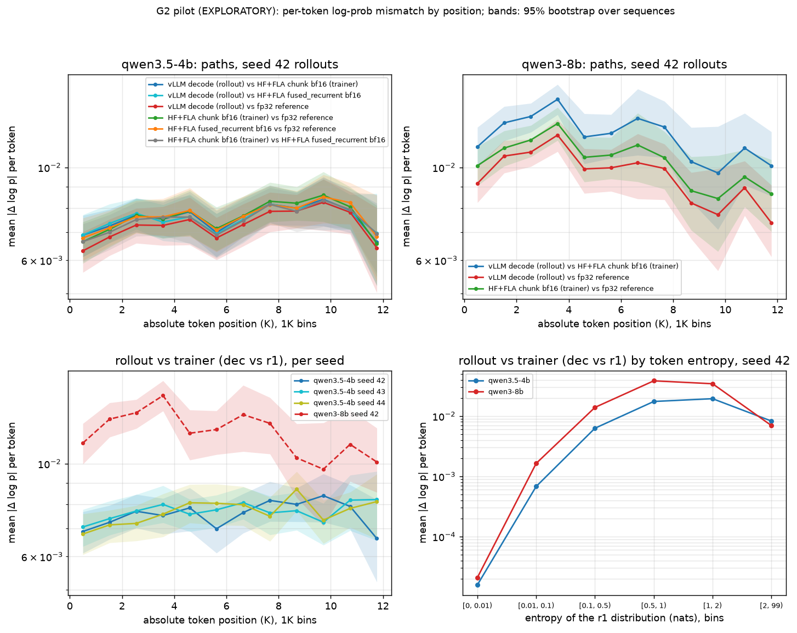

# G2 exploratory pilot: GDN-hybrid train-inference mismatch by token position

**EXPLORATORY.** This is the executable pilot of the G2 gauntlet wave (D104). It is not a
registered experiment: there is no preregistration, no decision rule and no confirmatory
claim. Every number below describes these 96 rollouts on this node, nothing more.

- Question (dossier entry 1, `program/evidence/2026-10-14/question-sweep-memory-gpu/dossier.md`):
  does the per-token log-prob mismatch between vLLM rollouts and the HF+FLA trainer grow with
  token position for a Gated-DeltaNet hybrid (Qwen3.5-4B), while a dense control stays flat?
- Config: `experiments/g2/g2-pilot-v1.yaml`. Code: `scripts/run_g2_rollouts.py`,
  `scripts/run_g2_teacher_force.py`, `scripts/analyze_g2_pilot.py`, `harness/g2_pilot.py`,
  tests in `tests/test_g2_pilot.py`.
- GPU use: **0.4372 physical GPU-h** of the 0.5 cap, image builds and one failed attempt
  included (table below).

## What ran

| Job | What | GPUs | Run time | GPU-h | Outcome |
|---|---|---:|---:|---:|---|
| 1331, 1332 | CPU pre-image selftest: committed scripts mounted into the existing images | 0 | about 1 min each | 0 | 1331: teacher-force selftest failed (no `USER` in the container); 1332: both pass |
| 1333 | GPU-less fetch lane: Qwen3-8B full weights under D1 | 0 | 00:00:58 | 0 | COMPLETED |
| 1334 | vLLM overlay build, commit `cd1692c5` | 1 | 00:01:01 | 0.0169 | COMPLETED, `sha256:8608bc52...` |
| 1335 | research source-overlay build, commit `cd1692c5` | 1 | 00:00:17 | 0.0047 | COMPLETED, `sha256:be6d183d...` |
| 1337 | rollouts, attempt 1 (64 prompts x 3 seeds, no time budget) | 1 | 00:12:41 | 0.2114 | **no data**, cancelled (see Problems) |
| 1338 | CPU post-build selftest of the `cd1692c5` images | 0 | about 1 min | 0 | pass |
| 1339 | vLLM overlay build, commit `307fa7ed` | 1 | 00:01:00 | 0.0167 | COMPLETED, `sha256:fabad633...` |
| 1340 | research source-overlay build, commit `307fa7ed` | 1 | 00:00:16 | 0.0044 | COMPLETED, `sha256:95bb9a2d...` |
| 1343 | CPU post-build selftest of the `307fa7ed` images | 0 | about 1 min | 0 | pass |
| 1342 | rollouts, attempt 2 | 1 | 00:06:45 | 0.1125 | COMPLETED 0:0, `reason=completed` |
| 1352 | teacher forcing | 1 | 00:04:14 | 0.0706 | COMPLETED 0:0, `reason=completed` |
| | **total** | | 00:26:14 on GPUs | **0.4372** | |

Every GPU job was submitted on a queue with no inference-baseline job (`stage0/inference-baseline`)
running; `ops/preflight.log` holds the queue and GPU state taken just before each submission.
The CPU jobs 1331-1333 ran beside the baseline's jobs g and h (no GPU, 8 CPUs).

### Images, code and models

| Item | Identity |
|---|---|
| Rollout image (job 1342) | `cotcodec-vllm` cu129 overlay `sha256:fabad63386d3c39b296e037491d6a6a3b5457c3af31e57764c80ca33c4dec011`; vLLM 0.31.0 (`db9527a4`), torch 2.13.0+cu129, transformers 5.17.0; base `vllm/vllm-openai@sha256:b18abb2d...` (image `sha256:423783aa...`); build receipt `builds/vllm-overlay-307fa7ed-job1339-build-receipt.json` |
| Teacher-forcing image (job 1352) | research source overlay `sha256:95bb9a2d6602f743be1f0556e0aa3283de28a3330991f6996a9d66ffc35c080a`; torch 2.11.0+cu128, transformers 5.15.0, flash-linear-attention 0.5.2, no `causal_conv1d`, no `kernels`; base `cotcodec-research:ed5d5a93-architecture` (image `sha256:500f3b02...`, local-registry digest `sha256:13a9de83...`), offline `uv sync --frozen`; `builds/research-overlay-307fa7ed-job1340.txt` |
| Code in both images | git `307fa7ed2734847091e34e76f50332aa4c7b3982`, source capsule `6c93dc46...` (`builds/source-capsules.json`); attempt 1 used `cd1692c5`, capsule `c3b4e6dc...` |
| Qwen3.5-4B (GDN hybrid) | `Qwen/Qwen3.5-4B` @ `851bf6e8`, 9,342,907,469 bytes, artifact root `3b8a0751...`, receipt `75ebfc53...`; verified by the lane in both jobs |
| Qwen3-8B (dense control) | `Qwen/Qwen3-8B` @ `b968826d`, Apache-2.0, fetched in full under D1 by job 1333 from huggingface.co: 16,397,461,266 bytes, 15 files, artifact root `325ab760...`, receipt `b9e3a74d...` (per-file SHA-256 in `fetch/qwen3-8b-full-receipt.json`). The receipt went to the lane's own receipt root (`cotcodec-receipts-cpu-lane`), so the earlier metadata receipt (`8c206de0...`) was not overwritten. Re-verified by the drivers (`fetch_open_model.py verify`, 12 s) in both jobs |
| Prompts | 64 MATH-500 level-5 problems (`HuggingFaceH4/MATH-500` `test.jsonl` @ `6e4ed1a2`, 446,564 bytes, SHA-256 `35dc4108...`, MIT), chosen with `random.Random(42)`; this run used 24 of them (`g2.prompt_subset`, again seed 42) |
| Rollout data | `tf-input.json` SHA-256 `e50934f2...` (96 sequences), the teacher-forcing job's hash-bound study artifact; raw files and their SHA-256 in `jobs/1342-rollouts/g2/raw-sha256.txt` and `jobs/1352-teacher-force/g2tf/raw-sha256.txt` (kept on the host) |

The chat template is each model's own, thinking on, with Qwen's math suffix ("Please reason
step by step, and put your final answer within \boxed{}"). No `--trust-remote-code`; no
model-generated code ran (D7): the GPUs ran vLLM, torch, transformers and FLA only.

### Design as run, against the plan

| | Planned (config, dossier) | Run |
|---|---|---|
| Prompts | 64 | 24 (seeded subset) |
| Rollouts | Qwen3.5-4B 64 x seeds 42/43/44; Qwen3-8B 64 x seed 42 | Qwen3.5-4B 24 x 3 = 72; Qwen3-8B 24 x 1 = 24 |
| Length | up to 16,384 tokens | a 120 s generation budget per model: Qwen3.5-4B 31 of 72 ended (`<|im_end|>`), 41 cut at 11,503-11,504 tokens; Qwen3-8B 18 of 24 ended, 6 cut (median 6,261, max 11,741) |
| Sampling | T 1.0, top-p 1, top-k off, vLLM `raw_logprobs` of the sampled token | as planned; per-request seed; engine seed 42; bf16; prefix caching off; CUDA graphs on (`FULL_AND_PIECEWISE`); FLASH_ATTN; KV cache `auto`; GDN state cache dtype `auto` (the model config sets `mamba_ssm_dtype: float32`; the engine did not log the resolved value) |
| R1 HF+FLA `chunk_gated_delta_rule`, bf16 | every rollout | every rollout (96) |
| R2 packed `cu_seqlens` | in the dossier | **not run** (unpacked, batch 1 only) |
| R3 HF+FLA `fused_recurrent_gated_delta_rule`, bf16 | every rollout | seed-42 rollouts of Qwen3.5-4B (24) |
| R4 fp32 reference (fp32 upcast weights, TF32 off, memory-efficient SDPA, HF torch-native chunked GDN) | seed-42 rollouts | seed-42 rollouts of both models (48) |
| R5 vLLM prefill recompute | every rollout | **not run** (budget after attempt 1) |
| Common-text arm, FP16 and `mamba_ssm_cache_dtype` arms, per-layer diagnostics | dossier | **not run** |

Every forward is one unpacked sequence with no KV cache. The LM head runs on 2,048-position
chunks: logits in the model dtype, fp32 log-softmax (as the trainer does). Entropy is that of
the r1 distribution. The GDN function was swapped through the module global
`modeling_qwen3_5.torch_chunk_gated_delta_rule`; a counter checked 24 GDN calls per forward
on every sequence, and the stock resolution of that global is FLA's
`chunk_gated_delta_rule` (`jobs/1352-teacher-force/g2tf/summary.json`), so R1 is the stock HF
path.

Metrics (per completion token, on the rollout's own tokens; `d = log p_A - log p_B`): mean and
p99 of |d|; for comparisons with the decode path, mean k3 = `exp(r) - 1 - r` with
`r = log p_B - log p_dec` (an estimate of KL(p_dec || p_B), since the tokens are samples from
the decode distribution) and the share of importance ratios `exp(r)` outside [0.8, 1.25];
the OLS slope of |d| on absolute position (per 1,000 tokens) with a 95% percentile bootstrap
over sequences (2,000 draws, seed 42); the same slope with entropy-bin fixed effects (bins
[0, 0.01, 0.1, 0.5, 1, 2, inf) nats).

## Results



`mismatch-by-position.png` (from `scripts/analyze_g2_pilot.py analyze`): top, every pair of
paths by 1K position bin on the seed-42 rollouts of each model; bottom left, rollout vs
trainer (dec vs r1) per seed; bottom right, dec vs r1 by entropy bin. Bands are 95% bootstrap
intervals over sequences. Full tables: `analysis/tables.md`; everything: `analysis/analysis.json`.

### Seed-42 rollouts of both models

| Model | Comparison | Tokens | Mean abs | p99 abs | k3 | Ratio outside [0.8, 1.25] | Slope per 1K [95% CI] | Slope within entropy bins [95% CI] |
|---|---|---:|---:|---:|---:|---:|---|---|
| Qwen3.5-4B | dec vs r1 (rollout vs trainer) | 220,099 | 0.0076 | 0.111 | 2.7e-4 | 0.032% | +7.9e-5 [-1.5e-5, +1.8e-4] | +1.5e-5 [-4.7e-5, +7.8e-5] |
| Qwen3.5-4B | dec vs r3 (rollout vs trainer, recurrent GDN) | 220,099 | 0.0075 | 0.111 | 2.7e-4 | 0.040% | +7.2e-5 [-1.7e-5, +1.6e-4] | +8.7e-6 [-5.0e-5, +6.7e-5] |
| Qwen3.5-4B | dec vs r4 (rollout vs fp32) | 220,099 | 0.0073 | 0.073 | 1.5e-4 | 0.001% | +1.1e-4 [+2.6e-5, +2.1e-4] | +5.3e-5 [-5.3e-6, +1.1e-4] |
| Qwen3.5-4B | r1 vs r4 (trainer vs fp32) | 220,099 | 0.0076 | 0.077 | | | +1.1e-4 [+1.6e-5, +2.1e-4] | +4.8e-5 [-1.4e-5, +1.1e-4] |
| Qwen3.5-4B | r3 vs r4 | 220,099 | 0.0076 | 0.077 | | | +1.0e-4 [+1.0e-5, +2.0e-4] | +3.9e-5 [-2.2e-5, +1.0e-4] |
| Qwen3.5-4B | r1 vs r3 (chunk vs recurrent) | 220,099 | 0.0075 | 0.111 | | | +1.0e-4 [+1.7e-5, +1.9e-4] | +4.1e-5 [-1.5e-5, +1.0e-4] |
| Qwen3-8B | dec vs r1 | 167,450 | 0.0123 | 0.190 | 7.3e-4 | 0.42% | -1.6e-4 [-3.1e-4, +2.7e-5] | -3.3e-4 [-4.8e-4, -2.3e-4] |
| Qwen3-8B | dec vs r4 | 167,450 | 0.0100 | 0.120 | 3.5e-4 | 0.041% | -1.8e-4 [-3.0e-4, -3.4e-5] | -3.1e-4 [-4.1e-4, -2.2e-4] |
| Qwen3-8B | r1 vs r4 | 167,450 | 0.0108 | 0.130 | | | -1.8e-4 [-3.0e-4, -2.7e-5] | -3.2e-4 [-4.3e-4, -2.3e-4] |

All three seeds of Qwen3.5-4B (72 rollouts, 679,588 tokens), dec vs r1: mean 0.0076, p99
0.112, k3 2.7e-4, slope +7.6e-5 per 1K [+2.2e-5, +1.3e-4], within entropy bins +1.3e-5
[-2.3e-5, +4.9e-5].

### Position curve, rollout vs trainer (dec vs r1), seed 42

| Bin start | 4B seqs | 4B mean abs | 8B seqs | 8B mean abs | Mean ratio 4B/8B | 4B p99 | 8B p99 | p99 ratio |
|---:|---:|---:|---:|---:|---:|---:|---:|---:|
| 0 | 24 | 0.0069 | 24 | 0.0112 | 0.62 | 0.109 | 0.196 | 0.56 |
| 1,024 | 24 | 0.0072 | 24 | 0.0128 | 0.57 | 0.112 | 0.196 | 0.57 |
| 2,048 | 24 | 0.0077 | 24 | 0.0132 | 0.58 | 0.111 | 0.198 | 0.56 |
| 3,072 | 24 | 0.0075 | 19 | 0.0145 | 0.52 | 0.109 | 0.201 | 0.54 |
| 4,096 | 23 | 0.0078 | 17 | 0.0118 | 0.66 | 0.111 | 0.187 | 0.59 |
| 5,120 | 21 | 0.0070 | 15 | 0.0121 | 0.58 | 0.110 | 0.191 | 0.57 |
| 6,144 | 17 | 0.0076 | 13 | 0.0131 | 0.58 | 0.112 | 0.194 | 0.58 |
| 7,168 | 15 | 0.0082 | 11 | 0.0125 | 0.65 | 0.113 | 0.178 | 0.63 |
| 8,192 | 15 | 0.0080 | 9 | 0.0103 | 0.77 | 0.112 | 0.166 | 0.68 |
| 9,216 | 15 | 0.0084 | 8 | 0.0097 | 0.86 | 0.113 | 0.171 | 0.66 |
| 10,240 | 15 | 0.0079 | 6 | 0.0111 | 0.71 | 0.112 | 0.154 | 0.73 |
| 11,264 (partial bin) | 14 | 0.0066 | 6 | 0.0101 | 0.66 | 0.108 | 0.133 | 0.81 |

The all-seed Qwen3.5-4B curve (72 rollouts, `analysis/tables.md`) rises from 0.0069
[0.0065, 0.0074] in the first bin to 0.0077-0.0081 from 3K on, and is flat from 3K to 11K
within its intervals.

### By entropy (dec vs r1, seed 42)

| r1 entropy (nats) | 4B tokens | 4B mean abs | 8B tokens | 8B mean abs |
|---|---:|---:|---:|---:|
| [0, 0.01) | 54,943 | 0.00002 | 53,904 | 0.00002 |
| [0.01, 0.1) | 25,698 | 0.00068 | 15,002 | 0.00164 |
| [0.1, 0.5) | 29,961 | 0.0063 | 21,616 | 0.0139 |
| [0.5, 1) | 31,330 | 0.0175 | 24,448 | 0.0384 |
| [1, 2) | 24,175 | 0.0194 | 15,537 | 0.0344 |
| [2, inf) | 53,992 | 0.0083 | 36,943 | 0.0070 |

Within entropy bins (4B, all seeds), the position slope interval includes 0 in four of six
bins; in [0.5, 1) it is negative (-1.2e-4 [-1.9e-4, -5.4e-5]) and in [2, inf)
positive (+1.3e-4 [+1.9e-5, +2.3e-4]). These are six of many intervals in an exploratory
table; no correction for multiplicity was made.

### Spread across rollouts

- Per-sequence mean |dec - r1|, Qwen3.5-4B, 72 rollouts: min 0.0051, quartiles 0.0067 /
  0.0071 / 0.0081, max 0.0115. Qwen3-8B, 24 rollouts: min 0.0094, quartiles 0.0111 / 0.0121 /
  0.0126, max 0.0158. The two ranges barely overlap.
- Per seed (Qwen3.5-4B, 24 rollouts each), dec vs r1: mean 0.0076 / 0.0077 / 0.0076, k3
  2.67e-4 / 2.71e-4 / 2.71e-4 for seeds 42 / 43 / 44; position slopes +7.9e-5
  [-1.5e-5, +1.8e-4], +5.4e-5 [-5.5e-5, +1.5e-4], +9.4e-5 [+1.3e-5, +1.7e-4]. One seed of
  three has a slope interval that excludes 0. The per-seed curves cross each other throughout
  (figure, bottom left).

## What the pilot says and what it does not

It says, for these rollouts on this stack:

1. The harness works end to end on stock libraries: vLLM rollouts with streamed sampled-token
   log-probs, teacher forcing of the identical token sequences through HF+FLA in bf16, a swap
   of the trainer's GDN kernel, and an fp32 reference, with receipts, on 0.44 GPU-h.
2. Qwen3.5-4B's rollout-vs-trainer mismatch is small and close to what practitioners report:
   mean |d| 0.0076, k3 2.7e-4, 0.03% of importance ratios outside [0.8, 1.25]. The only
   comparable number the D103 sweep found is first-party (not opened again here):
   radixark/miles PR #3597 (opened 2026-09-22, open;
   https://github.com/radixark/miles/pull/3597) reports `train_rollout_logprob_abs_diff`
   0.0072-0.0096 and KL about 3.6e-4 for Qwen3.5-4B GRPO on 4xB200.
3. No sign of a semantic mismatch between vLLM and HF for Qwen3.5 (dossier kill criterion 4):
   no path differs from the fp32 reference by more than the bf16 paths differ from each other.
4. Neither side is the noisy one (kill criterion 3): vLLM decode (0.0073) and the HF+FLA
   trainer (0.0076) sit about equally far from the fp32 reference.
5. Chunk vs recurrent GDN in the trainer does not matter here (the H2b arm): swapping FLA's
   chunk kernel for `fused_recurrent` changes the rollout-trainer mismatch from 0.00758 to
   0.00755 (under 1%) and leaves the distance to fp32 unchanged (0.0076). Under kill
   criterion 2 this arm would be dropped.
6. The hybrid's mismatch rises by about 12% over the first 3K positions (0.0069 to 0.0077)
   and is flat after that up to 11.5K. Pooled over seeds the raw slope is positive (+1% of the mean per 1K),
   but with entropy-bin fixed effects it is +1.3e-5 [-2.3e-5, +4.9e-5]: the position trend
   is what the entropy profile of the traces predicts (the J2/J3 concern), not a separate
   position effect.
7. The dense control is not flatter and not smaller: Qwen3-8B's mismatch is 1.2-1.9x the
   hybrid's (median 1.6x) in every bin, in every entropy bin above 0.01 nats except the top one, and it
   falls with position. On the dossier's kill criterion 1 (hybrid within 1.5x of dense
   Qwen3-8B in every 1K bin, slope CI including 0), this pilot reads as the null: the hybrid
   is below the dense control in every bin.

It does not say:

- Anything confirmatory. The sample is 24 prompts, 72 hybrid and 24 dense rollouts, one node,
  one software stack, no preregistration.
- Anything about 11.5K-16K. The generation budget cut 41 of 72 hybrid rollouts at about 11.5K
  tokens, so the last bin is partial and nothing beyond it was measured. Cut rollouts are
  also a length-biased subsample of the traces that would have run to 16K.
- That hybrids mismatch less than dense models. Qwen3-8B is twice the size, has 36 layers, an
  untied LM head and a different vocabulary, and generated different text on the same
  prompts; the contrast confounds architecture with all of these. Kill criterion 1 is
  defined on the full study, not on this pilot.
- What causes the tail. p99 |d| is almost the same in every bin (0.108-0.113 for the hybrid,
  0.13-0.20 for the dense model), as a fixed quantization step would make it. One untested
  explanation is bf16 logits: both vLLM and the trainer form logits in bf16, whose spacing at
  logit magnitudes 16-32 is 0.125, and the fp32 reference's tail is smaller (p99 0.073). An
  fp32 LM-head arm would test this; it was not run.
- Anything about packing (R2), vLLM prefill vs decode (R5), FP16, the GDN state-cache dtype,
  the common-text arm or per-layer error. None ran.
- That the decode path is free of recomputation. The engine was not run with statistics, so
  preemptions were not counted; the KV pools (1.59M and 334K tokens) exceeded the peak demand
  of 72 x 11.8K and 24 x 11.7K tokens, so none is expected.

## Problems

- **Attempt 1 (job 1337) returned no data and cost 0.2114 GPU-h.** `LLM.enqueue` in vLLM
  0.31.0 returns internal request ids (`"<n>-<suffix>"`, from `InputProcessor.assign_request_id`),
  while `RequestOutput.request_id` carries the external id; the driver matched them the
  wrong way round, so all 192 finished rollouts (390 s of generation) were counted unmatched
  and dropped. The worker then hung at interpreter exit, past the USR1/TERM sequence, until
  it was cancelled. The CPU selftests could not catch either (no engine without a GPU). Fixed
  in `a97c41e9`: requests go through `LLMEngine.add_request` under our own ids with DELTA
  output (so a request cut at a time budget keeps its tokens), the worker writes `done.json`
  and leaves with `os._exit` after a bounded engine shutdown, and the driver kills a hung
  worker's process group.
- Attempt 1 also showed the plan was too large: 192 rollouts up to 16K tokens had not all
  finished after 6.5 minutes. What remained of the cap set the reduced scope above.
- Job 1331's teacher-force selftest failed because the container had no `USER` (torch's
  Inductor cache path calls `getpass.getuser`); the lane sets `USER`, the selftest script
  now does too.

## Reproduce

On the host, from a clean checkout of this branch (CPU only):

```bash
uv run --locked python scripts/analyze_g2_pilot.py analyze \
  --per-token program/evidence/2026-10-14/g2-pilot/data/per-token.npz --output-dir <dir>
```

`data/per-token.npz` (written by `analyze_g2_pilot.py pack` from the two jobs' raw outputs)
holds, per model and completion token, the absolute position, the r1 log-prob (fp32), every
other path as an fp16 difference from r1, and the r1 and r4 entropies. `data/rollouts-*-tokens.npz`
hold the rollout token ids and decode log-probs; `data/rollouts-*-texts.jsonl.gz` the
completions. The jobs' manifests, lane records and logs are under `manifests/`, `jobs/`,
`builds/`, `fetch/`, `selftests/` and `ops/` (`ops/jobs.log` is the operator log).

## Next

For the G2 gauntlet wave: the pilot argues for narrowing G2 before spending the 3 GPU-h. The
position question looks answered by entropy at 4B up to 11.5K; what is left is (a) whether
the 11.5K-16K range or the 9B changes that, (b) the bf16 LM-head tail, an fp32 LM-head arm
being nearly free, and (c) a size-matched dense control and the common-text arm, without
which no hybrid-vs-dense statement can be made.
