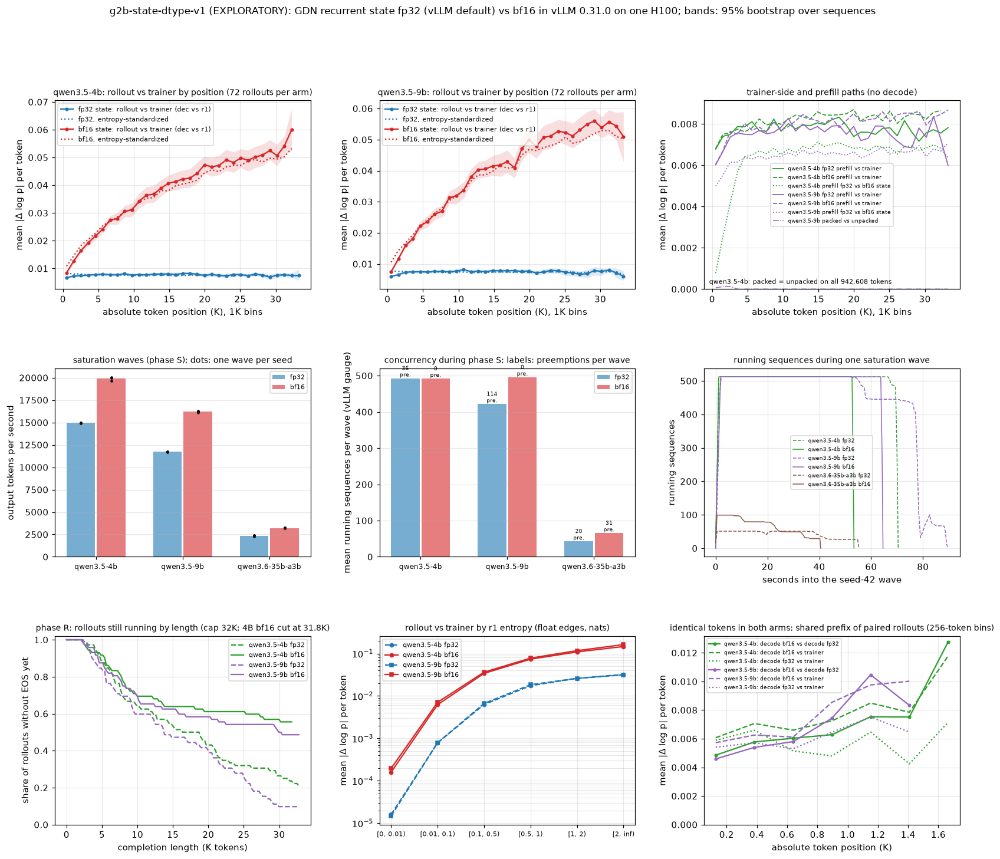

# g2b-state-dtype-v1: a bfloat16 GDN recurrent state in vLLM 0.31.0 (concurrency, throughput, train-inference mismatch)

> **EXPLORATORY. Not a registered experiment.** There is no preregistration, no hypothesis
> and no decision rule. Nothing below is a confirmatory claim. The numbers describe these
> rollouts, prompts and engines on one node and one software stack (vLLM 0.31.0; the trainer
> path is transformers 5.15 with flash-linear-attention 0.5.2). The jobs ran 2026-10-14
> 22:21-23:03 UTC. **1.8386 physical GPU-h** of the 3.0 cap were used, image builds and smoke
> runs included.

Follows D105 (vLLM keeps the gated-DeltaNet state in the checkpoint's float32,
`program/evidence/2026-10-14/inference-baseline/`) and the G2 pilot
(`program/evidence/2026-10-14/g2-pilot/`).

## Main takeaways (exploratory)

- **The setting.** vLLM 0.31.0 exposes it as `--mamba-ssm-cache-dtype` (`mamba_ssm_cache_dtype`
  on `LLM`/`EngineArgs`). It accepts `auto`, `float32`, `float16` and `bfloat16`. `auto` copies
  the checkpoint's `mamba_ssm_dtype`, which is float32 for all three models. With `bfloat16`, vLLM
  logs a warning and uses it. This halves the GDN state per sequence: 49.1 to 25.1 MiB on
  Qwen3.5-4B and 9B, and 61.4 to 31.4 MiB on Qwen3.6-35B-A3B. It also halves the hybrid
  block (528 to 272 tokens; 1,056 to 544 on the MoE), so the pool holds twice as many blocks.
- **(a) It raises concurrency and throughput where the state is a large share of each
  sequence's memory.** Saturation waves of 512 fixed-length rollouts (2,048 output tokens):
  - Qwen3.5-4B: 14.9K to 19.9K output tok/s (1.33x).
  - Qwen3.5-9B: 11.7K to 16.2K tok/s (1.38x). The fp32 engine averaged 421 running sequences
    with 114 preemptions per wave; bf16 averaged 495 with none.
  - One-GPU Qwen3.6-35B-A3B (128 rollouts of 1,024 tokens): at most 51 running sequences with
    fp32 and 99 with bf16, for 2.35K and 3.22K tok/s (1.37x).

  The gain shrinks with sequence length. By the engines' own block counts, the most
  2K-token sequences that fit rises 23-39%, and the most 32K-token sequences rises 4-20%.
  In the long reasoning rollouts (72 at once, up to 32K tokens), the 4B and 9B block pools
  never filled (peak 38-72%). The one-GPU MoE did fill: 51 of 64 rollouts ran with fp32 and
  all 64 with bf16.
- **(b) It changes the train-inference mismatch a lot, and the change grows with position.**
  Rollout log-probs against the HF+FLA trainer on the rollouts' own tokens:
  - Mean |Δ log p| rises from 0.0077 to 0.0357 on the 4B (4.6x, 95% CI over prompts
    [4.3, 4.9]) and from 0.0074 to 0.0365 on the 9B (4.9x [4.6, 5.1]).
  - k3, the per-token KL estimate, rises 18-21x (2.6e-4 to 4.8e-3 and 5.3e-3).
  - The share of importance ratios outside [0.8, 1.25] rises from 0.02-0.03% to 3.7-3.9%.
  - The fp32 arm is flat in position. The bf16 arm grows by +1.3e-3 (4B) and +1.5e-3 (9B)
    per 1,000 tokens within sequences. Against fp32 it is 1.25x in the first 1K positions,
    about 5x at 16K and 7-8x at 28-32K, and it grows in every entropy bin.
- **The drift is in vLLM's decode path.** Prefill in the same bf16 state stays as close to
  the trainer as fp32 does (1.05x and 1.06x). Prefill rounds the state only at chunk
  boundaries; decode rounds it at every token. The bf16 decode is also 0.034-0.037 from the
  fp32 reference, while the trainer is 0.008 from it. So the rollout side moved, not the
  trainer.
- **The bf16 state also changed what the models generated: their reasoning ran much longer.**
  This uses the same 24 prompts and the same 3 seeds per arm.
  - Qwen3.5-9B: 35 of 72 rollouts hit the 32K cap with bf16, against 7 of 72 with fp32. By
    24K tokens, 52 fp32 rollouts had ended with EOS, against 33 bf16 rollouts.
  - Qwen3.5-4B: 40 bf16 rollouts were still running at 31.8K tokens when the time budget
    ended them; 15 fp32 rollouts hit the cap.
  - Paired over (prompt, seed), the bf16 rollout ran longer in 47 of 72 pairs on the 4B and
    the fp32 one in 10 (sign test p = 7.5e-7). On the 9B the split is 56 to 9 (p = 2.0e-9).
    By prompt it is 19 to 3 and 21 to 2.
  - The long bf16 traces read as coherent but indecisive re-verification, not as loops.
  - Of the rollouts that did end, a similar share matched the reference answer by string.
  - This is a behaviour effect, beyond what a per-token mismatch average shows.
- **Trainer side.** FLA 0.5.2's chunk kernel keeps the running state as an fp32 accumulator. It
  stores bf16 per-chunk state snapshots, which are used for outputs; a runtime probe confirms
  the dtypes. The packed varlen path (cu_seqlens, as in verl) reproduced the unpacked log-probs
  exactly on 942,608 tokens of the 4B. On the 9B it matched to a mean of 1.7e-5. Packing is not
  a mismatch source on this stack.
- **Reading.** A bf16 GDN state is a real 1.3-1.4x throughput lever for short, state-dominated
  rollouts. For long-reasoning RL on these hybrids it is not free: it makes the rollouts about
  5x more off-policy per token, increasingly so with length, and it makes them run longer. The
  vLLM default (fp32) is the right choice for RL rollouts unless the trainer corrects for this.
  - Not tested: `float16`, which vLLM also accepts at the same memory as bf16 with three more
    mantissa bits. It is the natural next arm.

## The setting, from the source (read-only checks, CPU jobs 1354 and 1355)

The images' own source was printed, with line numbers, with no GPU and no network
(`source-check/`). The vLLM side comes from the G2 pilot's overlay `sha256:fabad633...`
(vLLM 0.31.0); the trainer side from its research overlay `sha256:95bb9a2d...`.

| What | Where (vLLM 0.31.0 unless stated) |
|---|---|
| `MambaDType = Literal["auto", "float32", "float16", "bfloat16"]` | `config/cache.py:61` |
| `mamba_ssm_cache_dtype: MambaDType = "auto"` ("ssm state only, conv state will still be controlled by mamba_cache_dtype") | `config/cache.py:186-189` |
| CLI `--mamba-ssm-cache-dtype` | `engine/arg_utils.py:1365` |
| `auto` copies the checkpoint's `mamba_ssm_dtype`; an explicit value wins, with a warning | `model_executor/models/config.py:819-843` |
| temporal (SSM) state dtype from `mamba_ssm_cache_dtype`; convolution state from `mamba_cache_dtype` (model dtype, bf16) | `model_executor/layers/mamba/mamba_utils.py:98-110` |
| FlashInfer GDN prefill: the cached state is upcast (`initial_state.to(torch.float32)`), and the final state is written back with `.to(ssm_state.dtype)` | `model_executor/layers/mamba/gdn/qwen_gdn_linear_attn.py:216`, `:1523` |
| Decode kernel: the fused CUDA path accepts fp32 or bf16 states (`FUSED_GDN_STATE_DTYPES`) but is not built in this image; both arms logged "Falling back to the Triton GDN decode path" and "GDN decode kernel: triton" | `qwen_gdn_linear_attn.py:90`, `:515-533`; engine logs in `jobs/*-rs/g2b/worker-*.log.gz` |
| `LLM.get_metrics()` (needs `disable_log_stats=False`); gauges `vllm:num_requests_running`, `vllm:num_requests_waiting`, `vllm:kv_cache_usage_perc`; counter `vllm:num_preemptions` | `entrypoints/llm.py:857`, `v1/engine/llm_engine.py:398-400`, `v1/metrics/loggers.py:509-683` |
| Trainer (FLA 0.5.2): running state accumulated in fp32 (`b_h1 = tl.zeros(..., dtype=tl.float32)`), per-chunk snapshots `h = k.new_empty(...)` (input dtype, bf16), final state fp32 | `fla/ops/common/chunk_delta_h.py:90-104`, `:703-707` |
| HF 5.15 `Qwen3_5GatedDeltaNet.forward` passes `cu_seqlens=kwargs.pop("cu_seq_lens_q")` to the chunk rule, but its torch `causal_conv1d_fn` fallback convolves the whole row (a packed row would mix sequences) | `source-check/research-source*.txt` |

Every engine recorded its resolved setting (`engine.json`, `cache_config_info`). The runtime
probe in the teacher-forcing jobs gave `chunk_state_snapshot_dtype: torch.bfloat16`,
`final_state_dtype: torch.float32`. The HF teacher-forcing call passes `initial_state=None`
and `output_final_state=False`, since there is no cache.

## What ran

All GPU jobs used the docker-research lane through `scripts/submit_docker_research_job.py`
(dry-run, test-only, then submit; `manifests/`), with digest-pinned images, Slurm GRES and time
limits, and lane receipts (`jobs/`). GPU-h are physical: GPUs times run time. The run time is
Slurm's `RunTime` where it was captured. For jobs 1385 and 1389, whose Slurm records had expired,
it is the lane's `started_at` to `finished_at` plus 1 s; the lane and Slurm agree within 1 s
wherever both exist.

| Job | What | Image (commit) | Run time | GPU-h | Outcome |
|---|---|---|---:|---:|---|
| 1354, 1355 | CPU: read-only source checks | G2 pilot images | ~1 min | 0 | done |
| 1356 | CPU: pre-image selftest (`1d6aefb5` mounted into the pilot images) | | ~1 min | 0 | vLLM side pass; trainer side failed its own leak threshold (Problems) |
| 1357 | vLLM overlay build | `ef7ee50c` → `sha256:f86cd2c1...` | 00:01:05 | 0.0181 | provenance PASS |
| 1358 | research source-overlay build | `ef7ee50c` → `sha256:c59d7664...` | 00:00:19 | 0.0053 | done |
| 1359 | CPU: post-build selftest | `ef7ee50c` images | ~1 min | 0 | both pass |
| 1361 | smoke: 4B bf16 rollouts and waves | vLLM `ef7ee50c` | 00:01:43 | 0.0286 | pass (not data) |
| 1364 | smoke: paired prefill, both dtypes | vLLM `ef7ee50c` | 00:02:31 | 0.0419 | pass (not data) |
| 1366 | smoke: teacher forcing | research `ef7ee50c` | 00:01:21 | 0.0225 | **failed** after r1 (Problems) |
| 1379 | research source-overlay rebuild | `4555c647` → `sha256:f8e136e4...` | 00:00:17 | 0.0047 | done |
| 1380 | CPU: post-build selftest | `4555c647` | ~1 min | 0 | both pass |
| 1382 | smoke: teacher forcing, attempt 2 | research `4555c647` | 00:01:27 | 0.0242 | pass (not data) |
| 1368, 1370 | Qwen3.5-4B fp32 / bf16: phases R and S | vLLM `ef7ee50c` | 00:11:41, 00:11:56 | 0.3936 | COMPLETED 0:0 |
| 1372, 1374 | Qwen3.5-9B fp32 / bf16: phases R and S | vLLM `ef7ee50c` | 00:13:30, 00:14:09 | 0.4608 | COMPLETED 0:0 |
| 1376, 1378 | Qwen3.6-35B-A3B fp32 / bf16 (one GPU): phases R and S | vLLM `ef7ee50c` | 00:09:01, 00:08:17 | 0.2883 | COMPLETED 0:0 |
| 1385, 1389 | paired prefill 4B / 9B: both dtypes re-score both arms | vLLM `ef7ee50c` | 00:04:32, 00:05:32 | 0.1678 | COMPLETED 0:0 |
| 1387, 1391 | teacher forcing 4B / 9B: r1, r2, r4 | research `4555c647` | 00:10:30, 00:12:28 | 0.3828 | COMPLETED 0:0 |
| 1392, 1398, 1399 | CPU: analysis (1392 preliminary, 4B only; 1398 at `79c3cbc1`; 1399 final at `5be81bf5`, adding the tail check; identical per-token files) | host checkout | ~1 min each | 0 | done |
| 1400 | CPU: the README's reproduction command on the committed seed-42 subsets | host checkout `5be81bf5` | ~1 min | 0 | seed-42 means, p99s, termination and saturation tables equal the full analysis |
| 1401 | CPU: lint of the new files, 30 tests (g2b and G2 pilot), architecture and provider validators | host checkout `5a523852` | ~1 min | 0 | all pass |
| | **Total** | | 6,619 GPU-s | **1.8386** | |

The six rollout jobs ran at the same time on six GPUs, with disjoint CPU sets of 16 cores each.
So each model's two arms ran side by side under the same host load. Build 1379 (17 s, CPU-heavy)
overlapped their engine start-up. `ops/preflight.log` holds the queue and GPU state taken
before every submission; the queue held only this experiment's jobs throughout.

## Design as run

- **Models and checkpoints** (lane-verified receipts): Qwen3.5-4B `851bf6e8`, Qwen3.5-9B
  `c2022362`, Qwen3.6-35B-A3B `995ad96e`, all with `mamba_ssm_dtype: float32` in `config.json`.
  None used `--trust-remote-code`. No model-generated code ran: the GPUs ran vLLM, torch,
  transformers and FLA only.
- **Arms:** `mamba_ssm_cache_dtype` = `auto` (vLLM's default, resolved to float32 and recorded)
  against `bfloat16`. Each model's two arms ran as separate engines on separate GPUs at the same
  time.
- **Rollout engines:** bf16 weights, `gpu_memory_utilization` 0.90 (as in D105),
  `max_model_len` 33,536, `max_num_seqs` 512 (128 on the one-GPU MoE, as D105 job h),
  `max_num_batched_tokens` 8,192, prefix caching off, CUDA graphs on, engine seed 42,
  `logprobs_mode raw_logprobs`, stats on.
- **Phase R** (long reasoning rollouts): the G2 pilot's 24 MATH-500 level-5 prompts (MIT,
  `g2.prompt_subset`) times seeds 42/43/44, so 72 requests submitted at once. Sampling was
  T 1.0, top-p 1, no top-k, at most 32,768 tokens, with the sampled token's log-prob streamed.
  Generation budgets were 450 s (4B) and 570 s (9B). The MoE ran 64 prompts once (seed 42),
  capped at 16K tokens, for 180 s. Engine metrics were sampled every 0.5 s.
- **Phase S** (saturation, fixed work in both arms): one wave per seed. Each wave sends every one
  of the 64 prompts x 8 requests (x 2 on the MoE), with `ignore_eos` and exactly 2,048 output
  tokens (1,024 on the MoE). The request seed is `seed * 1e6 + prompt * 100 + j`. Each wave
  records wall time, output tok/s, running and waiting sequences, KV usage and preemptions.
- **Paired prefill** (jobs 1385, 1389): every rollout of both arms (144 per model), as
  prompt+completion with `prompt_logprobs=0`, in a fresh fp32-state engine and then a fresh
  bf16-state engine (`gpu_memory_utilization` 0.80, 4,096 batched tokens). So `pre32` and
  `pre16` are paired on identical tokens.
- **Teacher forcing** (jobs 1387, 1391), on the same 144 rollouts per model:
  - **r1:** HF transformers bf16, unpacked, FLA `chunk_gated_delta_rule` (the stock resolution,
    checked by a call counter). All 144 rollouts.
  - **r2:** packed varlen, as RL trainers such as verl do (verl `qwen3_5.py`,
    https://github.com/verl-project/verl/blob/main/verl/models/transformers/qwen3_5.py, read
    2026-10-14). Sequences are concatenated into rows of at most 65,536 tokens, with
    per-sequence position ids. FLA chunk runs with `cu_seqlens`; the short convolution runs per
    sequence (verl's fallback when `causal_conv1d` is absent, as here); attention uses torch's
    `varlen_attn`, checked against per-segment SDPA in each job (max 0.0039 in bf16). Every pack
    asserted 24 packed GDN calls, 24 per-sequence convolutions and 8 varlen attention calls.
    Run on the seed-42 rollouts of both arms (48; 18 and 19 packs).
  - **r4:** the fp32 reference (fp32 weights, TF32 off, memory-efficient SDPA, HF's torch
    chunked gated delta rule in fp32). Run on seed 42 and the first 16 subset prompts of both
    arms (32).
  - The LM head runs in 2,048-row chunks, with bf16 logits and fp32 log-softmax.
- **Analysis** (`scripts/analyze_g2b_state_dtype.py`, CPU, run on the host):
  - The metric is d = log p_A - log p_B on the rollout's own tokens. Reported per comparison:
    mean and p99 |d|; k3 and the share of ratios outside [0.8, 1.25] against the decode path;
    1K position bins; and float entropy bins with edges [0, 0.01, 0.1, 0.5, 1, 2, inf) nats,
    using the r1 distribution's entropy and the pilot's numeric-edge fix.
  - Slopes of |d| on position are pooled, with entropy-bin fixed effects, within sequences
    (sequence fixed effects), and within sequence x entropy-bin cells. Each carries a 95%
    bootstrap over sequences (2,000 draws, seed 42).
  - Arm contrasts (bf16 minus fp32) bootstrap over the 24 prompts, since the arms share prompts.
  - Phase R termination is analysed paired over (prompt, seed), with an exact sign test.

## Results: (a) concurrency and throughput

### Block pool (from each engine's own start-up)

| Model | State | GDN state per sequence | Blocks | Block (tokens) | Most sequences that fit at 1K / 2K / 4K / 8K / 16K / 32K tokens |
|---|---|---:|---:|---:|---|
| Qwen3.5-4B | fp32 | 49.1 MiB | 3,733 | 528 | 746 / 533 / 339 / 196 / 106 / 56 |
| Qwen3.5-4B | bf16 | 25.1 MiB | 7,248 | 272 | 1,035 / 658 / 381 / 213 / 113 / 58 |
| Qwen3.5-9B | fp32 | 49.1 MiB | 3,137 | 528 | 627 / 448 / 285 / 165 / 89 / 47 |
| Qwen3.5-9B | bf16 | 25.1 MiB | 6,090 | 272 | 869 / 553 / 320 / 179 / 95 / 49 |
| Qwen3.6-35B-A3B (1 GPU) | fp32 | 61.4 MiB | 207 | 1,056 | 51 / 41 / 29 / 18 / 10 / 5 |
| Qwen3.6-35B-A3B (1 GPU) | bf16 | 31.4 MiB | 402 | 544 | 80 / 57 / 36 / 21 / 11 / 6 |

A running sequence holds one block in each of the three GDN groups, plus attention blocks for
its tokens (D105). The table applies that rule to the logged block counts. It is consistent
with the measured peaks of 51 and 99 running MoE sequences in phase S: at the start of a wave
each prompt (at most 720 tokens) needs one or two attention blocks, so the rule gives 41-51
with fp32 and 80-100 with bf16. The predicted bf16 block sizes (272 and 544) are exactly what vLLM chose. vLLM's
own start-up line ("GPU KV cache size") barely moves (1.87M to 1.91M tokens on the 4B). It
counts token capacity at long length, so it does not show the per-sequence saving.

### Saturation waves (phase S), three waves per arm (seeds 42, 43, 44)

| Model | State | Output tok/s per wave | Mean of waves (range/mean) | Mean running | Preemptions per wave | Peak KV use | bf16/fp32 per seed |
|---|---|---|---:|---:|---:|---:|---|
| Qwen3.5-4B | fp32 | 14,894 / 14,979 / 14,968 | 14,947 (0.6%) | 490-497 | 36 | 100% | |
| Qwen3.5-4B | bf16 | 19,659 / 20,001 / 20,047 | 19,903 (2.0%) | 490-494 | 0 | 79% | 1.320, 1.335, 1.339 |
| Qwen3.5-9B | fp32 | 11,697 / 11,725 / 11,733 | 11,718 (0.3%) | 420-423 | 114 | 100% | |
| Qwen3.5-9B | bf16 | 16,251 / 16,083 / 16,272 | 16,202 (1.2%) | 494-496 | 0 | 94-95% | 1.389, 1.372, 1.387 |
| Qwen3.6-35B-A3B | fp32 | 2,371 / 2,293 / 2,375 | 2,346 (3.5%) | 42-43 (peak 51) | 20 | 100% | |
| Qwen3.6-35B-A3B | bf16 | 3,234 / 3,191 / 3,243 | 3,223 (1.6%) | 65-66 (peak 99) | 31 | 100% | 1.364, 1.391, 1.366 |

On the 4B and 9B, peak running reached `max_num_seqs` (512) in both arms. With the fp32 state,
the pool then filled as sequences grew, and vLLM preempted and recomputed. The 4B gain comes
mostly from bandwidth: mean running was equal in both arms, and fp32 had few preemptions. A
decode step at about 500 running sequences reads and writes each sequence's state, about 48 GiB
per step with fp32 and 25 GiB with bf16 (an estimate from the state sizes, as in D105). The 9B adds the capacity effect: 421 against 495
running. The bf16 MoE admitted more sequences and then preempted some as they grew (31 against
20 per wave).

### Long reasoning rollouts (phase R)

| Model | State | Rollouts | Output tok/s (window) | Mean / peak running | Preemptions | Peak KV use |
|---|---|---:|---:|---:|---:|---:|
| Qwen3.5-4B | fp32 | 72 | 3,374 (384 s; all ended) | 38 / 72 | 0 | 38% |
| Qwen3.5-4B | bf16 | 72 | 3,562 (451 s budget) | 48 / 72 | 0 | 67% |
| Qwen3.5-9B | fp32 | 72 | 2,698 (427 s; all ended) | 35 / 72 | 0 | 40% |
| Qwen3.5-9B | bf16 | 72 | 2,899 (539 s; all ended) | 45 / 72 | 0 | 72% |
| Qwen3.6-35B-A3B | fp32 | 64 | 1,644 (180 s budget) | 27 / 51 | 38 | 100% |
| Qwen3.6-35B-A3B | bf16 | 64 | 2,042 (180 s budget) | 37 / 64 | 48 | 100% |

For the 4B and 9B these throughputs are not comparable between arms: the bf16 rollouts ran
longer (next section), which kept more of them running. Neither pool came close to full. On
the one-GPU MoE, the fp32 state left 13 of the 64 requests waiting for the whole 180 s window.

## Results: (b) train-inference mismatch

### Rollout vs trainer, all 72 rollouts per arm (`analysis/tables.md` has everything)

| Model | State | Tokens | Mean abs (dec vs r1) | p99 abs | k3 | Ratios outside [0.8, 1.25] | Within-sequence slope per 1K [95% CI] | Within sequence x entropy |
|---|---|---:|---:|---:|---:|---:|---|---|
| Qwen3.5-4B | fp32 | 1,296,141 | 0.0077 | 0.112 | 2.70e-4 | 0.03% | +3.7e-6 [-1.7e-5, +2.4e-5] | -1.6e-5 [-2.2e-5, -1.0e-5] |
| Qwen3.5-4B | bf16 | 1,607,186 | 0.0357 | 0.439 | 4.77e-3 | 3.74% | +1.33e-3 [+1.25e-3, +1.41e-3] | +1.21e-3 [+1.14e-3, +1.28e-3] |
| Qwen3.5-9B | fp32 | 1,152,192 | 0.0074 | 0.110 | 2.58e-4 | 0.02% | +1.1e-5 [-6.2e-6, +3.0e-5] | -1.0e-5 [-1.6e-5, -5.0e-6] |
| Qwen3.5-9B | bf16 | 1,563,703 | 0.0365 | 0.467 | 5.33e-3 | 3.93% | +1.46e-3 [+1.39e-3, +1.54e-3] | +1.26e-3 [+1.21e-3, +1.32e-3] |

Arm contrasts, bootstrapped over the 24 prompts:
- Mean |d| ratio bf16/fp32: 4.64 [4.35, 4.87] on the 4B and 4.92 [4.65, 5.14] on the 9B.
- Within-sequence slope difference: +1.32e-3 [+1.23e-3, +1.43e-3] and +1.45e-3
  [+1.36e-3, +1.55e-3] per 1K.
- The same holds against the packed trainer (dec vs r2: 4.41x and 4.97x) and the fp32
  reference (dec vs r4: 4.43x and 5.23x).

### By position (ratio bf16/fp32 of the mean |d|, 95% bootstrap over prompts)

| Position bin | 4B fp32 | 4B bf16 | 4B ratio | 9B fp32 | 9B bf16 | 9B ratio |
|---:|---:|---:|---|---:|---:|---|
| 0-1K | 0.0067 | 0.0084 | 1.25 [1.19, 1.31] | 0.0060 | 0.0075 | 1.25 |
| 1-2K | 0.0073 | 0.0127 | 1.75 [1.64, 1.87] | 0.0066 | 0.0116 | 1.78 |
| 2-3K | 0.0074 | 0.0165 | 2.22 [1.97, 2.45] | 0.0074 | 0.0160 | 2.17 |
| 15-16K | 0.0078 | 0.0413 | 5.27 [4.86, 5.70] | 0.0078 | 0.0418 | 5.36 |
| 30-31K | 0.0077 | 0.0541 | 7.03 [6.14, 8.57] | 0.0081 | 0.0557 | 6.91 |

Every 1K bin, with sequence counts and CIs, is in `analysis/tables.md`. The two arms are
different token sequences: the rollouts diverge after a shared prefix of a median of about
250 tokens. The entropy-standardized curve (dotted in the figure) reweights each position bin
to a common entropy mix, and it tracks the raw curve. So the growth is not an entropy-mix
artifact.

### By r1 entropy (float edges), mean |d|, rollout vs trainer

| Entropy (nats) | 4B fp32 | 4B bf16 | 9B fp32 | 9B bf16 | bf16 slope per 1K (4B / 9B) |
|---|---:|---:|---:|---:|---|
| [0, 0.01) | 0.00002 | 0.00016 | 0.00001 | 0.00020 | +1.0e-5 / +1.4e-5 |
| [0.01, 0.1) | 0.00079 | 0.0062 | 0.00079 | 0.0071 | +3.2e-4 / +3.6e-4 |
| [0.1, 0.5) | 0.0063 | 0.034 | 0.0066 | 0.036 | +1.4e-3 / +1.5e-3 |
| [0.5, 1) | 0.017 | 0.074 | 0.018 | 0.078 | +2.4e-3 / +2.7e-3 |
| [1, 2) | 0.026 | 0.109 | 0.026 | 0.117 | +3.5e-3 / +3.9e-3 |
| [2, inf) | 0.032 | 0.146 | 0.031 | 0.162 | +4.5e-3 / +5.4e-3 |

The fp32 arm's slopes in these bins are near zero or slightly negative (`tables.md`).

### Which path moved

| Comparison (mean abs) | 4B fp32 arm | 4B bf16 arm | 9B fp32 arm | 9B bf16 arm |
|---|---:|---:|---:|---:|
| decode vs trainer r1 | 0.0077 | 0.0357 | 0.0074 | 0.0365 |
| decode vs prefill in the same state dtype | 0.0065 | 0.0356 | 0.0061 | 0.0365 |
| prefill (same dtype) vs trainer r1 | 0.0077 | 0.0081 | 0.0075 | 0.0079 |
| prefill fp32 vs prefill bf16 state (same tokens) | 0.0059 | 0.0063 | 0.0062 | 0.0065 |
| trainer r1 vs fp32 reference r4 | 0.0079 | 0.0080 | 0.0073 | 0.0079 |
| decode vs fp32 reference r4 | 0.0076 | 0.0336 | 0.0070 | 0.0365 |
| packed r2 vs unpacked r1 | 0 | 0 | 3.8e-5 | 0 |

- The prefill state dtype matters a little. Prefill rounds the state between chunks of at
  most 4,096 tokens. pre32 vs pre16 is 0.006, with a small positive within-sequence slope:
  +9e-5 per 1K on the 4B and +2e-5 on the 9B. The decode slope is 15-70 times larger.
- On the shared prefix of the paired rollouts (same prompt and seed, identical tokens until
  they diverge: a median of 260 and 250 tokens, at most 1.7K), decode bf16 and decode fp32
  differ by 0.005-0.006 on the same tokens. The bf16 decode is already slightly further from
  the trainer than the fp32 decode at these early positions (figure, bottom right).

### Run-to-run spread

- Phase S waves agree within 0.3-3.5% (range/mean). Per-seed bf16/fp32 ratios span 1.320-1.339
  (4B), 1.372-1.389 (9B) and 1.364-1.391 (MoE).
- dec vs r1 per seed (42 / 43 / 44): 4B fp32 0.0079 / 0.0075 / 0.0077 and bf16 0.0346 /
  0.0359 / 0.0363; 9B fp32 0.0075 / 0.0075 / 0.0073 and bf16 0.0373 / 0.0348 / 0.0374.
  Within-sequence slopes per seed: bf16 +1.29e-3 to +1.35e-3 (4B) and +1.42e-3 to +1.51e-3
  (9B); fp32 -4.8e-6 to +1.8e-5.
- Per-sequence mean |d| quartiles: fp32 0.0067 / 0.0074 / 0.0080 (4B), bf16 0.020 / 0.034 /
  0.037. The bf16 spread is wide because longer sequences accumulate more drift.
- The fp32 arm reproduces the G2 pilot on the pilot's own 24 prompts: mean 0.0077 (pilot
  0.0076), k3 2.7e-4 (pilot 2.7e-4). That was a different engine configuration and a 120 s
  budget.
- Engine-instance variance (D105) was not measured beyond these repeats. Each arm is one
  engine instance.

## Results: how the rollouts ended (phase R)

| Model | State | Rollouts | Ended (EOS) | Hit 32K cap | Cut by time | Ended before 8K / 16K / 24K / 28K | Boxed answer = reference (string) |
|---|---|---:|---:|---:|---:|---|---:|
| Qwen3.5-4B | fp32 | 72 | 57 | 15 | 0 | 23 / 36 / 49 / 51 | 52 |
| Qwen3.5-4B | bf16 | 72 | 32 | 0 | 40 (at 31,795) | 17 / 26 / 28 / 31 | 29 |
| Qwen3.5-9B | fp32 | 72 | 65 | 7 | 0 | 22 / 38 / 52 / 62 | 58 |
| Qwen3.5-9B | bf16 | 72 | 37 | 35 | 0 | 18 / 29 / 33 / 33 | 33 |

- Paired over (prompt, seed), "ran longer" means the other arm's rollout ended with EOS first.
  - 4B: bf16 longer in 47 pairs, fp32 in 10, 15 ties; sign test p = 7.5e-7. By prompt, over
    3 seeds net, 19 to 3 with 2 tied (p = 8.6e-4).
  - 9B: 56 to 9 with 7 ties (p = 2.0e-9). By prompt, 21 to 2 with 1 tied (p = 6.6e-5).
- The "ended before" columns are fully observed up to 28K in every arm, since the 4B bf16 cut
  is at 31,795.
- The tails were compressed as a loop check (`zlib` ratio over the last 4,000 characters;
  `tables.md`). The median ratio is 0.39-0.40 in all four arms, the lowest single tail 0.24,
  so none looks like a loop. A typical long bf16
  trace keeps re-checking an answer it has already found (`data/rollouts-*-texts.jsonl.gz`).
- Of the rollouts that ended, the share whose last `\boxed{}` matched the reference string is
  similar in both arms (4B 91% and 91%, 9B 89% and 89%). This is a normalized string match,
  not an equivalence checker.
- The MoE's 180 s window ended 13 rollouts in each arm, too few to compare.

## Figure



`g2b-state-dtype.png` comes from `scripts/analyze_g2b_state_dtype.py analyze`.
- Top row: rollout vs trainer by position for each model and arm, with bands and
  entropy-standardized curves; then the trainer-side and prefill paths.
- Middle row: saturation-wave throughput (dots are waves); mean running sequences, labelled
  with preemptions per wave; running sequences during the seed-42 wave.
- Bottom row: the share of rollouts with no EOS yet, by length; rollout vs trainer by entropy
  bin; the shared-prefix comparison on identical tokens.

## What it says and what it does not

It says, for this stack and these prompts:
1. The bf16 state is a working vLLM 0.31.0 setting for the Qwen3.5/3.6 hybrids. It halves the
   per-sequence state, doubles the hybrid block pool at half the block size, and gives
   1.32-1.39x output throughput when about 500 short rollouts (or 128 on the one-GPU MoE)
   share a GPU.
2. For long reasoning rollouts it multiplies the per-token mismatch against the trainer about
   5x on average. The excess grows almost linearly with position and appears in every entropy
   bin. It sits in vLLM's decode path, not the trainer, packing or prefill.
3. It changes generation. With the same prompts and seeds, bf16-state rollouts end with EOS far
   less often within 32K tokens.

It does not say:
- Anything confirmatory. There are 24 prompts, 72 rollouts per arm and model, one node, one
  vLLM build and one engine instance per arm, with no preregistration.
- That precision alone causes the effects. The setting also changes the attention block size
  (528 to 272 tokens) and the state-loading kernel instance. The design does not separate
  these. `float16` (same memory, more mantissa) and a forced-block control would.
- How RL training would respond. No training ran. The importance-ratio and k3 numbers say how
  much off-policy correction a trainer would face, not whether it would cope.
- Anything about other GDN kernels (the fused CUDA decode path is not built in this image),
  prefix caching (off here), FP8 KV, or other models.
- That the longer bf16 reasoning is worse reasoning. Accuracy was compared only on the rollouts
  that ended, by string match, and the samples are small.

## Problems and deviations

- **Trainer-side selftest threshold (job 1356).** The packed path matched per-sequence forwards
  exactly (0.0) on a tiny random model. Both leak checks fired, but the GDN leak (9e-5 to
  3.6e-4) sat under the 1e-3 threshold, so the selftest failed. The thresholds became 1e-5
  (`ef7ee50c`) before any image was built.
- **Teacher-forcing smoke failure (job 1366, 0.0225 GPU-h).** r1 ran, then the single-sequence
  packed check unpacked `score_pack`'s list of results as a pair. The fix (`4555c647`) also
  makes each path record its own failure and still save the others. The research overlay was
  rebuilt (1379), and smoke 1382 passed. The vLLM overlay was unchanged, so the rollout and
  prefill jobs ran on the `ef7ee50c` image; the teacher-forcing jobs ran on `4555c647`.
- **Two manifest render errors**, both caught by the submitter's dry-run before any job was
  created. A GPU-h cap rounded down (0.1333 < 8/60) was fixed by rounding up. Job names with a
  dot (`q3.5`) are not Slurm-safe slugs and became `q35`. The failing renders were overwritten,
  so only the corrected manifests are in `manifests/`.
- **The 4B bf16 rollouts hit the 450 s budget** at 31,795 tokens (40 of 72). The fp32 arm ended
  in 384 s, so the arms' R-phase windows differ. The termination table handles this (cut =
  running), and the "ended before" counts up to 28K are fully observed.
- **Scope cuts, chosen before the run:** r2 on seed 42 only, r4 on seed 42 x 16 prompts. The
  question scoped the MoE to the concurrency arm; its fp32 reference would not fit on one GPU.
- **Slurm records expired** for jobs 1385 and 1389 before collection. Their `scontrol.txt`
  says so, and their run times come from the lane records.
- **Packed vs unpacked:** the smoke (1382) showed a mean 0.0007 r2-r1 difference on 3,072
  tokens. The main 4B run showed exactly 0 on 942,608 tokens, and the 9B a mean of 1.7e-5. The
  likely source is Triton autotuning picking kernel configurations per launch shape. It was not
  investigated.

## Files

| Path | Contents |
|---|---|
| `source-check/` | the read-only source dumps (jobs 1354, 1355), their sbatch scripts in `ops/` |
| `selftests/` | CPU selftests: pre-image (1356), post-build `ef7ee50c` (1359) and `4555c647` (1380) |
| `builds/` | vLLM overlay build receipt (1357), research overlay records (1358, 1379), source capsules |
| `manifests/` | every GPU job's manifest with its dry-run, test-only and submit output |
| `jobs/<id>-<kind>/` | lane receipts (`job.env`, `termination.env`, `manifest.json`, `command.json`, model and provenance verification, GPU prolog, container doctor, compressed container log, `scontrol.txt`). Under `g2b/`, `g2bp/` and `g2btf/`: the driver summaries, engine records (`engine.json`), worker logs (gzip), progress logs, per-rollout records (`sequences.json`), phase stats (`phase-*-stats.npz`, one row per engine step; `*.metrics.jsonl`, the 0.5 s metric samples), and `raw-sha256.txt` for the raw arrays kept on the host |
| `data/rollouts-<model>-<arm>-texts.jsonl.gz` | every phase-R completion, all three models and both arms |
| `data/per-token-<model>-seed42.npz` | the seed-42 rows (48 rollouts per model) of the per-token analysis file, exact (fp16 differences from r1 for dec, pre32, pre16, r2, r4 and the shared-prefix pair; r1 and r4 entropies; per-sequence arm, seed, prompt, pack and partner) |
| `analysis/` | `analysis.json` (all tables, computed on the host from the full per-token files), `tables.md`, `throughput.json`, `SHA256SUMS-host.txt` (including the full per-token files), `analysis-git-sha.txt` |
| `g2b-state-dtype.png` | the figure |
| `ops/` | `jobs.log`, `preflight.log`, the build, selftest, analysis and staging scripts, `render_manifest.py`, `submit.sh`, `subset_per_token.py` |

These stay on the host under `~/cotcodec-runs/stage0/g2b-state-dtype/`, with SHA-256 in
`jobs/*/*/raw-sha256.txt` and `analysis/SHA256SUMS-host.txt`:
- the full per-token files (22 and 20 MB);
- the rollout token ids and decode log-probs (`tokens.npz`, 24 MB in all);
- the prefill and teacher-forcing arrays;
- the merged teacher-forcing inputs.

Code: `experiments/g2/g2b-state-dtype-v1.yaml`, `harness/g2b_state_dtype.py`,
`scripts/run_g2b_rollouts.py`, `scripts/run_g2b_teacher_force.py`,
`scripts/analyze_g2b_state_dtype.py`, and `tests/test_g2b_state_dtype.py` (15 tests, among them
checks that the block accounting reproduces D105's numbers and that the analysis recovers
injected effects).

### Reproduce

On the host, from a clean checkout of `5be81bf5` or later (CPU only):

```bash
sbatch --export=ALL,G2B_CHECKOUT=<checkout>,G2B_ANALYSIS=<out>,\
G2B_JOBS="qwen3.5-4b:1368:1370:1385:1387 qwen3.5-9b:1372:1374:1389:1391",\
G2B_RS_JOBS="1368 1370 1372 1374 1376 1378" \
  program/evidence/2026-10-15/g2b-state-dtype/ops/analysis-cpu.sbatch
```

From the committed seed-42 subsets alone:

```bash
uv run --locked python scripts/analyze_g2b_state_dtype.py analyze \
  --per-token program/evidence/2026-10-15/g2b-state-dtype/data/per-token-qwen3.5-4b-seed42.npz \
              program/evidence/2026-10-15/g2b-state-dtype/data/per-token-qwen3.5-9b-seed42.npz \
  --throughput program/evidence/2026-10-15/g2b-state-dtype/analysis/throughput.json \
  --output-dir <dir>
```

This reproduces the seed-42 rows of the mismatch tables, and all of the throughput and
termination tables.

## Next

- A `float16` state arm, which costs the same memory as bf16. It would tell whether mantissa
  precision is the cause. If fp16 tracks fp32, it would keep the 1.3-1.4x lever without the
  drift.
- A forced-block control, to separate precision from the block layout.
- For G1 (rollout memory levers): count the bf16 state as a throughput lever with a measured
  correctness cost, not a free one.
- For G2: the position-resolved mismatch on the default (fp32) stack stays flat to 32K on both
  hybrids. This extends the pilot's 11.5K reading.
