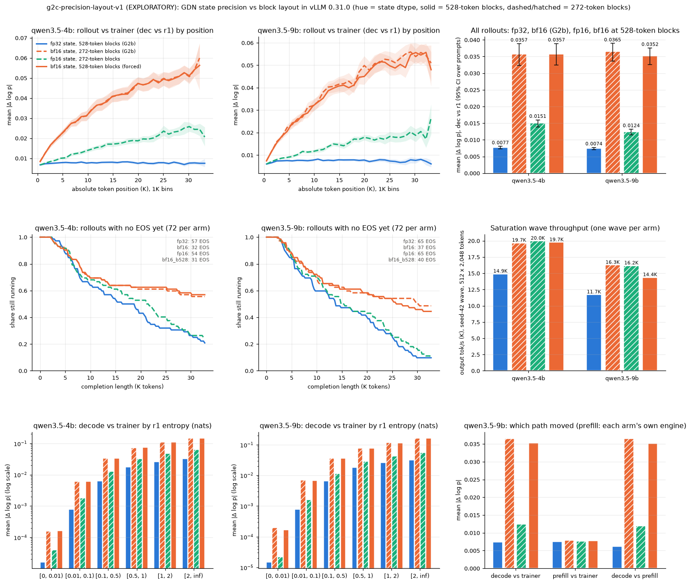

# g2c-precision-layout-v1: does G2b's bf16-state drift come from precision or from the block layout?

> **EXPLORATORY. Not a registered experiment.** There is no preregistration, no hypothesis
> test and no decision rule. Nothing below is a confirmatory claim. The numbers describe these
> rollouts, prompts and engines on one node and one software stack (vLLM 0.31.0; the trainer
> path is transformers 5.15 with flash-linear-attention 0.5.2). The GPU jobs ran 2026-10-15
> 00:10-00:54 UTC. **1.2158 physical GPU-h** of the 1.5 cap were used, image builds and smoke
> runs included.

## Main takeaways (exploratory)

- **Precision drives the drift. The block layout does not.**
  - bf16 at fp32's 528-token block (bf16_b528) drifts exactly as G2b's bf16 arm does.
    Rollout-vs-trainer mean |Δ log p| is 0.0357 against bf16's 0.0357 on the 4B (ratio 1.00,
    95% CI over prompts [0.99, 1.01]) and 0.0352 against 0.0365 on the 9B (0.96 [0.94, 0.99]).
    The within-sequence growth is the same: +1.31e-3 against +1.33e-3 per 1K tokens on the 4B,
    and +1.46e-3 against +1.46e-3 on the 9B (differences include 0).
  - On the 4B the forced-block rollouts are G2b's bf16 rollouts, token for token: 66 of 72 are
    identical up to the shorter of the two (27 to the end, the rest until the time budget cut
    one of them), and 99.96% of the decode log-probs on the shared tokens are bit-equal. On the
    9B they diverge after a median 220 tokens, as any two arms do, but the drift statistics
    still match.
  - fp16, at bf16's layout and memory, removes most of the drift: 0.0151 (4B) and 0.0124 (9B),
    against fp32's 0.0077 and 0.0074 and bf16's 0.0357 and 0.0365. It keeps 26% and 17% of
    bf16's excess mean |Δ log p| over fp32, 14% and 7% of its excess k3, and 43% and 31% of
    its excess within-sequence slope.
- **fp16 is not fp32.** Its mismatch is 2.0x (4B) and 1.7x (9B) fp32's, k3 3.3x and 2.5x, and
  0.58% and 0.35% of importance ratios fall outside [0.8, 1.25] (fp32 0.03% and 0.02%, bf16
  3.7% and 3.9%). It still grows within sequences (+5.8e-4 and +4.5e-4 per 1K), from 1.0x fp32
  in the first 1K positions to about 3x (4B) and 2.5x (9B) at 30K, in every entropy bin.
- **The length effect follows the drift.** The bf16_b528 rollouts run as long as bf16's (4B: 31
  ended with EOS against 32; 9B: 40 against 37; paired against bf16, 4 to 1 and 21 to 22). The
  fp16 rollouts end like fp32's (4B: 54 against 57; 9B: 65 against 65). Paired over (prompt,
  seed), fp16 ran longer than fp32 in 37 pairs against 24 (4B, sign test p = 0.12) and 38
  against 29 (9B, p = 0.33): no difference is detectable here, though a small one is not ruled
  out. Against bf16 it ran shorter (13 to 41, p = 1.8e-4; 15 to 50, p = 1.6e-5).
- **The drift stays in vLLM's decode path.** vLLM prefill in each arm's own engine is as close to
  the trainer as fp32's is (0.0075-0.0081 in every arm), and the trainer's distance to the fp32
  reference does not change (0.0073-0.0080).
- **Throughput (one wave per arm).** fp16 keeps the bf16 lever: 19,968 and 16,161 output tok/s
  against G2b's fp32 wave of 14,894 and 11,697 (1.34x and 1.38x). bf16_b528 splits G2b's gain
  into its two sources. On the 4B it keeps all of it (19,739, 1.33x) with fp32's block pool and
  fp32's 36 preemptions, so the 4B gain is state bandwidth. On the 9B it reaches 14,356 (1.23x
  against bf16's 1.39x) with fp32's 114 preemptions, so about 58% of the 9B gain is bandwidth
  and the rest the larger pool.
- **Reading.** On this stack the bf16 drift tracks the state's number format, not the attention
  block layout. A float16 state costs the same memory as bf16, gives the same throughput, and
  carries about a fifth to a quarter of bf16's excess mismatch. It is still not drift-free.
  - Not separated: the kernel instance, which vLLM specializes per state dtype, from the
    precision itself; and, within fp16, its extra mantissa bits from its narrower exponent range.
  - Not runnable: fp32 at 272-token blocks (below).
  - No RL training ran, so nothing here says how training would respond.


## Why this step

G2b (`program/evidence/2026-10-15/g2b-state-dtype/`, D105 follow-up) found that a bf16
gated-DeltaNet (GDN) recurrent state in vLLM 0.31.0 gives 1.33-1.38x throughput, but about 5x
the per-token rollout-trainer mismatch, growing with position, and much longer reasoning. The
setting also halves the hybrid block (528 to 272 tokens), so G2b could not separate the state's
precision from the block layout and kernel instance. This step adds two arms that split them:

| Arm | State dtype | Block (tokens) | Same precision as | Same layout as |
|---|---|---:|---|---|
| fp32 (G2b) | float32 | 528 | | |
| bf16 (G2b) | bfloat16 | 272 | | |
| **fp16** (new) | float16 | 272 | neither (10 mantissa bits, 5 exponent bits) | bf16 |
| **bf16_b528** (new) | bfloat16 | 528, forced | bf16 | fp32 |

So fp16 changes only the number format at bf16's layout and memory, and bf16_b528 changes only
the layout at bf16's precision. The fp32 and bf16 arms are G2b's jobs 1368-1391, reused from
their committed and hash-bound outputs and not rerun.

## The block size, from the source (read-only), and the cell that cannot be run

vLLM 0.31.0 lets a user set `block_size` (`--block-size`), but for a hybrid model it then aligns
the block to the GDN state page and may raise it. CPU job 1403 printed the source from G2b's vLLM
overlay (`source-check/vllm-block-size-source.txt`); CPU job 1409 printed the callers from this
step's overlay (`selftests/selftest-postbuild-3833d544/vllm-block-size-source-2.txt`). The file
`platforms/interface.py` has the same SHA-256 (`6f5f0f7f...`) in both images.

| What | Where (vLLM 0.31.0) |
|---|---|
| `block_size: int \| None` and CLI `--block-size`, passed to `CacheConfig` | `engine/arg_utils.py:571`, `:1324`, `:2209` |
| `CacheConfig.block_size = Field(default=None, gt=0)`; a given value sets `user_specified_block_size = True` | `config/cache.py:73`, `:326-339` |
| `update_block_size_for_backend`: phase 1 picks the backend's preferred block only if the user set none; phase 2, for hybrid models, calls `_align_hybrid_block_size` ("may override user settings") | `platforms/interface.py:666-708` |
| Called by the executor once the model's attention backends are known | `v1/executor/uniproc_executor.py:75`, `multiproc_executor.py:696` |
| Kernel alignment = max(smallest kernel block of the backend, current `block_size`); FLASH_ATTN advertises `MultipleOf(16)` | `platforms/interface.py:949-957`; `v1/attention/backends/flash_attn.py:355-363` |
| Without prefix caching: minimum block = alignment x cdiv(GDN page, alignment x attention bytes per token) | `platforms/interface.py:976-982` |
| A smaller `block_size` is raised to that minimum, with the log line "Setting attention block size to N tokens" | `platforms/interface.py:987-993` |
| Attention page >= GDN page is asserted; the GDN page is padded up to the attention page ("Padding mamba page size by X%") | `platforms/interface.py:998-1018`; `v1/kv_cache_interface.py:1068-1077` |

What this means here (Qwen3.5-4B and 9B: 4 KV heads x 256, so 4,096 bytes per token per
attention layer; GDN page 2,146,304 bytes in fp32 and 1,097,728 in bf16 or fp16):

- **fp32 at bf16's block (272) cannot be forced without code changes.** A user `block_size` of
  272 makes the alignment 272, and one 272-token attention page (1,114,112 bytes) is smaller than
  the fp32 GDN page, so vLLM raises the block to 2 x 272 = 544. The GDN state is stored in a
  page of the shared block pool, and the pool requires equal pages. The smoke job's probe
  confirmed this at run time: an fp32-state engine given `block_size=272` resolved to 544 tokens
  and logged "Padding mamba page size by 3.82%" (`jobs/1414-smoke-rs/g2c/probe.json`, dummy
  weights, eager mode; a config probe, not data).
- **bf16 at fp32's block (528) can be set** with `block_size=528`: the alignment becomes 528,
  one page holds the bf16 state, the block is kept, and the bf16 GDN page is padded by 97.01%
  to the 528-token attention page. The bf16_b528 engines resolved exactly that, with the same
  block pool as G2b's fp32 engines (3,733 blocks on the 4B and 3,137 on the 9B,
  against fp32's 3,733 and 3,137).

So the forced-block control is the second option in the question: bf16 state with fp32's block
size.

## What ran

All GPU jobs used the docker-research lane through `scripts/submit_docker_research_job.py`
(dry-run and test-only, then submit; `manifests/`), with digest-pinned images built from commit
`3833d544` (the G2b route: retained source capsule, offline overlay builds), Slurm GRES and time
limits, and lane receipts (`jobs/`). GPU-h are physical: GPUs times the Slurm `RunTime`.
- `RunTime` was read with `scontrol` at completion for every GPU job and logged in
  `ops/jobs.log`. Records are committed for the builds (`builds/scontrol-build-*.txt`) and for
  1428 and 1431. The captures for 1414, 1418 and 1420 were overwritten by a later re-capture
  after the records had expired, and 1422's was not captured (Problems). For all four, the
  logged `RunTime` equals the lane interval (`job.env` started_at to `termination.env`
  finished_at) within 1 s.
- Slurm accounting is off on the host. The queue also held another workstream's AM1 jobs
  (`ops/preflight.log`).

| Job | What | Image | Run time | GPU-h | Outcome |
|---|---|---|---:|---:|---|
| 1403 | CPU: read-only block-size source check | G2b vLLM overlay `f86cd2c1` | ~1 min | 0 | done |
| 1406 | vLLM overlay build | `3833d544` → `sha256:7f6d49d7...` | 00:01:04 | 0.0178 | provenance PASS |
| 1407 | research source-overlay build | `3833d544` → `sha256:ba5b3ce3...` | 00:00:20 | 0.0056 | done |
| 1409 | CPU: post-build selftests, plan, second source pass | both new images | ~1 min | 0 | all exit 0 |
| 1414 | smoke: fp32 block-272 probe, then both arms (smoke-size phase R, wave, prefill), 4B | vLLM | 00:05:34 | 0.0928 | pass (not data) |
| 1422 | smoke: teacher forcing r1 and r4 on 1414's rollouts | research | 00:01:00 | 0.0167 | pass (not data) |
| 1418 | Qwen3.5-4B, fp16 then bf16_b528: phase R, wave S42, prefill | vLLM | 00:21:37 | 0.3603 | COMPLETED 0:0 |
| 1420 | Qwen3.5-9B, fp16 then bf16_b528: phase R, wave S42, prefill | vLLM | 00:24:36 | 0.4100 | COMPLETED 0:0 |
| 1428 | teacher forcing 4B: r1 (144), r4 (32) | research | 00:08:31 | 0.1419 | COMPLETED 0:0 |
| 1431 | teacher forcing 9B: r1 (144), r4 (32) | research | 00:10:15 | 0.1708 | COMPLETED 0:0 |
| 1423-1425 | CPU: analysis dry runs on the smoke outputs (1423 and 1424 failed, Problems) | host checkouts | <1 min | 0 | 1425 pass |
| 1433, 1437, 1438 | CPU: analysis at `df4f35d4`, `7f7143af` (adds the same-seed pairs), `4273c223` (figure layout only; tables identical) | host checkouts | ~1 min each | 0 | done |
| @@CHECKS_JOB@@ | CPU: lint, tests, validators at the final commit | host checkout | | 0 | @@CHECKS_OUTCOME@@ |
| | **Total** | | 4,377 GPU-s | **1.2158** | of the 1.5 cap |

## Design as run

- **Models, prompts, seeds, sampling, budgets:** G2b's, inherited from its config by hash
  (`experiments/g2/g2c-precision-layout-v1.yaml` loads `g2b-state-dtype-v1.yaml`, SHA-256
  `6036cc83...`). Qwen3.5-4B `851bf6e8` and 9B `c2022362` (lane-verified), the G2 pilot's 24
  MATH-500 level-5 prompts x seeds 42/43/44 (72 rollouts per arm), T 1.0, top-p 1, up to
  32,768 tokens, phase-R budgets 450 s (4B) and 570 s (9B). Engine: bf16 weights,
  `gpu_memory_utilization` 0.90, `max_model_len` 33,536, `max_num_seqs` 512,
  `max_num_batched_tokens` 8,192, prefix caching off, CUDA graphs on, engine seed 42,
  `logprobs_mode raw_logprobs`. No `--trust-remote-code`; no model-generated code ran (the GPUs
  ran vLLM, torch, transformers and FLA only).
- **Arms:** `mamba_ssm_cache_dtype` `float16` with vLLM's own block; `bfloat16` with
  `block_size=528`. Each engine recorded its resolved settings (`engine.json`). Both models'
  engines resolved: fp16 at 272 tokens (7,248 and 6,090 blocks, the same as G2b's bf16), and
  bf16_b528 at 528 tokens (3,733 and 3,137 blocks, the same as G2b's fp32), GDN page padding
  1.49% and 97.01%. Every rollout engine logged "GDN decode kernel: triton", as G2b's did.
- **One job per model, one H100:** the two arms ran in turn (fp16 first), each as a rollout
  engine (phase R, then one saturation wave, seed 42) and then a fresh prefill engine with
  G2b's prefill settings (`gpu_memory_utilization` 0.80, 4,096 batched tokens, 16 sequences) in
  the arm's own state dtype and block size, on that arm's 72 rollouts. G2b instead ran its arms
  side by side in separate jobs and prefilled every rollout in both dtypes.
- **Teacher forcing:** G2b's r1 (HF transformers bf16, unpacked, FLA `chunk_gated_delta_rule`,
  checked by a call counter) on all 144 rollouts per model, and G2b's r4 (fp32 weights, TF32
  off, memory-efficient SDPA, HF's torch chunked rule in fp32) on its subset: seed 42 and the
  first 16 of the 24 prompts, both arms (32). No r2: G2b found the packed path equal to r1. The
  runtime probe again gave bf16 per-chunk snapshots and an fp32 final state in FLA.
- **Analysis** (`scripts/analyze_g2c_precision_layout.py`, CPU, on the host):
  - The metric and statistics are G2b's: d = log p_A - log p_B on each rollout's own tokens;
    mean and p99 |d|; k3 and the share of ratios outside [0.8, 1.25] against the decode path;
    slopes per 1K positions (within sequences; within sequence x entropy-bin cells); float
    entropy bins; 1K position bins. G2b's fp32 and bf16 arms are recomputed from G2b's full
    per-token files on the host (SHA-256 checked against G2b's `SHA256SUMS-host.txt`) with
    the same code. The recomputed numbers equal G2b's committed `analysis.json` exactly (largest
    difference 0; `analysis/tables.md`, last section).
  - Contrasts bootstrap over the 24 prompts, drawn jointly for all four arms (2,000 draws, seed
    42). The excess fraction is (arm - fp32) / (bf16 - fp32).
  - The same-seed comparison reads each arm's rollout tokens (G2b's stay on the host) and
    reports how long two arms' rollouts of one (prompt, seed) stay identical, and the decode
    log-probs on that shared prefix. It was added after the first analysis (1433) showed the 4B
    bf16_b528 rollouts' termination matching bf16's almost exactly; it is descriptive.

## Results: rollout vs trainer, all four arms side by side

All 72 rollouts per arm (`analysis/tables.md` has every table with CIs, and the per-seed rows).

| Model | Arm | State, block | Tokens | Mean abs (dec vs r1) [95% CI] | p99 abs | k3 | Ratios outside [0.8, 1.25] | Within-sequence slope per 1K [95% CI] | Excess fraction of mean abs [95% CI] |
|---|---|---|---:|---|---:|---:|---:|---|---|
| Qwen3.5-4B | fp32 (G2b) | fp32, 528 | 1,296,141 | 0.0077 [0.0073, 0.0081] | 0.112 | 2.70e-4 | 0.03% | +3.7e-6 [-1.7e-5, +2.4e-5] | 0 |
| Qwen3.5-4B | bf16 (G2b) | bf16, 272 | 1,607,186 | 0.0357 [0.0323, 0.0389] | 0.439 | 4.77e-3 | 3.74% | +1.33e-3 [+1.25e-3, +1.41e-3] | 1 |
| Qwen3.5-4B | **fp16** | fp16, 272 | 1,395,611 | 0.0151 [0.0138, 0.0160] | 0.183 | 8.83e-4 | 0.58% | +5.78e-4 [+5.38e-4, +6.13e-4] | 0.26 [0.23, 0.29] |
| Qwen3.5-4B | **bf16_b528** | bf16, 528 | 1,614,521 | 0.0357 [0.0324, 0.0389] | 0.439 | 4.81e-3 | 3.75% | +1.31e-3 [+1.23e-3, +1.39e-3] | 1.00 [0.99, 1.02] |
| Qwen3.5-9B | fp32 (G2b) | fp32, 528 | 1,152,192 | 0.0074 [0.0071, 0.0077] | 0.110 | 2.58e-4 | 0.02% | +1.1e-5 [-6.2e-6, +3.0e-5] | 0 |
| Qwen3.5-9B | bf16 (G2b) | bf16, 272 | 1,563,703 | 0.0365 [0.0337, 0.0389] | 0.467 | 5.32e-3 | 3.93% | +1.46e-3 [+1.39e-3, +1.54e-3] | 1 |
| Qwen3.5-9B | **fp16** | fp16, 272 | 1,229,766 | 0.0124 [0.0114, 0.0132] | 0.147 | 6.33e-4 | 0.35% | +4.53e-4 [+4.28e-4, +4.80e-4] | 0.17 [0.145, 0.197] |
| Qwen3.5-9B | **bf16_b528** | bf16, 528 | 1,552,481 | 0.0352 [0.0325, 0.0376] | 0.452 | 5.19e-3 | 3.74% | +1.46e-3 [+1.38e-3, +1.54e-3] | 0.95 [0.93, 0.98] |

Arm contrasts on the decode path (bootstrap over prompts):

| Contrast | 4B mean abs ratio | 4B slope difference per 1K | 9B mean abs ratio | 9B slope difference per 1K |
|---|---|---|---|---|
| bf16_b528 / bf16 (layout only) | 1.00 [0.99, 1.01] | -1.2e-5 [-3.2e-5, +1.1e-6] | 0.96 [0.94, 0.99] | -2.5e-6 [-7.7e-5, +7.5e-5] |
| fp16 / bf16 (number format only) | 0.42 [0.39, 0.45] | -7.5e-4 [-8.6e-4, -6.6e-4] | 0.34 [0.32, 0.36] | -1.0e-3 [-1.1e-3, -9.2e-4] |
| fp16 / fp32 | 1.96 [1.83, 2.05] | +5.7e-4 [+5.3e-4, +6.2e-4] | 1.67 [1.56, 1.77] | +4.4e-4 [+4.1e-4, +4.7e-4] |
| bf16_b528 / fp32 | 4.64 [4.34, 4.87] | +1.31e-3 [+1.22e-3, +1.42e-3] | 4.74 [4.48, 4.96] | +1.45e-3 [+1.37e-3, +1.54e-3] |

The 9B bf16_b528 mean sits 4% under bf16's while its within-sequence slope is identical. Its
rollouts end slightly more often (40 against 37), so it has fewer tokens at the longest, most
drifted positions; the position table below shows the two arms on top of each other bin by bin.

### By position (ratio to fp32 of the mean |d|, 95% bootstrap over prompts)

| Position bin | 4B bf16 | 4B fp16 | 4B bf16_b528 | 9B bf16 | 9B fp16 | 9B bf16_b528 |
|---:|---|---|---|---|---|---|
| 0-1K | 1.25 [1.18, 1.31] | 0.99 [0.95, 1.04] | 1.24 [1.18, 1.30] | 1.25 [1.19, 1.30] | 1.00 [0.96, 1.04] | 1.23 [1.18, 1.28] |
| 1-2K | 1.75 [1.64, 1.87] | 1.04 [0.96, 1.13] | 1.73 [1.62, 1.85] | 1.78 [1.67, 1.90] | 1.09 [1.03, 1.15] | 1.78 [1.69, 1.88] |
| 15-16K | 5.27 [4.86, 5.70] | 2.20 [1.97, 2.45] | 5.29 [4.87, 5.72] | 5.36 [4.83, 5.94] | 1.81 [1.55, 2.12] | 5.27 [4.75, 5.87] |
| 30-31K | 7.03 [6.14, 8.57] | 3.17 [2.90, 3.61] | 7.04 [6.15, 8.59] | 6.91 [6.14, 8.09] | 2.54 [2.12, 3.14] | 6.77 [6.21, 7.84] |

### By r1 entropy (mean |d|, decode vs trainer)

| Entropy (nats) | 4B fp32 | 4B bf16 | 4B fp16 | 4B bf16_b528 | 9B fp32 | 9B bf16 | 9B fp16 | 9B bf16_b528 |
|---|---:|---:|---:|---:|---:|---:|---:|---:|
| [0, 0.01) | 0.00002 | 0.00016 | 0.00004 | 0.00016 | 0.00001 | 0.00020 | 0.00002 | 0.00017 |
| [0.01, 0.1) | 0.00079 | 0.0062 | 0.0018 | 0.0062 | 0.00079 | 0.0071 | 0.0016 | 0.0067 |
| [0.1, 0.5) | 0.0063 | 0.034 | 0.013 | 0.034 | 0.0066 | 0.036 | 0.011 | 0.036 |
| [0.5, 1) | 0.017 | 0.074 | 0.032 | 0.074 | 0.018 | 0.078 | 0.029 | 0.076 |
| [1, 2) | 0.026 | 0.109 | 0.049 | 0.109 | 0.026 | 0.117 | 0.043 | 0.115 |
| [2, inf) | 0.032 | 0.146 | 0.064 | 0.146 | 0.031 | 0.162 | 0.056 | 0.162 |

The fp16 slopes are positive in every bin (`tables.md`), as bf16's are; fp32's are near zero.

### Which path moved (mean |d|)

| Comparison | 4B fp32 | 4B bf16 | 4B fp16 | 4B bf16_b528 | 9B fp32 | 9B bf16 | 9B fp16 | 9B bf16_b528 |
|---|---:|---:|---:|---:|---:|---:|---:|---:|
| decode vs trainer r1 | 0.0077 | 0.0357 | 0.0151 | 0.0357 | 0.0074 | 0.0365 | 0.0124 | 0.0352 |
| decode vs prefill, same engine settings | 0.0065 | 0.0356 | 0.0147 | 0.0357 | 0.0061 | 0.0365 | 0.0120 | 0.0351 |
| prefill vs trainer r1 | 0.0077 | 0.0081 | 0.0079 | 0.0081 | 0.0075 | 0.0079 | 0.0076 | 0.0078 |
| trainer r1 vs fp32 reference r4 | 0.0079 | 0.0080 | 0.0080 | 0.0080 | 0.0073 | 0.0079 | 0.0075 | 0.0075 |
| decode vs fp32 reference r4 | 0.0076 | 0.0336 | 0.0139 | 0.0341 | 0.0070 | 0.0365 | 0.0116 | 0.0340 |

G2b's prefill columns are its `pre32` (fp32 arm) and `pre16` (bf16 arm). The r4 rows cover the
r4 subset (seed 42, 16 prompts) of each arm.

### Same prompt and seed across arms

| Model | Pair | Identical to the end | Identical up to the shorter | Shared prefix median [IQR] | Decode mean |d| on the shared prefix | Bit-equal decode log-probs |
|---|---|---:|---:|---|---:|---:|
| 4B | bf16_b528 vs bf16 | 27 / 72 | 66 / 72 | 31,687 [7,819, 31,687] | 0.000003 | 99.96% |
| 4B | fp16 vs fp32 | 0 | 0 | 242 [92, 454] | 0.0045 | 22.9% |
| 4B | bf16 vs fp32 (G2b) | 0 | 0 | 260 [113, 438] | 0.0058 | 19.6% |
| 9B | bf16_b528 vs bf16 | 0 | 0 | 220 [124, 389] | 0.0044 | 26.6% |
| 9B | fp16 vs fp32 | 0 | 0 | 260 [135, 471] | 0.0041 | 30.1% |
| 9B | bf16 vs fp32 (G2b) | 0 | 0 | 250 [159, 394] | 0.0053 | 24.8% |

On the 4B, two vLLM engines with the same bf16 state and different block layouts and block
pools produced the same tokens and almost always the same log-prob bits, in different jobs on
different GPUs about two hours apart. On the 9B the two bf16 engines diverge as early as any pair of
arms. Each arm is one engine instance, so this cannot tell whether the 9B divergence comes from
the layout or from engine-instance variance (D105). Either way, the 9B drift statistics of
the two arms match.

## Results: how the rollouts ended (phase R)

| Model | Arm | Ended (EOS) | Hit 32K cap | Cut by time | Median length | Ended before 8K / 16K / 24K / 28K | Boxed = reference (string) |
|---|---|---:|---:|---:|---:|---|---:|
| 4B | fp32 (G2b) | 57 | 15 | 0 | 17,562 | 23 / 36 / 49 / 51 | 52 |
| 4B | bf16 (G2b) | 32 | 0 | 40 (at 31,795) | 31,795 | 17 / 26 / 28 / 31 | 29 |
| 4B | **fp16** | 54 | 18 | 0 | 21,468 | 21 / 31 / 43 / 50 | 47 |
| 4B | **bf16_b528** | 31 | 0 | 41 (at 31,687) | 31,687 | 17 / 26 / 27 / 30 | 28 |
| 9B | fp32 (G2b) | 65 | 7 | 0 | 13,748 | 22 / 38 / 52 / 62 | 58 |
| 9B | bf16 (G2b) | 37 | 35 | 0 | 30,056 | 18 / 29 / 33 / 33 | 33 |
| 9B | **fp16** | 65 | 7 | 0 | 15,096 | 20 / 38 / 51 / 59 | 57 |
| 9B | **bf16_b528** | 40 | 32 | 0 | 26,368 | 17 / 28 / 33 / 38 | 36 |

Paired over (prompt, seed), "ran longer" means the other arm's rollout ended with EOS first:

| Model | Pair | Arm longer | Reference longer | Neither | Sign test p | By prompt (arm / ref / tied), p |
|---|---|---:|---:|---:|---:|---|
| 4B | fp16 vs fp32 | 37 | 24 | 11 | 0.12 | 13 / 6 / 5, 0.17 |
| 4B | fp16 vs bf16 | 13 | 41 | 18 | 1.8e-4 | 5 / 16 / 3, 0.027 |
| 4B | bf16_b528 vs bf16 | 4 | 1 | 67 | 0.38 | 4 / 1 / 19, 0.38 |
| 4B | bf16_b528 vs fp32 | 47 | 10 | 15 | 7.5e-7 | 19 / 3 / 2, 8.6e-4 |
| 9B | fp16 vs fp32 | 38 | 29 | 5 | 0.33 | 15 / 9 / 0, 0.31 |
| 9B | fp16 vs bf16 | 15 | 50 | 7 | 1.6e-5 | 4 / 20 / 0, 0.0015 |
| 9B | bf16_b528 vs bf16 | 21 | 22 | 29 | 1.0 | 7 / 7 / 10, 1.0 |
| 9B | bf16_b528 vs fp32 | 53 | 12 | 7 | 2.8e-7 | 21 / 2 / 1, 6.6e-5 |

- The 4B bf16 arms were cut by the 450 s budget at 31,795 and 31,687 tokens; every other arm's
  rollouts all ended (EOS or cap) inside its budget. The "ended before" counts are fully
  observed up to 28K in every arm.
- Tails compress like ordinary text in every arm (median zlib ratio 0.39-0.40), so no arm loops.
- Among rollouts that ended, the share whose last `\boxed{}` matches the reference string is
  similar in all arms, 87-91% (normalized string match, not an equivalence checker).
- No log-prob was non-finite in any fp16 or bf16_b528 rollout (fp16 has 5 exponent bits).

## Results: block pool and throughput (one saturation wave per arm, seed 42)

| Model | Arm | Block (tokens) | Blocks | GDN page padding | Output tok/s | vs fp32 | Mean running | Preemptions | Peak KV use |
|---|---|---:|---:|---:|---:|---:|---:|---:|---:|
| 4B | fp32 (G2b) | 528 | 3,733 | 0.76% | 14,894 | 1 | 497 | 36 | 100% |
| 4B | bf16 (G2b) | 272 | 7,248 | 1.49% | 19,659 | 1.32 | 491 | 0 | 79% |
| 4B | **fp16** | 272 | 7,248 | 1.49% | 19,968 | 1.34 | 494 | 0 | 79% |
| 4B | **bf16_b528** | 528 | 3,733 | 97.01% | 19,739 | 1.33 | 485 | 36 | 100% |
| 9B | fp32 (G2b) | 528 | 3,137 | 0.76% | 11,697 | 1 | 420 | 114 | 100% |
| 9B | bf16 (G2b) | 272 | 6,090 | 1.49% | 16,251 | 1.39 | 494 | 0 | 95% |
| 9B | **fp16** | 272 | 6,090 | 1.49% | 16,161 | 1.38 | 496 | 0 | 94% |
| 9B | **bf16_b528** | 528 | 3,137 | 97.01% | 14,356 | 1.23 | 410 | 114 | 100% |

- G2b's rows are its seed-42 waves. G2b's three waves per arm agreed within 0.3-3.5%, and wave
  scheduling is deterministic (bf16_b528 repeats fp32's 36 and 114 preemptions exactly). These
  are single waves in different jobs on a shared host, so differences of a few percent (fp16
  against bf16) are not resolved.
- bf16_b528 holds fp32's block pool. Each sequence still reads and writes a bf16 state, so a
  decode step moves about half of fp32's state bytes. On the 4B, where the pool never limits
  running sequences much, that alone gives the whole gain. On the 9B, fp32's pool caps running
  sequences (about 410-420 against 494), and the bandwidth alone gives 1.23x of the 1.39x.

## Figure



`g2c-precision-vs-layout.png` comes from `scripts/analyze_g2c_precision_layout.py analyze`. Hue
is the state dtype (blue fp32, orange bf16, green fp16). Solid lines and plain bars are
528-token blocks; dashed lines and hatched bars are 272-token blocks.
- Top row: rollout vs trainer by position (4B, 9B), with 95% bands over sequences; mean |Δ log p|
  per arm with 95% CIs over prompts.
- Middle row: the share of rollouts with no EOS yet, by length (4B, 9B); the seed-42 wave
  throughput.
- Bottom row: rollout vs trainer by r1 entropy (4B, 9B, log scale); which path moved (9B).

## What it says and what it does not

It says, for this stack, these prompts and these engines:
1. With the state's number format held at bf16, moving the block layout from 272 to 528 tokens
   (and the block pool to fp32's) leaves the drift, its growth with position and the longer
   reasoning unchanged. On the 4B it leaves even the tokens unchanged.
2. With the layout and memory held at bf16's, a float16 state removes most of the drift, and its
   rollouts end like fp32's. The drift tracks the number format.
3. fp16 still drifts: about 2x fp32 on average, growing within sequences, about 3x fp32 at 30K.
4. fp16 keeps bf16's throughput. On the 4B all of bf16's gain is state bandwidth; on the 9B
   about 58% is.

It does not say:
- Anything confirmatory. There are 24 prompts, 72 rollouts per arm and model, one node, one vLLM
  build, one engine instance per arm, one wave per arm, and no preregistration.
- That precision is separated from the kernel. vLLM compiles the GDN decode kernel per state
  dtype, so "fp16" is the fp16 kernel instance with an fp16 state. Within fp16, the 3 extra
  mantissa bits and the 3 fewer exponent bits are not separated. If the excess scaled with the
  rounding unit, fp16 (2^-11 against bf16's 2^-8) would keep about 1/8 of it; it keeps 17-26% of
  the mean and 31-43% of the slope. That is consistent with an extra source, such as small state
  entries losing precision in fp16's narrower range, but nothing here tests it.
- What fp32 at 272-token blocks would do. vLLM 0.31.0 cannot run it without code changes.
- How RL training would respond, or which state dtype RL rollouts should use. No training ran.
  The k3 and importance-ratio numbers describe the off-policy gap a trainer would face.
- Anything about other GDN kernels (the fused CUDA decode path is not built in this image),
  prefix caching (off), FP8 KV, the MoE, or other models.
- Whether fp16 changes reasoning length at all. The paired tests here cannot see an effect of the
  size these samples allow (37-24 and 38-29 lean longer, p 0.12 and 0.33).

## Problems and deviations

- **No fresh-job resume test (AGENTS.md hard rule 2).** As in G2b, the G2 pilot and the
  inference baseline, these short exploratory jobs ran without one. On a stop signal the
  drivers save finished arms or paths and write the lane's checkpoint marker with a "no resume"
  note. No job was signalled (`checkpoint_marker_present=false` in every `termination.env`). A
  disclosed exemption for short exploratory measurements, not a resume capability.
- **scontrol records.** The `RunTime` of 1414, 1418 and 1420 was read and logged at completion,
  but their saved captures were overwritten by a re-capture taken after the records had expired;
  1422's was never saved. The run times in What ran are the logged values, each within 1 s of
  the lane interval.
- **Analysis dry runs.** 1423 failed at once (`[[` under `/bin/sh` in an `sbatch --wrap`). 1424
  failed writing the tables: the smoke arms share no prompt with G2b's 24, so there are no
  contrasts, and the table code read them unguarded. That was fixed (`df4f35d4`, with a test)
  before any data job finished, and 1425 passed.
- **Same-seed comparison added after the first analysis** (`7f7143af`). It is descriptive and
  changes no other number: 1437's and 1438's tables are identical to 1433's apart from the new
  section.
- **Arm order and host load.** Each model's two arms ran in turn on one GPU (fp16 first); G2b ran
  its arms side by side. Another workstream's AM1 jobs shared the host (other GPUs). Phase-R
  budgets are wall-clock; the 4B bf16_b528 cut fell at 31,687 tokens against G2b's 31,795.
- **One saturation wave per arm** (G2b ran three), chosen before the run to fit the cap.
- **Scope:** no MoE arm, no r2, no paired cross-dtype prefill (each arm's prefill ran in its own
  engine settings only).

## Files

| Path | Contents |
|---|---|
| `source-check/` | the read-only block-size source dump (CPU job 1403); its sbatch in `ops/` |
| `selftests/selftest-postbuild-3833d544/` | CPU selftests, plan and the second source pass (1409) |
| `builds/` | vLLM overlay build receipt (1406), research overlay record (1407), source capsule, build `scontrol` |
| `manifests/` | every GPU job's manifest with its dry-run, test-only and submit output |
| `jobs/<id>-<kind>/` | lane receipts (`job.env`, `termination.env`, `manifest.json`, `command.json`, model and provenance verification, GPU prolog, container doctor, compressed container log, `scontrol.txt`). Under `g2c/` and `g2ctf/`: driver summaries, engine records, worker logs (gzip), progress logs, per-rollout records (`sequences.json`), phase stats, the smoke probe (`1414-smoke-rs/g2c/probe.json`), and `raw-sha256.txt` for the raw arrays kept on the host |
| `data/rollouts-<model>-<arm>-texts.jsonl.gz` | every phase-R completion of the two new arms |
| `data/per-token-<model>-seed42.npz` | the seed-42 rows (48 rollouts per model) of the new arms' per-token files, exact (fp16 differences from r1 for dec, pre and r4; r1 and r4 entropies; per-sequence arm, seed, prompt, finished) |
| `analysis/` | `analysis.json`, `tables.md`, `rollouts.json` (engine, log and rollout records), `pairs.json` (same-seed comparison), `analysis-git-sha.txt`, `SHA256SUMS-host.txt` |
| `g2c-precision-vs-layout.png` | the figure |
| `ops/` | `jobs.log`, `preflight.log`, build, selftest, source-check, analysis and staging scripts, `render_manifest.py`, `submit.sh`, `subset_per_token.py` |

These stay on the host under `~/cotcodec-runs/stage0/g2c-precision-layout/`, with SHA-256 in
`jobs/*/*/raw-sha256.txt` and `analysis/SHA256SUMS-host.txt`: the full per-token files (18 and
16 MB), the rollout token arrays, the prefill and teacher-forcing arrays, and the
teacher-forcing inputs.

Code: `experiments/g2/g2c-precision-layout-v1.yaml`, `harness/g2c_precision_layout.py`,
`scripts/run_g2c_rollouts.py`, `scripts/run_g2c_teacher_force.py`,
`scripts/analyze_g2c_precision_layout.py`, and `tests/test_g2c_precision_layout.py` (23 tests,
among them: the config refuses tampering and inherits G2b's settings; the block rule reproduces
G2b's resolved blocks and paddings and predicts 544 for fp32 at 272; the four-arm contrasts
recover injected effects; the committed G2b seed-42 subsets reproduce G2b's committed numbers).
G2b's scripts came in by merging `stage0/g2b-state-dtype` at `a213572e`, read-only on that
branch.

### Reproduce

On the host, from a clean checkout of `4273c223` or later (CPU only):

```bash
sbatch --export=ALL,G2C_CHECKOUT=<checkout>,G2C_ANALYSIS=<out>,\
G2C_JOBS="qwen3.5-4b:1418:1428 qwen3.5-9b:1420:1431",G2C_SMOKE_JOB=1414 \
  program/evidence/2026-10-15/g2c-precision-vs-layout/ops/analysis-cpu.sbatch
```

The new arms' seed-42 rows alone, with G2b's committed seed-42 subsets:

```bash
uv run --locked python scripts/analyze_g2c_precision_layout.py analyze \
  --per-token program/evidence/2026-10-15/g2c-precision-vs-layout/data/per-token-qwen3.5-4b-seed42.npz \
              program/evidence/2026-10-15/g2c-precision-vs-layout/data/per-token-qwen3.5-9b-seed42.npz \
  --g2b-per-token program/evidence/2026-10-15/g2b-state-dtype/data/per-token-qwen3.5-4b-seed42.npz \
                  program/evidence/2026-10-15/g2b-state-dtype/data/per-token-qwen3.5-9b-seed42.npz \
  --output-dir <dir>
```

This reproduces the seed-42 rows (`fp16/seed_42` and `bf16_b528/seed_42`) of the mismatch tables.

## Next

- For G1 (rollout memory levers): a float16 GDN state is the better half-memory setting on this
  stack: bf16's throughput with about a fifth to a quarter of its excess mismatch. It still
  drifts with position, so for long rollouts it is a smaller off-policy cost, not none.
- If the residual fp16 drift matters, the cheap next measurements are a state-value histogram
  (how much of the state sits below fp16's normal range) and an fp32-accumulate decode check.
  Both would need a reviewed kernel or instrumentation change, which this step did not make.
- An engine-instance A/A on the 9B (two bf16 engines, same layout) would say whether the 9B
  token divergence between bf16 and bf16_b528 is the layout or the instance.

